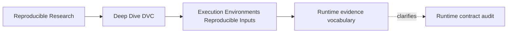
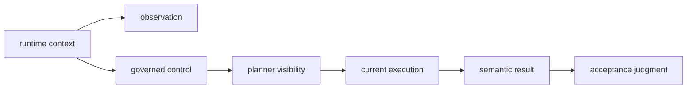
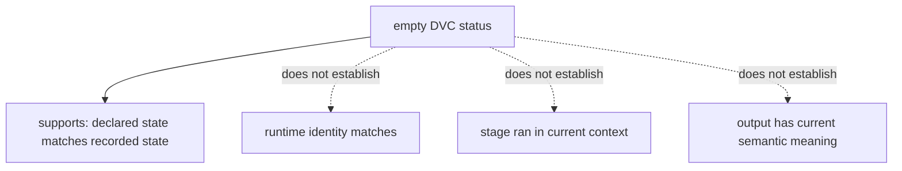
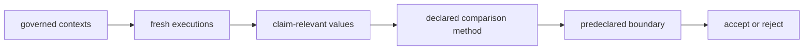

# Glossary

<!-- page-maps:start -->
## Page Maps




<!-- page-maps:end -->

Use this glossary while reading receipts and reviewing your exercise packet. The terms are
designed to prevent common substitutions: an observation for a control, a skipped result
for a repeated result, or an after-the-fact lock change for a repaired declaration.

## Core runtime terms

### Execution environment

The interpreters, libraries, operating-system behavior, hardware, process state, services,
and configuration present when a command runs.

The environment is broader than the subset that matters to one claim. Do not respond to
that breadth by recording everything. Bound the investigation by influential facts.

### Runtime influence

A fact present during execution that can change the produced result or the meaning of a
result claim.

In the specimen, `REPORT_STYLE` is a runtime influence because changing it and executing
the renderer changes `8.00` to `8,00`.

### Input surface

The set of facts that can influence a result, whether or not they are currently declared.

The input surface is causal. The DVC dependency surface is declarative. A defect exists
when the trusted stale decision requires an influential fact that has no declared or
externally enforced route.

### Runtime contract

A reviewable representation of governed runtime facts and the rules for enforcing them.

The specimen's `environment/runtime.env` is a small contract:

```text
REPORT_STYLE=dot
```

A production contract might safely identify a dependency lock, container digest, locale,
or thread count. It must not expose secrets.

### Governed runtime fact

A runtime fact with a named owner, approved value or comparison rule, enforcement point,
and evidence route.

Recording a fact in a fingerprint makes it observed. Governance requires more.

### Hidden runtime input

An influential runtime fact consumed by a stage but absent from the declared graph and
without an external enforcement route sufficient for the result claim.

“Hidden” describes the contract boundary, not secrecy. `REPORT_STYLE` is visible in
process state and still hidden from DVC stale detection.

## Declaration and planner terms

### Declared dependency

A file or directory listed in a stage's `deps`. DVC can compare its identity with recorded
state when evaluating staleness.

Declaring a generated environment contract does not make DVC the owner of environment
installation. It gives the planner a representation to observe.

### Governed parameter

A control value selected through DVC's parameter mechanism and consumed by the stage.

Seeds, thresholds, and thread counts can be parameters when they are deliberate
experimental controls. A parameter declaration is truthful only if the command actually
uses the selected value.

### Declaration edge

The explicit route connecting an influence to a stage's stale decision, such as a file in
`deps` or a selected parameter.

The declared specimen has an edge from `runtime.env` to `declared_runtime`. The hidden
specimen has program-level causality but no declaration edge for the process value.

### Stale

A planner judgment that current declared state differs from recorded stage state in a way
that requires reproduction.

Staleness is relative to declared state. A stage can be semantically obsolete because of
hidden runtime drift while DVC status remains empty.

### Planner convergence

The condition in which unchanged declared state causes ordinary reproduction to skip
completed stages.

Convergence is useful and expected. It becomes misleading only when the declaration omits
an influence needed by the result claim.

### Empty status

A DVC status result indicating no detected change in evaluated declared state.

Safe reading:

> No declared change makes the stage stale.

Unsafe reading:

> The code, data, parameters, runtime, services, and meaning are all unchanged.



## Evidence terms

### Runtime fingerprint

A structured observation of selected runtime facts, such as Python version, platform,
machine, image digest, or governed process controls.

A fingerprint supports comparison. It becomes control evidence only when policy defines
governed fields and an enforcement point evaluates them.

### Execution receipt

Evidence that a named command or stage ran in an identified context and completed with a
recorded outcome.

DVC repro output can contribute to an execution receipt. Stronger settings may need a run
manifest, timestamps, executor identity, and result hashes.

### Planner receipt

Preserved status or reproduction output showing what the planner judged stale, ran, or
skipped.

Capture it before intervention. A later successful run cannot reconstruct the exact
pre-rerun decision.

### Semantic result

The claim-relevant meaning extracted from an output, rather than only its existence or
byte identity.

For the specimen, `style=comma` and `rendered=8,00` express current report policy. The file
can exist and have a valid hash while carrying old semantic meaning.

### Current-context execution

An execution proven to have occurred after the stated runtime context and workflow inputs
were established.

This is required before comparing results across contexts. A retained cache result is not
a run in the new context.

### Joined evidence

Evidence from multiple owners bound to the same execution or result claim.

For example, an executor receipt, image digest, DVC lock identity, data revision, and
result hash share one run ID. Without a join, individually valid receipts may describe
different runs.

### Evidence packet

An organized set of claims, receipts, decisions, and limits that lets another person
repeat a review.

The module exercises build such a packet under
`artifacts/learning/deep-dive-dvc/runtime-evidence/`.

## Lock and intervention terms

### `dvc.lock`

Recorded stage state associated with executions, including declared dependency and output
identities.

Read it in time order. A lock change after a forced execution can prove new output was
recorded. It does not make an undeclared process variable visible to the earlier stale
decision.

### Retrospective evidence

Evidence created or changed because an execution already happened.

Lock and output identities are often retrospective. They can describe what occurred, but
cannot by themselves supply a missing pre-execution planner input.

### Forced reproduction

Execution requested without requiring the ordinary stale judgment.

In this module, force is a causal probe. It shows that current hidden runtime state can
change the result. Repeatedly forcing does not create a declaration edge.

### Causal probe

A controlled intervention used to test whether a suspected influence changes the result.

The strongest probe changes one candidate fact while holding plausible alternatives fixed.
Its conclusion should name what was isolated and what remains outside the experiment.

### Contract repair

A durable change that makes an influential fact declared, externally enforced, or removes
its influence.

A repair needs acceptance evidence: stale detection or gate rejection, current execution,
correct semantic result, and convergence where applicable.

## Determinism and comparison terms

### Exact repeatability

Fresh executions under stated governed contexts produce equal results according to an
explicit exact comparison.

State whether equality means bytes, parsed values, or another surface.

### Conditional repeatability

Fresh executions under declared contexts may differ, but a predeclared comparison method
and acceptance boundary govern the difference.

Conditional repeatability is not a label for unexplained drift. The conditions and
boundary are the claim.

### Stale semantic reuse

Reuse of an existing output whose bytes remain available but whose meaning no longer
reflects current influential state.

The hidden audit's retained `8.00` under comma intent is stale semantic reuse.

### Tolerance

A predeclared rule for deciding whether differences between current, governed results are
acceptable.

A tolerance must specify the compared field, measure, boundary, and execution requirements.
It cannot repair missing execution or a hidden dependency.

### Comparison surface

The portion of an output used to judge equality or acceptable difference.

Examples include file bytes, parsed metric values, dataset schema and keys, or report
fields. Choose it from the scientific or operational claim.



## Environment strategy terms

### Dependency lockfile

A concrete dependency resolution produced from dependency declarations.

It makes resolution reviewable. It does not by itself prove installation, pin the host
kernel, or identify every loaded native component.

### Immutable image digest

A content-derived identity for a container image.

It identifies packaged image content more strongly than a mutable tag. It does not include
every host, device, service, mount, secret, or orchestration fact.

### Canonical executor

The governed execution context whose completed evidence has authority to support an
accepted result claim.

CI becomes canonical through declared policy, enforcement, and retained receipts—not
because it is remote or automated.

### Environment gate

A pre-execution or acceptance check that verifies governed runtime facts and rejects
unapproved contexts.

An effective gate records what it checked, the observed identities, the policy decision,
and the run to which the decision applies.

### Executor manifest

A structured record joining source, data, parameter, runtime, execution, and result
identities for one run.

It should avoid secrets and distinguish observations from enforced controls.

### Residual limit

A relevant condition that remains outside the supported claim or chosen controls.

Naming residual limits makes the contract honest. Examples include an unpinned external
service, unsupported hardware, or inability to rebuild an image after its registry
retention period.

## Important contrasts

| Do not substitute | For | Reason |
| --- | --- | --- |
| fingerprint | declaration edge | observation alone does not make DVC stale |
| empty status | environment identity | DVC reports on declared state |
| existing output | current execution | cached bytes may carry old meaning |
| changed lock after force | repaired contract | lock change is retrospective |
| forced run | future stale detection | force bypasses ordinary planning |
| container tag | immutable image identity | tag content can move |
| lockfile presence | proof of installed resolution | execution may not use the file |
| small delta | accepted conditional repeatability | currency and policy must come first |
| CI success indicator | joined evidence packet | transient green status lacks durable identities |
| exhaustive environment dump | claim-specific runtime control | volume does not create relevance or enforcement |

## Language for review notes

Prefer bounded statements:

> The drift fingerprint differs only on report style in this controlled specimen.

> Empty hidden status shows no declared influence changed; it does not establish matching
> process state.

> Forced execution changed output while declaration identity stayed fixed, supporting a
> causal but undeclared runtime influence.

Avoid:

> The environment changed.

> DVC ignored the environment.

> Force fixed the pipeline.

> The results are close enough.

The preferred sentences name evidence, inference, and limit. That is the vocabulary
standard the module expects.
