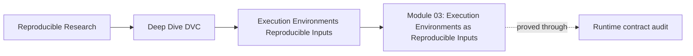
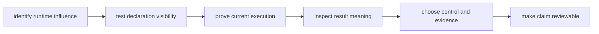
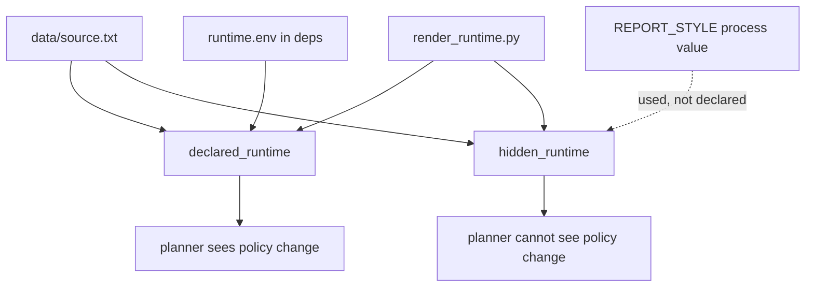
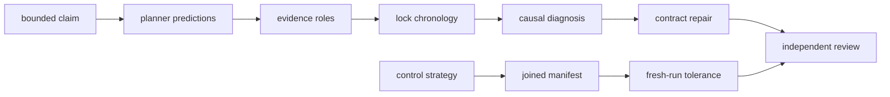

# Module 03: Execution Environments as Reproducible Inputs

<!-- page-maps:start -->
## Page Maps




<!-- page-maps:end -->

The same code, data, and parameters can produce a different result when the runtime
changes. They can also appear to produce the same result because a workflow silently
reused output created under an older runtime.

This module teaches you to distinguish those cases.

You will use a paired DVC specimen in which one stage declares a report-style policy and
another reads the equivalent policy from hidden process state. The declared stage becomes
stale and rebuilds. The hidden stage reports no declared change and preserves old
semantic meaning until forced.

The lesson is not “always use containers.” It is:

> Identify which runtime facts can influence the claim, make their control route explicit,
> and preserve enough evidence to prove that the reviewed result came from the stated
> context.

## Who this module is for

This module assumes you can:

- read a small `dvc.yaml`;
- distinguish Git source identity from DVC data identity;
- run Make targets from the repository root;
- read JSON with `jq`;
- interpret a file hash as identity evidence rather than semantic meaning.

If those ideas are unfamiliar, revisit Modules 01 and 02 before attempting the cumulative
exercises. You do not need prior container or CI expertise. The environment-strategy
lesson builds those boundaries from first principles.

## What you will be able to do

After completing the lesson and evidence packet, you should be able to:

- bound an environment investigation by a result claim;
- identify influential runtime facts without inventorying the entire machine;
- predict DVC stale behavior from declaration edges;
- interpret empty status without claiming the runtime is unchanged;
- prove whether compared results were freshly executed;
- distinguish lock evidence after execution from planner visibility before execution;
- use a forced run as a causal probe without presenting it as repair;
- choose lockfiles, containers, CI, DVC controls, and tolerances by responsibility;
- join external executor identity to workflow and result evidence;
- write a runtime-drift conclusion that another learner can reproduce.

## The controlled specimen

Both stages add `3` and `5` and render the result:

```text
dot policy   -> 8.00
comma policy -> 8,00
```

They share data and renderer code. Only the policy route differs:



This is a teaching model, not a simulation of every environment problem. Deterministic
punctuation makes the causal route easy to inspect. Real projects may need repeated runs,
domain-specific comparisons, and controls for package, platform, hardware, service, or
secret state.

## Produce the source evidence

From the repository root:

```bash
make PROGRAM=reproducible-research/deep-dive-dvc capstone-runtime-contract-audit
```

The audit writes to:

```text
artifacts/audit/reproducible-research/deep-dive-dvc/runtime-contracts/
```

Begin with:

```bash
audit=artifacts/audit/reproducible-research/deep-dive-dvc/runtime-contracts
cat "$audit/summary.tsv"
cat "$audit/route.txt"
```

The generated workspace is isolated. The governed specimen under `capstone/repro/` remains
unchanged.

## How to read audit decisions

The summary has a test result and a production decision:

| Result and decision | Meaning |
| --- | --- |
| `PASS / ACCEPT` | the assertion passed and the observed behavior belongs in a truthful contract |
| `PASS / REJECT` | the assertion passed by reproducing behavior a truthful contract must reject |
| `FAIL` | the audit could not establish its expected evidence |

Do not report all `PASS` rows as desirable. The hidden status, stale ordinary repro, and
forced-run findings pass because the audit correctly exposes the intentional defect.

## Recommended full study route

Allow one serious session for reading and the worked investigation, then another for the
cumulative exercises.

| Reading | Question it resolves | Evidence action |
| --- | --- | --- |
| [Execution Environment as Part of the Input Surface](execution-environment-as-part-of-the-input-surface.md) | when does runtime count as input? | compare paired stage declarations |
| [Determinism Is a Spectrum, Not a Switch](determinism-is-a-spectrum-not-a-switch.md) | when is a difference acceptable? | require current-run proof before tolerance |
| [What DVC Records Indirectly and What It Does Not Manage](what-dvc-records-indirectly-and-what-it-does-not-manage.md) | which environment claims can DVC support? | read declaration and lock in time order |
| [Lockfiles, Containers, and CI as Environment Strategies](lockfiles-containers-and-ci-as-environment-strategies.md) | which control owns which boundary? | map threats to enforcement and receipts |
| [Reviewing Environment Drift and Runtime Evidence](reviewing-environment-drift-and-runtime-evidence.md) | how do I diagnose without guessing? | preserve status, execution, and semantic evidence |
| [Worked Investigation: Proving Hidden Runtime Drift](worked-investigation-proving-hidden-runtime-drift.md) | how does the full argument fit together? | reproduce the causal proof route |
| [Exercises](exercises.md) | can I produce an independent review? | build the ten-artifact learning packet |
| [Exercise Answers](exercise-answers.md) | where does my reasoning overclaim? | revise artifacts against model evidence |
| [Glossary](glossary.md) | am I using terms precisely? | check distinctions during review |

Read in this order on a first pass. The lessons intentionally build from causal surface to
control strategy.

## A shorter diagnostic route

If you are returning during an incident:

| Symptom | Begin with | Continue with |
| --- | --- | --- |
| status is empty but output seems wrong | drift review | worked investigation |
| lock changed after force and the team thinks the issue is repaired | DVC boundary | contract repair exercise |
| local and CI metrics differ slightly | determinism contract | tolerance gate exercise |
| team is debating lockfile versus container | environment strategies | executor manifest exercise |
| environment logs exist but cannot support acceptance | DVC boundary | joined manifest exercise |

Do not use the short route as a substitute for the full exercise packet if this is your
first encounter with runtime evidence.

## Learning packet

The exercises create:

```text
artifacts/learning/deep-dive-dvc/runtime-evidence/
├── claim-boundary.md
├── planner-predictions.tsv
├── evidence-inventory.tsv
├── lock-chronology.md
├── causal-diagnosis.md
├── environment-strategy.md
├── tolerance-gate.md
├── executor-manifest.json
├── contract-repair.md
└── review-packet.md
```

The packet is cumulative:



The files live under `artifacts/` because they are generated learning work, not course
source.

## Evidence reading order

When a result looks wrong, use this order:

1. preserve the result, fingerprint, status, declaration, and lock identities;
2. confirm code, data, parameter, and schema comparability;
3. inspect status before running repro;
4. prove whether the disputed stage executed;
5. compare claim-relevant result meaning;
6. isolate a suspected runtime cause;
7. choose a repair at the missing visibility or enforcement boundary;
8. rerun acceptance tests for staleness, execution, meaning, and convergence.

The order matters. Rerunning too early can erase stale-state evidence. Applying tolerance
before proving execution can normalize reused output.

## Commands to keep close

Generate the learning evidence:

```bash
make PROGRAM=reproducible-research/deep-dive-dvc capstone-runtime-contract-audit
```

Enforce the audit invariants:

```bash
make PROGRAM=reproducible-research/deep-dive-dvc capstone-runtime-contract-selftest
```

Inspect finding evidence:

```bash
jq '.findings[] | {finding, result, decision, checks}' \
  artifacts/audit/reproducible-research/deep-dive-dvc/runtime-contracts/report.json
```

Compare fingerprints:

```bash
jq -s '.' \
  artifacts/audit/reproducible-research/deep-dive-dvc/runtime-contracts/evidence/baseline-fingerprint.json \
  artifacts/audit/reproducible-research/deep-dive-dvc/runtime-contracts/evidence/drift-fingerprint.json
```

## Common reasoning traps

| Trap | Correction |
| --- | --- |
| “same output means same environment” | prove both contexts executed and compare runtime identities |
| “empty status means nothing changed” | empty status covers declared state only |
| “the fingerprint changed, so DVC will rebuild” | observation is not a declaration edge |
| “the lock changed, so runtime is tracked” | ask what was visible before execution |
| “force fixed it” | verify the declaration or enforcement route changed |
| “the metric delta is small, so accept it” | prove current governed executions before tolerance |
| “the container makes everything identical” | name host, device, service, and orchestration limits |
| “CI passed” | identify the enforced identities, result, and retained receipt |

Use this table during the exercises. If your argument resembles a trap, rewrite the
evidence route.

## Completion proof

You have completed Module 03 when you can explain the seven audit findings in your own
words and your learning packet passes:

```bash
learning=artifacts/learning/deep-dive-dvc/runtime-evidence

test -s "$learning/claim-boundary.md"
test -s "$learning/planner-predictions.tsv"
test -s "$learning/evidence-inventory.tsv"
test -s "$learning/lock-chronology.md"
test -s "$learning/causal-diagnosis.md"
test -s "$learning/environment-strategy.md"
test -s "$learning/tolerance-gate.md"
jq empty "$learning/executor-manifest.json"
test -s "$learning/contract-repair.md"
test -s "$learning/review-packet.md"
```

Self-check orally:

- Why does the declared policy change make one stage stale?
- Why can hidden status be empty while output has obsolete meaning?
- What proves report style is causal?
- Why does force change lock evidence without repairing future stale decisions?
- What evidence must join a canonical executor to its result?
- Why must current execution be established before tolerance?

If any answer relies on “DVC knows the environment,” return to the DVC boundary lesson.

## Transition to Module 04

Module 03 shows that an influential runtime fact can be real yet invisible to the planner.
Module 04 broadens that lesson into stage-contract design: dependencies, parameters,
outputs, staleness, and lock evidence.

Carry one question forward:

> Does every influence needed for a trustworthy stale decision have a truthful declared
> or externally enforced route?
