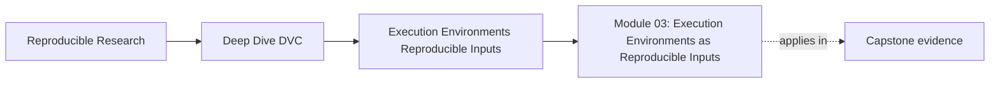

# Module 03: Execution Environments as Reproducible Inputs


<!-- page-maps:start -->
## Page Maps




<!-- page-maps:end -->

By Module 03, you already know that stable data identity matters.

The next surprise is harder:

even when code and data look stable, results can still drift because the execution
environment is part of the input surface.

This module is about making that invisible boundary visible:

- environment is not background weather
- honest runs can diverge without anyone being careless
- DVC can record some environment-adjacent evidence, but it does not own environment
  management by itself
- lockfiles, containers, and CI all solve different parts of the problem

The capstone corroboration surface for this module is the paired runtime specimen,
its audit guide, generated fingerprints, planner receipts, semantic results, and the
root-level `capstone-runtime-contract-audit` route. Together they show what changes when
runtime policy is declared and what DVC cannot see when the same policy arrives through
hidden process state.

## Why this module exists

Many workflow teams say:

- the code did not change
- the data did not change
- the parameters did not change

and still get different outcomes.

That is where reproducibility gets more honest. The environment is often the missing input
surface hiding in plain sight.

This module exists so you stop treating runtime as accidental background and start
treating it as part of the system you need to reason about.

## Study route


Read the module in that order the first time.

If the problem is already partly clear, use this shortcut:

- open Core 1 when the main confusion is "why does runtime count as input?"
- open Core 2 when the main confusion is "how can honest runs still diverge?"
- open Core 3 when the main confusion is "what part of this is DVC actually helping with?"
- open Core 4 when the main confusion is "which environment strategy fits which pressure?"
- open Core 5 when the main confusion is "how do I review or diagnose drift sanely?"

## Module map

| Page | Purpose |
| --- | --- |
| [Overview](index.md) | explains the module promise and study route |
| [Execution Environment as Part of the Input Surface](execution-environment-as-part-of-the-input-surface.md) | teaches why runtime belongs in the workflow story |
| [Determinism Is a Spectrum, Not a Switch](determinism-is-a-spectrum-not-a-switch.md) | teaches why divergence can be honest rather than mysterious |
| [What DVC Records Indirectly and What It Does Not Manage](what-dvc-records-indirectly-and-what-it-does-not-manage.md) | teaches DVC's boundary around environments |
| [Lockfiles, Containers, and CI as Environment Strategies](lockfiles-containers-and-ci-as-environment-strategies.md) | teaches the main environment-control approaches and their tradeoffs |
| [Reviewing Environment Drift and Runtime Evidence](reviewing-environment-drift-and-runtime-evidence.md) | teaches how to inspect and diagnose runtime differences without guesswork |
| [Worked Investigation: Proving Hidden Runtime Drift](worked-investigation-proving-hidden-runtime-drift.md) | follows preserved receipts from runtime mismatch to causal proof and contract repair |
| [Exercises](exercises.md) | gives ten cumulative exercises |
| [Exercise Answers](exercise-answers.md) | explains model answers and review logic |
| [Glossary](glossary.md) | keeps the module vocabulary stable |

## What should be clear by the end

By the end of this module, you should be able to explain:

- why the environment is part of the input surface
- why determinism is often conditional rather than absolute
- which runtime facts DVC helps surface and which it does not manage directly
- how lockfiles, containers, and CI differ as environment strategies
- how to review and diagnose environment drift without superstition

## Commands to keep close

These commands form the evidence loop for Module 03:

```bash
make PROGRAM=reproducible-research/deep-dive-dvc capstone-runtime-contract-audit
make PROGRAM=reproducible-research/deep-dive-dvc capstone-runtime-contract-selftest
```

The audit is the learning route. The self-test is the stronger enforcement route after
you can explain every accepted and rejected finding.

## Capstone route

Use the capstone only after the runtime boundary already feels concrete.

Best corroboration surfaces for this module:

- `capstone/repro/runtime-contracts/dvc.yaml`
- `capstone/repro/runtime-contracts/environment/runtime.env`
- `capstone/scripts/audit_runtime_contracts.py`
- `capstone/docs/runtime-contract-audit-guide.md`
- generated `fingerprints/`, `receipts/`, `results/`, and `summary.tsv`

Useful proof route:

```bash
make PROGRAM=reproducible-research/deep-dive-dvc capstone-runtime-contract-audit
```

The route proves that a declared policy change makes one stage stale and rebuilds to the
new meaning, while the equivalent hidden process change remains invisible and preserves
stale meaning under ordinary reproduction. Forced execution exposes the defect; it does
not repair the missing declaration.
