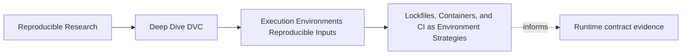
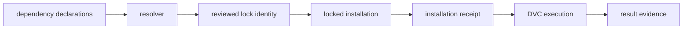
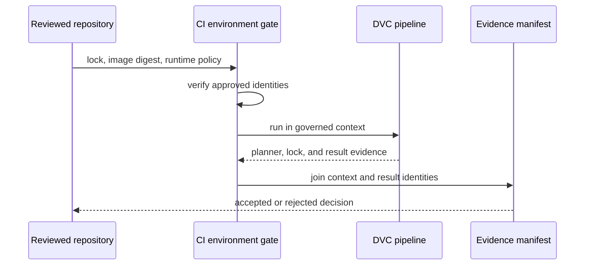

# Lockfiles, Containers, and CI as Environment Strategies

<!-- page-maps:start -->
## Page Maps




<!-- page-maps:end -->

A lockfile, a container, and CI do not solve the same problem. Treating them as
interchangeable leads to brittle promises:

- “we have a lockfile, so every machine is identical”;
- “it ran in a container, so the host cannot matter”;
- “CI passed, so anyone can reconstruct the result.”

Choose environment controls from the result claim and threat model. Then require evidence
that the chosen controls were actually used.

## Start with a concrete claim

Consider:

> An accepted evaluation report must be produced with the reviewed Python resolution,
> the approved operating-system userland, and the declared report-style policy.

This claim contains three different runtime concerns:

| Concern | Suitable primary control |
| --- | --- |
| resolved Python dependencies | lockfile |
| packaged system libraries and tools | container image |
| authority to accept a result | CI policy |
| report-style value consumed by the stage | DVC dependency or parameter |

No single tool covers the whole sentence. The strategy is the composition.

## Build a threat-to-control table

Name the drift you are trying to prevent or expose:

| Threat | Lockfile | Container | CI policy | DVC declaration |
| --- | --- | --- | --- | --- |
| dependency resolver selects a newer Python package | strong | strong if image is immutable | can enforce | can observe lock identity |
| native library differs across hosts | weak or ecosystem-dependent | stronger | can restrict executor | indirect |
| unapproved image is used | no | image alone cannot approve itself | strong | can record digest as a control |
| process variable silently changes behavior | usually no | only if fixed and enforced | can sanitize or check | strong if materialized |
| secret or service response differs | no | no | can govern access and versions | should not record secret value |
| result was not produced in approved context | no | no | strong with joined receipt | contributes run evidence |

The table is not a scorecard. “Strong” means the control can address that threat when
configured, enforced, and evidenced correctly.

## Lockfiles govern resolution

A dependency declaration permits versions. A lockfile records a concrete resolution.
That makes dependency change reviewable and gives installers a repeatable target.

A lockfile can support:

- exact or constrained package versions;
- transitive dependency identity;
- integrity hashes, depending on the ecosystem;
- a review diff when resolution changes.

It does not automatically prove:

- the lock was used for installation;
- the interpreter or system libraries match;
- optional dependency markers resolve identically on another platform;
- an external binary or driver matches;
- the running process loaded only locked components.

### The evidence chain for a lockfile



Keeping a lockfile in Git closes only the first part of this route. For an accepted result,
record or enforce that the execution environment was built from that lock identity.

### When to declare the lockfile to DVC

If a stage's environment is rebuilt from a lockfile as part of its reproducible execution
route, making the lockfile a dependency can cause dependency changes to invalidate the
stage.

That edge still does not prove the current interpreter was installed from the file. Pair
it with installation or image evidence.

## Containers package a broader runtime

A container image can package:

- operating-system userland;
- system libraries;
- language runtime;
- installed dependencies;
- workflow utilities;
- default environment configuration.

Refer to an immutable image digest for governed execution. A mutable tag such as `latest`
does not identify stable content.

Containers do not erase:

- host kernel behavior;
- CPU or accelerator architecture;
- device drivers exposed from the host;
- mounted files and credentials;
- network services and time;
- orchestration configuration;
- nondeterminism inside the workload.

“Runs in a container” is therefore a starting fact. A reviewable claim names the digest,
platform, relevant mounts, runtime configuration, and remaining host assumptions.

### Image build reproducibility and run reproducibility differ

An immutable digest proves which image bytes were used. It does not prove another build
from the same container recipe will produce that digest. Base images, package repositories,
timestamps, and build context can drift.

Keep these claims separate:

| Claim | Needed evidence |
| --- | --- |
| this run used approved image content | digest plus executor receipt |
| this image can be rebuilt from source | pinned build inputs and rebuild comparison |
| this result repeats inside the image | repeated fresh executions and result comparison |

## CI establishes authority and enforcement

CI can be the canonical executor: the environment whose completed run has authority to
support release or publication.

That policy can:

- permit only approved image digests;
- verify lockfile consistency;
- sanitize process variables;
- run DVC status and repro;
- capture fingerprints and result identities;
- reject results outside declared comparison rules.

CI is not automatically canonical because a workflow file exists. Authority must be
stated, enforcement must run, and receipts must be retained.



CI also has limits:

- service images and hosted runners can change;
- secrets and network dependencies may remain external;
- a green run can test the wrong claim;
- logs can expire;
- rerunning later may use a different executor unless identity is pinned.

Treat the workflow's receipt as an artifact, not as a transient screen color.

## DVC connects runtime policy to workflow state

The runtime specimen uses the smallest strategy: a policy file in `deps`.

```yaml
deps:
  - environment/runtime.env
```

This gives DVC a direct edge from report-style identity to the stage's stale decision. It
does not require a container because the lesson is about visibility, not full-stack
isolation.

In a larger workflow, a generated runtime contract might safely record:

```yaml
python_lock_sha256: "..."
container_digest: "sha256:..."
report_style: "comma"
thread_count: 1
```

Do not hand-maintain claims the executor could contradict. Generate the contract from
approved configuration, validate it before execution, and retain the enforcement receipt.

## Compare three strategy profiles

### Local reconstruction with reviewed dependencies

Use when researchers must run the workflow across several supported machines.

Possible composition:

- dependency lockfile;
- supported interpreter and platform matrix;
- setup verification command;
- runtime fingerprint;
- DVC-declared controls;
- semantic result checks.

Tradeoff: broad usability requires explicit compatibility boundaries and more local
diagnostic evidence.

### Packaged execution with a pinned image

Use when the workflow needs a portable, versioned runtime bundle.

Possible composition:

- immutable image digest;
- locked dependencies inside the image;
- declared host and accelerator requirements;
- DVC pipeline execution;
- joined image/result manifest.

Tradeoff: image distribution and rebuild provenance become part of maintenance.

### Canonical proof in CI

Use when one governed environment should decide acceptance.

Possible composition:

- approved image and lock identities;
- pre-execution environment gate;
- DVC reproduction and tests;
- result comparison;
- retained manifest and artifacts.

Tradeoff: local runs remain useful for development but cannot independently support the
same acceptance claim.

## Make the choice from stakes

Use a decision table:

| Need | Prefer | Reason |
| --- | --- | --- |
| fast cross-platform local iteration | lockfile plus support matrix | keeps installation visible to developers |
| regulated or release-grade result acceptance | canonical CI with retained receipts | centralizes enforceable authority |
| system libraries strongly affect results | pinned image | packages more than language dependencies |
| hardware-specific execution | image plus executor attestation | image alone does not identify device context |
| one influential runtime value | declared file or parameter | direct graph visibility is simpler |
| secrets influence access but must not be recorded | external policy and safe version identity | avoids leaking sensitive values |

More controls are not automatically better. Every control creates maintenance and
evidence obligations. Choose the narrowest composition that supports the claim.

## Diagnose a strategy gap with the runtime audit

Run:

```bash
make PROGRAM=reproducible-research/deep-dive-dvc capstone-runtime-contract-audit
```

The hidden case has a process variable but no contract route. Consider four repairs:

| Proposed repair | Does it repair future stale detection? | Assessment |
| --- | --- | --- |
| always run `dvc repro --force` | no | diagnostic habit, not a declared contract |
| print `REPORT_STYLE` in CI logs | no | observation without planner edge or gate |
| add report style to a declared contract file | yes | direct, reviewable DVC route |
| CI rejects any value except the approved one and joins the receipt | externally | valid if enforcement and result are joined |

A container `ENV REPORT_STYLE=comma` can help package the value, but DVC still will not
know a different image was used unless image identity is declared or externally enforced.

## Write an environment strategy record

A standalone learner should be able to produce this record for a project:

```text
Result claim:
Accepted evaluation metrics come from the canonical CI executor.

Governed runtime facts:
Python resolution, image digest, report style, thread count.

Controls:
Reviewed lockfile; immutable image; report style and thread count in runtime contract.

Enforcement:
CI checks lock hash and image digest before DVC repro.

Joined evidence:
Git commit, DVC lock hash, runtime contract hash, image digest, result hash.

Residual limits:
GPU driver is attested by executor but not packaged; external dataset service is outside
this claim.

Recovery:
Retained image digest, lockfile, DVC data identities, and run manifest reconstruct the
accepted route.
```

If a strategy cannot state enforcement, receipts, and residual limits, it is still a tool
list rather than an operating contract.

## Review checkpoint

You can choose environment controls when you can explain:

- what a lockfile resolves and what proves it was used;
- what an image digest identifies and which host facts remain;
- what makes CI authoritative rather than merely convenient;
- how runtime identity joins to DVC result evidence;
- when a small declared file is better than a broad container solution;
- which facts remain outside the supported claim.

The mature strategy is not “lockfiles versus containers versus CI.” It is:

> Use each control for the boundary it actually owns, and preserve evidence that the
> controls and the result belonged to the same execution.
