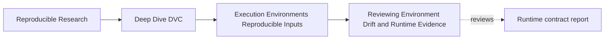
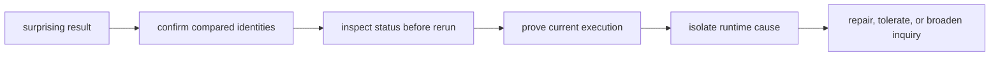
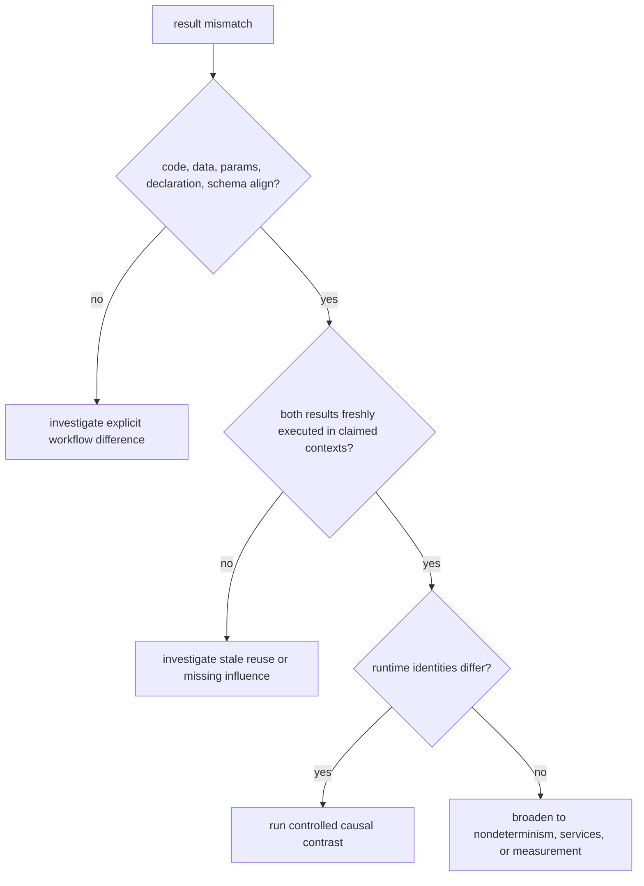

# Reviewing Environment Drift and Runtime Evidence

<!-- page-maps:start -->
## Page Maps




<!-- page-maps:end -->

“It is probably an environment issue” is not a diagnosis. It is a hypothesis that must
compete with data drift, parameter drift, code drift, stale reuse, and comparison error.

A runtime review should leave another person able to answer:

- what differed;
- what was held constant;
- whether the compared stages actually ran;
- whether the changed runtime fact was visible to DVC;
- which evidence makes that fact causal;
- which repair or acceptance rule follows.

## Preserve evidence before rerunning

The first impulse after a mismatch is often to run the pipeline again. That can destroy the
most useful evidence:

- pre-repro status;
- the stale result;
- the current runtime fingerprint;
- logs showing a skipped stage;
- lock and declaration identities before intervention.

Collect a pre-intervention packet:

```text
claim.txt
code-identity.txt
data-identity.txt
parameter-identity.txt
declaration.sha256
lock-before.sha256
runtime-fingerprint.json
status-before.json
result-before/
```

The exact filenames can follow project convention. The invariant is that you preserve the
state used to make the original decision.

## Define the symptom precisely

Replace “local and CI differ” with an observable statement:

> Local `metrics.json` reports `f1=0.843`; CI reports `f1=0.836` for the same claimed
> Git commit, data revision, and parameter set.

Then identify:

| Field | Example |
| --- | --- |
| result claim | accepted evaluation `f1` |
| local result identity | file hash and parsed value |
| CI result identity | artifact hash and parsed value |
| expected comparison | absolute metric delta |
| accepted boundary | no greater than `0.002` |
| immediate concern | observed delta is `0.007` |

This statement identifies what requires explanation. It does not yet assert that the
environment caused the gap.

## Confirm the comparison basis

Before investigating runtime, verify that both results claim the same:

- Git commit or source identity;
- DVC data identities;
- selected parameter values;
- stage declaration;
- comparison method;
- result schema.

If these differ, do not force the incident into an environment narrative. Classify the
known difference first.



## Read status before output

Status says what DVC can see in the declared graph. Read it before a command changes the
state.

The runtime audit preserves:

```text
evidence/declared-change-status.stdout.txt
evidence/hidden-change-status.stdout.txt
```

Run the audit:

```bash
make PROGRAM=reproducible-research/deep-dive-dvc capstone-runtime-contract-audit
audit=artifacts/audit/reproducible-research/deep-dive-dvc/runtime-contracts
```

Compare:

```bash
printf 'Declared change:\n'
cat "$audit/evidence/declared-change-status.stdout.txt"
printf '\nHidden change:\n'
cat "$audit/evidence/hidden-change-status.stdout.txt"
```

The declared receipt names `environment/runtime.env`. The hidden receipt is `{}`.

Do not translate `{}` as “nothing changed.” Translate it as:

> No changed declared influence made this stage stale.

That wording preserves the boundary of the evidence.

## Prove whether execution occurred

A result file can exist without being produced in the current context. Require an
execution receipt.

Possible proof includes:

- DVC repro output naming the executed stage;
- a run manifest with start, completion, and context identity;
- executor logs joined to the result;
- an intentional clean run whose artifacts are isolated.

In the hidden audit:

```bash
cat "$audit/evidence/hidden-change-ordinary-repro.stdout.txt"
```

The receipt says the data and pipelines are up to date. The result remains:

```text
style=dot
rendered=8.00
```

The current process requests `comma`, but no comma-context execution occurred. The
comparison has discovered stale semantic meaning, not acceptable cross-context stability.

## Compare fingerprints by governed field

A useful fingerprint is structured and claim-specific. The audit records:

```json
{
  "implementation": "CPython",
  "machine": "arm64",
  "platform": "darwin",
  "python": "3.14.4",
  "report_style": "dot"
}
```

Compare the two fingerprints:

```bash
jq -n \
  --slurpfile before "$audit/evidence/baseline-fingerprint.json" \
  --slurpfile after "$audit/evidence/drift-fingerprint.json" \
  '{
    before: $before[0],
    after: $after[0],
    changed: [
      ($before[0] | keys[]) as $key
      | select($before[0][$key] != $after[0][$key])
      | $key
    ]
  }'
```

Only `report_style` changes. That makes it a strong causal candidate, but the fingerprint
alone does not prove causality.

For a real project, label fields:

| Field | Governed? | Relevance to claim | Enforcement |
| --- | --- | --- | --- |
| image digest | yes | defines packaged runtime | CI allowlist |
| Python resolution hash | yes | numerical code dependency | installer check |
| machine hostname | no | diagnostic context only | none |
| locale | yes for rendered reports | changes semantic presentation | runtime contract |

Do not treat every fingerprint mismatch as equally meaningful.

## Test causality without calling the probe a repair

The audit forces the hidden stage under the changed process value:

```bash
cat "$audit/evidence/hidden-change-forced-repro.stdout.txt"
jq '.findings[] |
  select(.finding == "FORCED_RUN_CHANGES_OUTPUT_WITH_STABLE_DECLARATION") |
  .evidence' "$audit/report.json"
```

The result becomes `8,00`. This controlled intervention connects the process variable to
the result.

The declaration hash does not change. Therefore:

- causal claim: supported;
- future stale-detection repair: absent.

For a production incident, prefer an isolated workspace or branch for such probes.
Preserve the original packet and record every intervention.

## Use a causal evidence matrix

Build the explanation row by row:

| Question | Evidence | Finding |
| --- | --- | --- |
| Did explicit workflow state align? | code, data, parameter, declaration identities | yes |
| Did runtime context differ? | paired fingerprints | report style changed |
| Could DVC see the changed fact? | `dvc.yaml` and status | no hidden edge; status empty |
| Did ordinary repro execute? | repro receipt | no |
| Was retained output current? | process intent versus result | no; dot result under comma intent |
| Can the runtime fact change output? | forced causal probe | yes; output becomes comma |
| Did the declaration become truthful? | declaration hash | no |

Every row rules out a weaker explanation. The conclusion is now earned:

> An influential process variable was absent from the graph, so ordinary repro reused a
> semantically stale result.

## Classify before choosing action

| Classification | Evidence pattern | Appropriate action |
| --- | --- | --- |
| declared runtime drift | governed fingerprint differs; stage stale | rebuild, verify, review |
| hidden runtime influence | fingerprint differs; status empty; forced run changes result | declare influence or enforce externally |
| conditional variation | both contexts governed and freshly executed; bounded difference | apply predeclared tolerance |
| explicit workflow drift | code, data, params, or declaration differ | investigate that named difference |
| unexplained divergence | current governed runs differ without isolated cause | broaden experiments; do not invent certainty |
| comparison defect | schema or comparison method differs | repair measurement before judging workflow |

“Environment issue” is not one of the classifications. It lacks a causal and governance
statement.

## Choose the repair at the missing boundary

For hidden process state, possible durable repairs include:

- materialize the influential value as a dependency;
- move it into a selected parameter;
- pin it in an immutable runtime and declare the runtime identity;
- enforce it at the canonical executor and join the receipt;
- remove the influence from result-producing code.

Do not default to:

- forcing every run;
- deleting caches whenever results look surprising;
- widening tolerance before proving fresh execution;
- capturing larger ungoverned environment dumps;
- pinning unrelated packages.

The repair should close the evidence gap demonstrated by the investigation.

## Write the incident conclusion in layers

A review note should distinguish fact, inference, decision, and limit:

```text
Observed:
The hidden stage retained style=dot after the intended process policy changed to comma.
Status was empty and ordinary repro skipped.

Isolated cause:
The fingerprints differed only on report_style. A forced execution under comma changed
the output to 8,00.

Contract finding:
REPORT_STYLE affects output but is absent from dvc.yaml, so DVC cannot use it for stale
detection.

Decision:
Reject the retained output. Materialize report style as a declared contract dependency.

Limit:
This audit establishes one hidden runtime influence. It does not characterize all
platform or numerical variability.
```

This structure is concise enough for review and detailed enough to reproduce the reasoning.

## Know when to escalate

Escalate the technical investigation when:

- the suspected runtime contrast does not reproduce the result difference;
- multiple fields change and cannot yet be isolated;
- the stage executed but evidence cannot link the result to the executor;
- the comparison may affect release, publication, or safety decisions;
- sensitive infrastructure prevents adequate evidence capture.

Escalate contract repair when:

- an influential field has no declared or external enforcement route;
- status can remain empty after a result-changing context change;
- reviewers cannot identify which runtime produced an accepted result.

Escalate tolerance design only after current execution and governed contexts are proven.

## Review checkpoint

You can review runtime drift when you can:

- preserve pre-intervention evidence;
- define the mismatched claim precisely;
- rule out explicit workflow differences;
- read empty status within its declared boundary;
- prove whether each stage executed;
- isolate a runtime change and test causality;
- distinguish a causal probe from a durable repair;
- state what remains unknown.

The standard is not certainty at the first symptom. It is an evidence route that turns a
vague environment suspicion into a bounded, reproducible decision.
