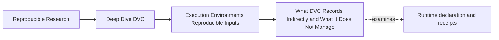
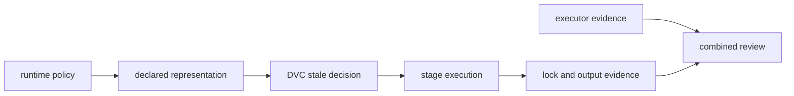
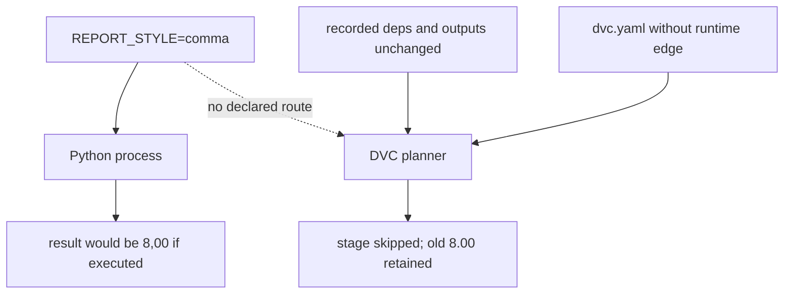
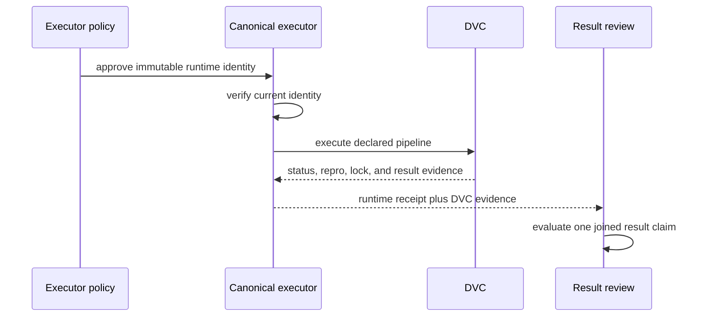

# What DVC Records Indirectly and What It Does Not Manage

<!-- page-maps:start -->
## Page Maps




<!-- page-maps:end -->

DVC can react to runtime state that reaches its declared graph. It does not discover every
fact about the machine, install the required environment, or decide which differences are
scientifically acceptable.

That boundary is not a weakness to conceal. It tells you where another control or evidence
source must join the workflow.

## Distinguish ownership from representation

A tool does not need to own a fact in order to represent it.

DVC does not own locale configuration. If a repository writes its governed locale to a
file and lists that file in `deps`, DVC can include changes to the file in stale
detection. A package manager still owns dependency resolution, but a resolved lockfile
can be a declared dependency. CI owns executor policy, while its immutable image digest
can be attached to a run receipt.

Ask two separate questions:

1. Who establishes or enforces this runtime fact?
2. How does evidence of that fact reach the result review?

Blurring them produces magical claims such as “DVC pins Python” or dismissive claims such
as “DVC has nothing to do with environments.”

## What DVC evaluates before execution

For a stage, DVC can reason about declared surfaces such as:

- command text;
- file and directory dependencies;
- selected parameter values;
- declared outputs;
- recorded stage state.

These surfaces let DVC compare current declared state with recorded state and decide
whether a stage is stale.

Consider the runtime specimen:

```yaml
declared_runtime:
  cmd: >-
    python scripts/render_runtime.py
    --contract environment/runtime.env
  deps:
    - environment/runtime.env
    - scripts/render_runtime.py
```

Changing `environment/runtime.env` changes a declared dependency. DVC can report:

```json
{
  "declared_runtime": [
    {
      "changed deps": {
        "environment/runtime.env": "modified"
      }
    }
  ]
}
```

The graph gives the planner a route from changed policy to stale stage.

## What remains invisible

Now inspect the paired stage:

```yaml
hidden_runtime:
  cmd: >-
    python scripts/render_runtime.py
    --environment-variable REPORT_STYLE
  deps:
    - scripts/render_runtime.py
```

The command reads `REPORT_STYLE`, but the stage declaration contains neither its value nor
an artifact representing it. When process state changes from `dot` to `comma`, no declared
surface changes.

The variable is real to the Python process and invisible to DVC's stale calculation.
There is no contradiction.



This is why an empty `dvc status --json` object has a precise, limited meaning:

> DVC found no difference in the declared state it evaluates.

It does not mean the process environment is identical to the environment that produced
the recorded output.

## Read `dvc.lock` in time order

The stage lock is execution evidence. It records command, dependency identities,
parameter values when applicable, and output identities associated with an execution.

It is not a universal runtime snapshot, and it cannot make an undeclared cause visible
before a run merely because an output changed afterward.

The hidden-case audit makes the time order explicit:

| Moment | `dvc.yaml` | `dvc.lock` | Hidden result |
| --- | --- | --- | --- |
| baseline after dot run | no runtime edge | records dot-produced output | `8.00` |
| process changes to comma | unchanged | unchanged | `8.00` |
| ordinary repro skips | unchanged | unchanged | `8.00` |
| forced execution | unchanged | records new output identity | `8,00` |

Inspect the hashes:

```bash
audit=artifacts/audit/reproducible-research/deep-dive-dvc/runtime-contracts

jq '.findings[] |
  select(.finding == "FORCED_RUN_CHANGES_OUTPUT_WITH_STABLE_DECLARATION") |
  .evidence' "$audit/report.json"
```

The declaration hash stays stable and the lock hash changes after force. The correct
inference is:

> DVC recorded the output produced by the forced execution; the process variable remains
> absent from future stale decisions.

The incorrect inference is:

> The lock changed, so DVC now tracks the environment variable.

## Separate declaration, observation, and enforcement

These words describe different strengths:

| Strength | Example | What it establishes |
| --- | --- | --- |
| declaration | runtime contract file is listed in `deps` | DVC can observe file identity changes |
| observation | fingerprint records Python and platform | reviewer can compare recorded contexts |
| enforcement | CI rejects an unapproved image digest | execution cannot proceed as accepted evidence |

A fingerprint is useful observation. It becomes part of a control only when:

- the governed fields are named;
- approved values or comparison rules exist;
- an enforcement point evaluates them;
- the resulting receipt is joined to the workflow result.

Saving `python --version` in a log does not by itself prevent, detect, or reject an
unapproved run.

## Decide where runtime facts belong

Not every runtime fact needs the same route.

| Runtime fact | Possible owner | DVC representation | External evidence |
| --- | --- | --- | --- |
| report style | repository policy | contract file in `deps` | review of contract generation |
| random seed | experiment design | selected `params.yaml` key | parameter approval |
| resolved Python packages | package manager | lockfile in `deps` if execution consumes it | installation receipt |
| container filesystem | image builder/registry | digest parameter or contract file | signed image identity |
| GPU driver | executor/platform | often none | platform attestation and compatibility gate |
| secret value | secret manager | do not record value | secret version or policy receipt |

Sensitive values require care. Reproducibility does not justify committing credentials or
private configuration. Record a safe identity, version, schema, or policy receipt instead
of the secret itself.

## Join external executor evidence to DVC evidence

Some runtime facts are better governed outside the graph. The result claim still needs a
join.



The join might be a manifest containing:

- Git commit;
- data and parameter identities;
- DVC stage or lock identity;
- executor and image identity;
- command and completion status;
- result identity.

Without a shared run identifier or manifest, the runtime receipt and result can describe
different executions.

## Audit a claim by asking who can prove it

For the claim:

> This result was produced under the approved Python dependency resolution.

Work backward:

| Required fact | Evidence source | Missing-evidence consequence |
| --- | --- | --- |
| approved resolution identity | reviewed lockfile or policy | “approved” is undefined |
| installed resolution identity | installer or image receipt | lockfile presence does not prove use |
| pipeline execution under that identity | executor receipt | runtime and result may not be joined |
| output and workflow state | DVC and result evidence | execution cannot be tied to claimed artifact |

DVC contributes the workflow-state and output side. It may also observe a declared
lockfile. It does not prove installation merely because the lockfile exists.

## Do not overread `make platform-report`

A platform report can answer:

- which versions and platform facts were observed;
- whether two receipts differ on recorded fields;
- whether a suspected change is worth investigating.

It cannot answer by itself:

- whether the observed environment was approved;
- whether every influential fact was captured;
- whether the stage executed after the receipt was created;
- whether a difference caused the result;
- whether the result difference is acceptable.

Use it as one evidence layer, not as a certificate of reproducibility.

## A boundary review for the capstone

Run:

```bash
make PROGRAM=reproducible-research/deep-dive-dvc capstone-runtime-contract-audit
```

Then fill this table from the generated evidence:

| Question | Declared case | Hidden case |
| --- | --- | --- |
| Who supplies report style? | contract file | process environment |
| Where is it represented? | dependency in `dvc.yaml` | fingerprint only |
| Can DVC see change before execution? | yes | no |
| What does ordinary repro do? | rebuilds | skips |
| What does lock evidence establish? | output from current declared policy | output from whichever context last executed |
| What durable repair is needed? | preserve contract | declare influence or enforce it externally |

If an answer says only “DVC handles it” or “CI handles it,” name the exact evidence and
decision point.

## Review checkpoint

You understand DVC's environment boundary when you can explain:

- why a file managed by another tool can still be a DVC dependency;
- why a runtime fingerprint does not automatically change stale status;
- why `dvc.lock` is retrospective execution evidence;
- why force can update lock evidence without repairing the declaration;
- how external runtime enforcement joins to DVC result evidence;
- why secrets need safe identities rather than recorded values.

The durable model is:

> Environment tooling establishes runtime state. DVC reasons about declared
> representations of influential state. Reviewers need a joined evidence route when
> control remains external.
