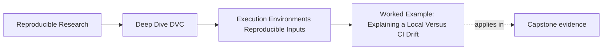

# Worked Example: Explaining a Local Versus CI Drift


<!-- page-maps:start -->
## Page Maps




<!-- page-maps:end -->

This example shows how Module 03 fits together when a workflow does something that makes
teams uneasy:

the local run and the CI run are both honest, but the result is not exactly the same.

## Execute the controlled version first

Run:

```bash
make PROGRAM=reproducible-research/deep-dive-dvc capstone-runtime-contract-audit
```

The specimen substitutes `REPORT_STYLE` for a larger local-versus-CI runtime difference.
This makes the causal path observable:

- `dot` context produces `8.00`
- `comma` context produces `8,00`
- Python, platform, code, and data remain fixed

Before reading the report, predict whether DVC will mark each paired stage stale after its
runtime policy changes.

## The situation

Suppose you run the DVC capstone locally and see one set of metrics.

CI runs the same repository and reports a slightly different metric.

Nobody changed:

- the Git commit
- the DVC-tracked data
- `params.yaml`

That is exactly the kind of moment where weak environment thinking breaks down.

## Step 1: Resist the wrong first conclusion

The weak conclusions are:

- someone must have changed the data
- CI is random nonsense
- DVC failed to make the workflow reproducible

Module 03 asks for a slower, better question:

> if the explicit data and parameter story still matches, what runtime facts might still be
> part of the input surface?

## Step 2: Confirm the explicit workflow state first

You check:

- DVC-tracked data identity
- `params.yaml`
- the declared workflow path

Those still align.

This matters because it narrows the drift question. The repository is not completely
mysterious anymore.

## Step 2A: Compare declaration paths

Open `workspace/baseline/dvc.yaml`.

The declared stage lists `environment/runtime.env` in `deps`. The hidden stage has no
equivalent edge for `REPORT_STYLE`.

This is the first decisive difference. Do not begin with output values; first ask whether
the planner can observe the changed cause.

## Step 3: Inspect runtime evidence

Next you compare environment clues:

- local toolchain versions
- CI toolchain versions
- `make platform-report`

Now the story becomes clearer:

- Python version differs slightly
- one numerical dependency version differs as well

This does not automatically explain the metric gap perfectly, but it turns the problem
from folklore into a reviewable runtime difference.

In the controlled audit, compare:

```text
evidence/baseline-fingerprint.json
evidence/drift-fingerprint.json
```

Only `report_style` differs. This does explain the specimen's result because force under
the changed context produces the predicted comma rendering.

## Step 4: Classify the drift honestly

You now have to decide:

- is this an expected amount of conditional determinism
- or is it meaningful enough to tighten the environment strategy

That is the real judgment in Module 03.

If the delta is tiny and within declared comparison tolerance, the honest answer may be:

> these runs are conditionally deterministic, and the current strategy allows small runtime variation.

If the delta is too large for the workflow's review standards, the answer may instead be:

> we need a stronger environment strategy or a stricter canonical executor.

For the hidden specimen, do not choose either tolerance outcome yet. Ordinary repro did
not execute under the changed context. Classify it as a hidden-runtime contract defect.

Evidence:

- hidden status is empty
- ordinary repro skips
- old semantic value remains
- force changes the value
- `dvc.yaml` remains unchanged

## Step 5: Choose the right repair

The repair is not automatically "pin everything harder."

Possible honest moves include:

- tightening dependency control with better lockfiles
- standardizing more of the runtime through containers
- treating CI as the canonical proof executor
- documenting the acceptable comparison tolerance more clearly

The correct move depends on the workflow's review and release needs.

For the controlled specimen, the durable repair is concrete:

- materialize `REPORT_STYLE` in a runtime contract file and declare it, or
- enforce the environment identity outside DVC and join that receipt to the run

`dvc repro --force` is only the diagnostic probe. It cannot govern the next context
change.

## What DVC contributed here

DVC did not solve the environment drift directly.

What it did do was make the rest of the story more explicit:

- the data identity was not in doubt
- the parameter surface was not in doubt
- the stage story was not in doubt

That clarity made the environment explanation possible instead of speculative.

## The evidence packet

Give a reviewer:

| Surface | Claim closed |
| --- | --- |
| paired `dvc.yaml` stages | declared versus hidden planner visibility |
| two fingerprints | isolated runtime change |
| declared status receipt | DVC sees declared contract drift |
| hidden status and ordinary repro receipts | DVC skips undeclared drift |
| pre-force and post-force results | runtime influence is causal |
| declaration and lock hashes | force records output but does not repair contract |

No item is decorative. Remove any one and identify which inference becomes weaker.

## The review note you would want

> Local and CI runs differed slightly even though the recorded data, parameters, and
> workflow declaration aligned. Platform evidence showed a runtime version difference,
> which makes environment drift the strongest current explanation. This does not mean DVC
> failed; it means the repository has made other state explicit enough for the remaining
> difference to be diagnosed as runtime-sensitive behavior. The next decision is whether
> the observed drift fits the workflow's accepted tolerance or whether environment control
> should be tightened.

That note is much stronger than "CI was weird."

For this specimen, a stronger review note is:

> Code, data, Python, and platform were held constant while `REPORT_STYLE` changed. The
> declared contract became stale and rebuilt `8,00`. The hidden stage reported empty
> status and retained `8.00` until forced. Force changed output and lock evidence without
> changing `dvc.yaml`, proving the process variable is causal but undeclared. Repair the
> runtime contract before discussing tolerance.

## Why this is a mastery example

This one story exercises the whole module:

- Core 1: environment was treated as input
- Core 2: divergence was read through the determinism spectrum
- Core 3: DVC's boundary stayed honest
- Core 4: environment strategy became the repair question
- Core 5: runtime evidence was used instead of superstition
