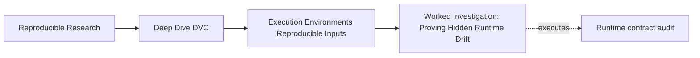
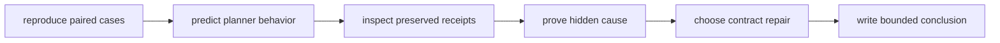
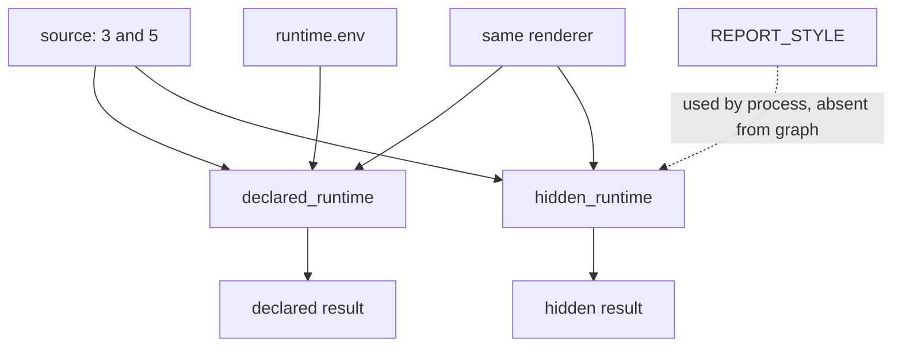
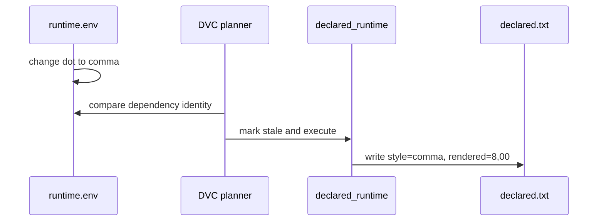

# Worked Investigation: Proving Hidden Runtime Drift

<!-- page-maps:start -->
## Page Maps




<!-- page-maps:end -->

This investigation begins with a result that looks reassuring: after runtime policy
changes, ordinary DVC reproduction says the pipeline is up to date and the output remains
stable.

The investigation shows why that stability is defective. A process variable changes the
meaning of the result, but the variable is absent from the stage declaration. DVC
correctly evaluates its graph and reuses an output produced under old runtime meaning.

You will follow the actual receipts produced by the capstone audit. No instructor-only
setup is required.

## The claim under review

The intended claim is:

> Each result renders the total according to the current `REPORT_STYLE` policy.

The renderer adds `3` and `5`. With `REPORT_STYLE=dot`, it writes:

```text
total=8
style=dot
rendered=8.00
```

With `REPORT_STYLE=comma`, it should write:

```text
total=8
style=comma
rendered=8,00
```

The punctuation is deliberately semantic in this specimen. It makes stale runtime meaning
visible without relying on accidental platform variation.

## Produce an isolated evidence packet

From the repository root, run:

```bash
make PROGRAM=reproducible-research/deep-dive-dvc capstone-runtime-contract-audit
```

Set a shell variable for shorter commands:

```bash
audit=artifacts/audit/reproducible-research/deep-dive-dvc/runtime-contracts
```

Confirm the audit itself passed:

```bash
column -t -s $'\t' "$audit/summary.tsv"
```

Expected finding names:

```text
BASELINE_CONVERGES
DECLARED_RUNTIME_CHANGE_IS_STALE
DECLARED_RUNTIME_REBUILD_ADOPTS_POLICY
HIDDEN_RUNTIME_CHANGE_IS_INVISIBLE
ORDINARY_REPRO_PRESERVES_STALE_RUNTIME_MEANING
FORCED_RUN_CHANGES_OUTPUT_WITH_STABLE_DECLARATION
FINGERPRINT_EXPOSES_RUNTIME_MISMATCH
```

Three rows have decision `REJECT` even though their test result is `PASS`. The audit
successfully reproduced behaviors that a production contract must reject.

## Understand the paired design

Open the settled baseline declaration:

```bash
sed -n '1,220p' "$audit/workspace/baseline/dvc.yaml"
```

Both stages share:

- `data/source.txt`;
- `scripts/render_runtime.py`;
- the same Python process;
- the same output schema.

Their runtime policy enters differently:

| Stage | Policy source | Is policy identity declared? |
| --- | --- | --- |
| `declared_runtime` | `environment/runtime.env` | yes, in `deps` |
| `hidden_runtime` | process variable `REPORT_STYLE` | no |



This design isolates *visibility to the planner*. It does not claim that all real
local-versus-CI incidents are this tidy.

## Make predictions before following receipts

Copy and complete this table in your notes:

| Change | Expected status | Expected ordinary repro | Expected result |
| --- | --- | --- | --- |
| contract file: dot to comma | | | |
| process variable: dot to comma | | | |

Use only the declaration to predict. DVC can compare declared file identity. It cannot
compare an environment-variable value that is neither in command text nor represented by
a dependency or parameter.

The expected predictions are:

| Change | Expected status | Expected ordinary repro | Expected result |
| --- | --- | --- | --- |
| contract file: dot to comma | declared stage stale | stage runs | `8,00` |
| process variable: dot to comma | empty | stage skips | retained `8.00` |

Now use evidence to test them.

## Establish the converged baseline

Inspect the baseline finding:

```bash
jq '.findings[] |
  select(.finding == "BASELINE_CONVERGES")' "$audit/report.json"
```

It establishes:

- both stages initially produced `dot` semantics;
- a second repro skipped both stages;
- status was empty after settling.

This baseline matters. Without it, later status might reflect an unrelated incomplete run
instead of the deliberate policy change.

The supported baseline claim is limited:

> Under the initial dot context, both declared stages settled and produced matching
> results.

It does not yet say how either stage responds to runtime change.

## Follow the declared change

The audit changes `environment/runtime.env` from:

```text
REPORT_STYLE=dot
```

to:

```text
REPORT_STYLE=comma
```

Inspect status:

```bash
cat "$audit/evidence/declared-change-status.stdout.txt"
```

The receipt names:

```json
{
  "declared_runtime": [
    {
      "changed deps": {
        "environment/runtime.env": "modified"
      }
    }
  ]
}
```

Before execution, the result still contains old dot semantics. That is normal stale state:
the declared dependency changed and the stage has not yet rebuilt.

Inspect the repro receipt and current result:

```bash
cat "$audit/evidence/declared-change-repro.stdout.txt"
cat "$audit/workspace/declared-change/results/declared.txt"
```

The stage runs and the result adopts comma semantics. The complete route is:



Each link has evidence: changed dependency, stale receipt, execution receipt, current
result.

## Follow the hidden change without intervening

The paired workspace changes process state to `REPORT_STYLE=comma` but leaves `dvc.yaml`
unchanged.

Compare fingerprints:

```bash
jq -s '.' \
  "$audit/evidence/baseline-fingerprint.json" \
  "$audit/evidence/drift-fingerprint.json"
```

Python, implementation, platform, and machine match. `report_style` differs.

Now inspect pre-repro status:

```bash
cat "$audit/evidence/hidden-change-status.stdout.txt"
```

It is:

```json
{}
```

This does not contradict the fingerprint. The files answer different questions:

- fingerprint: did recorded runtime context differ?
- DVC status: did declared graph state differ?

Inspect ordinary repro:

```bash
cat "$audit/evidence/hidden-change-ordinary-repro.stdout.txt"
cat "$audit/workspace/hidden-change/results/hidden.txt"
```

DVC skips the stage, and the result remains `style=dot` and `rendered=8.00`.

At this point, a strong finding is:

> The current runtime receipt says comma, while the retained output says dot. Because
> ordinary repro skipped, the output was not produced under the current context.

Do not call this conditional variation. Only one current-context execution exists so far:
none.

## Use force to test the suspected cause

The audit executes:

```bash
REPORT_STYLE=comma dvc repro --force hidden_runtime
```

Read the preserved receipt:

```bash
cat "$audit/evidence/hidden-change-forced-repro.stdout.txt"
```

Then inspect the report's before-and-after evidence:

```bash
jq '.findings[] |
  select(.finding == "FORCED_RUN_CHANGES_OUTPUT_WITH_STABLE_DECLARATION")' \
  "$audit/report.json"
```

The result changes from `8.00` to `8,00`. This supports the causal inference:

> Holding the specimen's other recorded facts constant, changing report style changes the
> output when the stage executes.

The report also shows:

- `dvc.yaml` has one stable hash before and after force;
- `dvc.lock` changes after execution;
- output identity changes after execution.

That proves force did not add a declaration edge.

## Reconstruct the causal argument

Write the argument as linked evidence, not a list of clues:

1. **Baseline control:** both stages converge under dot policy.
2. **Isolated contrast:** paired fingerprints differ only on `report_style`.
3. **Visibility contrast:** declared file change appears in status; hidden process change
   does not.
4. **Planner consequence:** declared ordinary repro runs; hidden ordinary repro skips.
5. **Semantic consequence:** declared output adopts comma; hidden output retains dot.
6. **Causal probe:** forced hidden execution under comma changes output to comma.
7. **Contract check:** declaration stays unchanged, so the missing influence remains
   missing.

The conclusion is stronger than “environment drift happened”:

> `REPORT_STYLE` is an influential hidden input. Its absence from `dvc.yaml` allows
> ordinary repro to preserve a result with obsolete runtime meaning.

## Evaluate repair proposals

| Proposal | Future change visible? | Result reviewable? | Verdict |
| --- | --- | --- | --- |
| always use `--force` | no | only per forced run | reject as operating contract |
| print variable in logs | no | context observable but not enforced | insufficient |
| widen result tolerance | no | stale output still unexecuted | category error |
| add runtime contract file to `deps` | yes | dependency and result evidence join | suitable |
| make report style a DVC parameter | yes | control value appears in stage state | suitable |
| enforce approved value in CI and join receipt | externally | yes if receipt is bound to run | suitable |
| remove formatting dependence | influence disappears | simpler claim | suitable if product allows |

The best repair depends on ownership. For this repository specimen, the declared contract
file is the clearest route because the value is a small, non-secret policy input.

## Draft the repaired declaration

A direct repair would make the hidden stage consume a contract:

```yaml
hidden_runtime:
  cmd: >-
    python scripts/render_runtime.py
    --source data/source.txt
    --contract environment/runtime.env
    --output results/hidden.txt
  deps:
    - data/source.txt
    - environment/runtime.env
    - scripts/render_runtime.py
  outs:
    - results/hidden.txt
```

The exercise is conceptual; do not edit the governed specimen during the audit. Its
intentional defect is required for the comparison and self-test.

A repair acceptance test should prove:

1. baseline settles;
2. changing only the contract makes the repaired stage stale;
3. ordinary repro executes it;
4. output adopts current policy;
5. a second repro converges.

“The YAML looks right” is not enough.

## Write the review note

A concise, evidence-backed note:

> The baseline converged with both stages rendering `8.00`. The drift fingerprint changed
> only `report_style` from dot to comma. The declared case named its runtime contract as a
> changed dependency, rebuilt, and produced `8,00`. The hidden case had empty status,
> ordinary repro skipped, and its output retained dot semantics. Forced execution under
> comma changed the result and lock while the declaration hash remained stable. This
> proves report style is causal but undeclared. Reject the retained hidden result and
> represent report style as a dependency or enforced run-bound control.

The note avoids three overclaims:

- it does not say all environment drift behaves this way;
- it does not call an empty status result a DVC failure;
- it does not claim force repaired the graph.

## Transfer the method to a local-versus-CI incident

A real incident is noisier. Use the same proof structure:

| Controlled specimen | Local-versus-CI analogue |
| --- | --- |
| paired declaration | compare stage and command identities |
| paired fingerprints | compare governed executor facts |
| preserved status | capture status before rerun |
| ordinary repro receipt | prove whether disputed stage ran |
| forced causal probe | reproduce one suspected difference in isolation |
| declaration hash | check whether repair changed the contract |
| semantic result | compare the claim-relevant output |

If many runtime fields differ, isolate them in smaller experiments. Do not leap directly
from a broad fingerprint diff to a causal conclusion.

## Investigation checklist

Before closing a runtime-drift review, confirm:

- [ ] The result claim and comparison method are explicit.
- [ ] Code, data, parameters, and declaration identities were checked.
- [ ] Pre-intervention status and results were preserved.
- [ ] Each compared result has current-execution evidence.
- [ ] The suspected runtime difference is recorded in structured form.
- [ ] A controlled intervention supports the causal claim.
- [ ] Diagnostic force is not presented as contract repair.
- [ ] The repair closes the demonstrated visibility or enforcement gap.
- [ ] The conclusion states what the evidence does not prove.

The investigation is complete when a missed-class learner can reproduce the observations,
the causal reasoning, and the repair decision from the packet alone.
