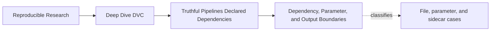
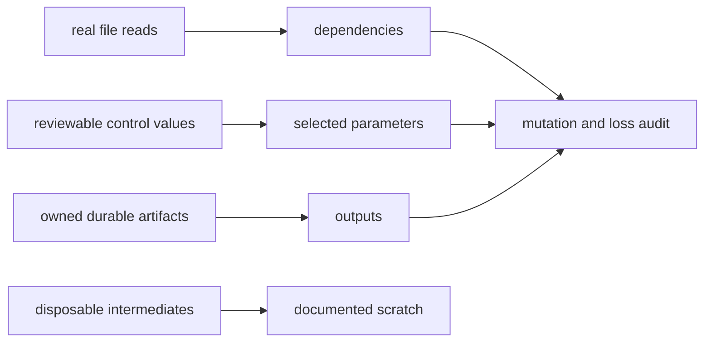
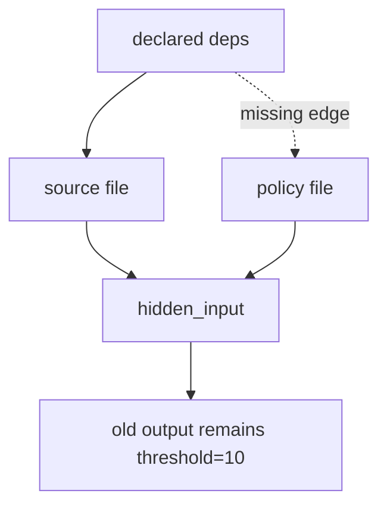

# Dependency, Parameter, and Output Boundaries

<!-- page-maps:start -->
## Page Maps




<!-- page-maps:end -->

Correct placement follows behavior and consequence, not filename extension.

- A dependency is an input whose change can invalidate the stage result.
- A parameter is a deliberate control value selected for review and comparison.
- An output is an artifact the stage promises to produce and own.
- Scratch is disposable state with no downstream or review obligation.

## Build an influence ledger

Before editing `dvc.yaml`, inventory:

```text
Influence or artifact
How command accesses it
Can its change alter output?
Must reviewers compare it?
Must loss trigger recreation?
Who owns it?
Sensitive?
Proposed declaration
```

Example:

| Item | Behavior | Consequence | Placement |
| --- | --- | --- | --- |
| `data/source.txt` | file read | values change | dependency |
| `policy/threshold.txt` | file read | threshold semantics change | dependency |
| `settings.multiplier` | parsed control | score changes | parameter |
| `results/declared-main.txt` | durable result | consumer needs it | output |
| `results/undeclared-receipt.txt` | review receipt | evidence lost if absent | output |
| parser scratch directory | transient | safe to recreate internally | scratch |

## Dependencies model reads

A file belongs in `deps` when its current identity influences the command result.

The hidden-input stage reads `policy/threshold.txt` but omits it:

```yaml
deps:
  - data/source.txt
  - scripts/render.py
```

The command still uses:

```text
--policy policy/threshold.txt
```

Changing the policy from `10` to `20` leaves the hidden stage absent from status.



Command-line appearance is not automatically a DVC dependency. The YAML must represent
the read.

## Parameters model deliberate controls

Putting values in `params.yaml` does not make every key globally visible to every stage.

Truthful:

```yaml
params:
  - settings.multiplier
```

When the key changes from `2` to `3`, the declared stage becomes stale and rebuilds score
from `16` to `24`.

Choose parameter treatment when:

- the value is a deliberate experiment or workflow control;
- reviewers should compare it by key;
- changes should appear in stage state;
- the value is safe to record.

Use a file dependency when the input is better governed as a whole artifact, such as a
policy document, schema, template, or model file.

Do not record secrets as parameters. Govern secret version or access policy externally.

## Outputs model ownership

Declare an artifact when:

- downstream stages consume it;
- reviewers need it;
- recovery requires it;
- its loss should cause reproduction;
- the stage claims responsibility for its content.

The specimen writes a main result and receipt. If the receipt supports audit or review, it
belongs in the contract.

Loss test:

1. settle baseline;
2. delete only the candidate artifact;
3. inspect status;
4. run ordinary repro;
5. confirm artifact restoration and current meaning.

If status remains empty and repro skips, DVC does not own the artifact.

## Scratch must truly be disposable

An artifact can remain scratch only when:

- no consumer reads it after command completion;
- no review or recovery claim needs it;
- deletion has no effect on accepted outputs;
- the command recreates it internally as needed;
- retention is not expected.

Location under `tmp`, `cache`, or `scratch` does not settle ownership. Conversely, a file
under `results/` is not automatically governed.

Use behavior and consequence.

## Decide from change and loss

| Question | If yes | Likely declaration |
| --- | --- | --- |
| does changing this file alter result? | stage must become stale | dependency |
| is this a named control reviewers compare? | key change must be visible | parameter |
| should artifact loss trigger recreation? | stage owns presence | output |
| can it vanish without affecting any claim? | no pipeline ownership needed | scratch |
| is it supplied by external governed context? | require joined enforcement evidence | external contract |

## Avoid broad declarations as a shortcut

Declaring an entire directory can hide unclear ownership:

- unrelated changes trigger false reruns;
- multiple stages appear to own the same area;
- scratch becomes durable accidentally;
- reviewers cannot identify the causal file.

Broad boundaries can be truthful when the whole directory is one versioned input or
output unit. Prove that ownership rather than using breadth to avoid inventory.

## Test every placement adversarially

| Placement | Adversarial test | Expected evidence |
| --- | --- | --- |
| dependency | change only file | status names stage; output adopts new value |
| parameter | change only selected key | status names key/stage; output adopts control |
| output | delete only artifact | status names missing output; repro restores |
| scratch | delete between runs | accepted outputs and review claims remain valid |
| external control | violate approved value | external gate rejects before trust |

## Handle multi-role files carefully

A file can contain many values. A stage may consume only one.

Options:

- declare whole file as dependency: any change reruns stage;
- select exact parameter key: relevant control change reruns stage;
- generate a smaller contract file: stage observes only owned subset.

Choose based on review granularity and safe staleness. Never omit the influence because
whole-file reruns seem noisy.

## Review checkpoint

You understand boundary placement when you can:

- classify from actual behavior;
- distinguish parameter presence from selected parameter contract;
- decide sidecar ownership by loss consequence;
- defend scratch as truly disposable;
- explain when whole-file or exact-key tracking is appropriate;
- design mutation/loss tests for every placement.

The standard is:

> Every real read, deliberate control, and owned artifact has a declaration whose
> adversarial test produces the expected planner and semantic evidence.
