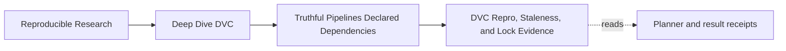
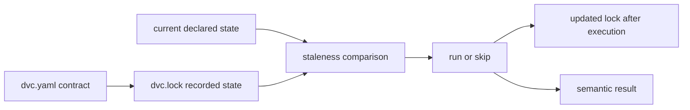

# DVC Repro, Staleness, and Lock Evidence

<!-- page-maps:start -->
## Page Maps




<!-- page-maps:end -->

`dvc.yaml`, `dvc.lock`, status, reproduction, and outputs answer different questions.

| Surface | Question |
| --- | --- |
| `dvc.yaml` | what causal contract is declared? |
| `dvc.lock` | which declared state and outputs were recorded after execution? |
| `dvc status` | which declared differences are visible now? |
| `dvc repro` | which visible stale stages execute or skip? |
| result values | does output express current meaning? |

No one surface proves contract completeness.

## Understand staleness precisely

A stage is stale when current declared state differs from recorded state according to
DVC's graph.

That definition includes an important boundary:

> A real influence absent from the declaration cannot participate in ordinary staleness.

The hidden file and parameter stages read changed values but remain absent from status.

## Predict before executing

Run:

```bash
make PROGRAM=reproducible-research/deep-dive-dvc capstone-stage-contract-audit
audit=artifacts/audit/reproducible-research/deep-dive-dvc/stage-contracts
```

Before reading receipts, inspect:

```bash
sed -n '1,240p' "$audit/workspace/baseline/dvc.yaml"
```

Predict:

| Mutation | Expected stale stage |
| --- | --- |
| threshold policy changes | `declared_input` |
| multiplier key changes | `declared_param` |
| undeclared receipt deleted | none |

Predictions derived from declaration edges reveal whether you understand the planner.

## Read file-change status

```bash
cat "$audit/evidence/input-change-status.stdout.txt"
```

The status names changed dependency `policy/threshold.txt` for `declared_input`. It omits
`hidden_input`.

Before reproduction, both outputs still say `threshold=10`; stale status identifies the
declared result that needs rebuilding.

After reproduction:

```text
declared-input.txt -> threshold=20
hidden-input.txt   -> threshold=10
```

```mermaid
sequenceDiagram
  participant Policy
  participant DVC
  participant Declared
  participant Hidden

  Policy->>Policy: change 10 to 20
  DVC->>DVC: compare declared state with lock
  DVC->>Declared: mark stale and run
  DVC-->>Hidden: no declared edge; skip
  Declared-->>DVC: current threshold=20
  Hidden-->>DVC: retained threshold=10
```

Empty hidden status is compatible with stale semantic output.

## Read parameter-change status

```bash
cat "$audit/evidence/param-change-status.stdout.txt"
```

The receipt names:

```text
settings.multiplier modified
```

for the declared parameter stage only.

After reproduction, the declared stage uses `3` and produces score `24`; the hidden stage
retains `2` and score `16`.

The lock can record selected parameter state only when the stage declares it. File
presence in `params.yaml` does not create a universal edge.

## Read lock evidence in time order

The lock is retrospective:

1. declaration defines what DVC observes;
2. execution occurs;
3. lock records declared inputs, parameters, command, and outputs;
4. later status compares current declared state with that record.

An undeclared influence cannot be repaired merely because its output hash changes after a
forced execution. Future comparison still lacks the cause.

Use lock evidence to answer:

- which declared identity produced recorded state;
- which selected parameter value was recorded;
- which owned output identity followed execution.

Do not use it to claim:

- all command reads were captured;
- all side effects are owned;
- runtime context is complete;
- hidden semantic state is current.

## Distinguish run, skip, and converge

| Observation | Supported claim |
| --- | --- |
| stage runs after declared change | planner detects declared influence |
| output adopts current value | execution restores semantic currency |
| second repro skips | recorded declared state converges |
| hidden stage skips after real change | declaration is incomplete, not “stable” |
| missing undeclared sidecar remains absent | stage does not own artifact |

## Preserve status before repair

Run status before reproduction and save JSON. Otherwise a successful reproduction can
erase evidence of submitted staleness.

A useful packet:

```text
declaration.yaml
lock-before.yaml
status-before.json
result-before.txt
repro.stdout.txt
lock-after.yaml
result-after.txt
status-after.json
```

This supports both planner and semantic reasoning.

## Why force is diagnostic only

Force can show that current hidden input changes output. It bypasses the ordinary stale
decision.

It does not:

- add the file dependency;
- select the parameter key;
- own the sidecar;
- protect future changes.

Durable repair changes declaration or command behavior and passes adversarial tests.

## Review checkpoint

You understand planner evidence when you can:

- predict staleness from `dvc.yaml`;
- explain lock evidence as retrospective;
- preserve status before repro;
- distinguish run, skip, and convergence;
- combine status with semantic result values;
- explain why forced freshness is not future correctness.

The standard is:

> Read declaration, recorded state, planner receipt, execution receipt, and result meaning
> in time order; never ask one layer to prove the entire contract.
