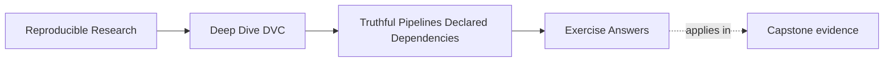

# Exercise Answers


<!-- page-maps:start -->
## Page Maps




<!-- page-maps:end -->

These answers are model explanations, not the only acceptable wording.

## How to use the answer page well

Do not read the model answer first and then reduce the whole module to "put more things
in `deps`."

A better rhythm is:

1. finish the exercise with your own contract packet
2. state the stage promise and the real influences on it
3. compare your reasoning with the model answer
4. revise anywhere you blurred file reads, control values, or ownership boundaries

What matters is whether the reasoning keeps declarations, real command behavior, and lock
evidence connected.

Strong Module 04 answers usually do five things:

- they read a stage declaration as a promise
- they place every influence in the right field for the right reason
- they predict reruns from declared edges instead of intuition
- they treat hidden reads as correctness defects
- they improve graph shape when provenance clarity needs it

The strongest self-study packets also leave behind six concrete artifacts:

- one stage-contract explanation
- one influence-classification table
- one rerun prediction sheet
- one repaired missing-dependency example
- one stage-boundary refactor
- one backward review of a real pipeline

If your answers rely only on "DVC will figure it out," the reasoning is still too thin.

## Answer 1: Read a stage contract

The stage promises:

- run `python -m incident_escalation_capstone.prepare`
- read `data/raw/service_incidents.csv`
- produce `data/prepared/incidents.parquet`

The stage should become stale when:

- the raw incidents file changes
- the command text changes
- the declared output is missing
- the recorded state no longer matches the declared current state

What still needs inspection:

- whether the command reads additional files such as schemas or reference tables
- whether it reads control values that belong in `params`
- whether it writes side artifacts that should be declared or cleaned elsewhere
- whether the repository convention also treats implementation files as explicit
  dependencies

The biggest hidden-risk category is undeclared influence: the command may depend on more
than the contract admits.

## Answer 2: Place each influence

Strong placement:

```yaml
deps:
  - models/escalation-model.json
  - data/prepared/incidents.parquet
  - data/reference/escalation_policy.csv
params:
  - evaluate.threshold
outs:
  - reports/evaluation.json
```

Why:

- file reads belong in `deps`
- reviewed control values belong in `params`
- governed durable products belong in `outs`

The temporary log usually stays outside the governed output contract if it is only
operational residue. It can still matter for debugging or incident review without
becoming a durable downstream artifact.

## Answer 3: Predict reruns

If the raw incidents file changes and `prepare` produces a new prepared output:

- `prepare` should rerun because its declared input changed
- `fit` should rerun because it depends on the prepared output
- `evaluate` should rerun because it depends on prepared data and likely on the updated
  model produced by `fit`

If `fit.model_family` changes:

- `fit` should rerun because its declared parameter changed
- `evaluate` should rerun if it consumes the model from `fit`
- `prepare` should remain stable because none of its declared inputs or controls changed

If `evaluate.threshold` changes:

- `evaluate` should rerun
- `prepare` and `fit` should remain stable

If an unrelated README changes:

- no stage should rerun unless the README was declared as a dependency, which would itself
  need justification

The main lesson is that rerun prediction follows declared edges, not feelings about which
part of the project changed.

## Answer 4: Diagnose stale output risk

Strong review response:

> The evaluation stage likely has a missing dependency. If the command reads
> `data/reference/escalation_policy.csv`, that file belongs in the stage's `deps`. This is
> more dangerous than an extra rerun because DVC can now skip evaluation after a
> meaningful input change, leaving a stale report that appears current. Add the policy CSV
> to `deps`, rerun the stage, and confirm `dvc.lock` now records the policy dependency and
> the updated evaluation evidence.

Concrete repair:

```yaml
deps:
  - models/escalation-model.json
  - data/prepared/incidents.parquet
  - data/reference/escalation_policy.csv
```

What lock evidence should show:

- the repaired dependency appears in the recorded stage state
- the affected output identity is refreshed after rerun

## Answer 5: Refactor a mixed stage

A strong split answer:

```yaml
stages:
  fit:
    cmd: python -m incident_escalation_capstone.fit
    deps:
      - data/prepared/incidents.parquet
    params:
      - fit.model_family
    outs:
      - models/escalation-model.json
  evaluate:
    cmd: python -m incident_escalation_capstone.evaluate
    deps:
      - data/prepared/incidents.parquet
      - models/escalation-model.json
    params:
      - evaluate.threshold
    outs:
      - reports/evaluation.json
```

Why this is often stronger:

- a model control change reruns fitting and then evaluation
- an evaluation threshold change reruns only evaluation
- the model has clear ownership as an intermediate
- review can separate "why did the model move?" from "why did the report move?"

A defensible keep-together answer exists only if the model has no independent reuse or
review value and the combined command truly owns one inseparable result boundary.

## Answer 6: Predict the stage-contract audit

A complete prediction table is:

| Finding | Result | Decision | Reason |
| --- | --- | --- | --- |
| `BASELINE_CONVERGES` | `PASS` | `ACCEPT` | all stages build, then skip on the settled run |
| `DECLARED_INPUT_CHANGE_IS_STALE` | `PASS` | `ACCEPT` | the changed policy path is in `deps` |
| `DECLARED_INPUT_REBUILDS_CURRENT_VALUE` | `PASS` | `ACCEPT` | the rebuilt output moves from `10` to `20` |
| `HIDDEN_INPUT_CHANGE_IS_INVISIBLE` | `PASS` | `REJECT` | the command reads the path but the stage omits it |
| `DECLARED_PARAM_CHANGE_IS_STALE` | `PASS` | `ACCEPT` | `settings.multiplier` is listed under `params` |
| `DECLARED_PARAM_REBUILDS_CURRENT_VALUE` | `PASS` | `ACCEPT` | the output moves from multiplier `2` to `3` |
| `HIDDEN_PARAM_CHANGE_IS_INVISIBLE` | `PASS` | `REJECT` | the key exists in the file but not in the stage contract |
| `UNDECLARED_OUTPUT_LOSS_IS_INVISIBLE` | `PASS` | `REJECT` | the deleted receipt is outside `outs` |

`PASS / REJECT` means the checker successfully reproduced the defect. Calling those rows
acceptable because they pass would reverse the purpose of the audit.

Why convergence cannot settle contract truth:

- DVC sees no declared change between baseline runs;
- hidden influences also do not change between those runs;
- undeclared products exist because the command just wrote them;
- therefore every stage can settle even when the graph is incomplete.

Convergence proves stability under unchanged declared state. It does not prove declaration
completeness.

## Answer 7: Prove file under-rebuild

A strong six-sentence proof is:

> The audit changes `policy/threshold.txt` from `10` to `20`.
> `input-change-status.stdout.txt` marks `declared_input` stale and does not name
> `hidden_input`. Reproducing the declared stage writes `threshold=20`. The hidden output
> remains at `threshold=10`. The decisive contract difference is that only
> `declared_input` lists the policy path in `deps`. The hidden artifact is semantically
> stale because its stored threshold disagrees with the current policy while DVC reports
> no declared reason to rebuild it.

The durable repair is:

```yaml
hidden_input:
  deps:
    - data/source.txt
    - policy/threshold.txt
    - scripts/render.py
```

After the repair, repeat the original mutation. Expected evidence:

```json
{
  "hidden_input": [
    {
      "changed deps": {
        "policy/threshold.txt": "modified"
      }
    }
  ]
}
```

The rebuilt hidden output must contain `threshold=20`.

Why force is insufficient: it refreshes one artifact without changing what DVC can detect
next time. Why deletion is insufficient: missing declared output triggers execution for a
different reason.

## Answer 8: Prove parameter under-rebuild

The declared case records:

```text
before: multiplier=2 score=16
after:  multiplier=3 score=24
```

The hidden case remains:

```text
multiplier=2 score=16
```

The score matters because it proves the obsolete control affected result meaning. A
timestamp or unchanged hash could show stability without explaining semantic impact.

Answers to the review questions:

1. `params.yaml` is a storage surface. A stage depends only on parameter keys declared
   under its own `params` contract.
2. `score=16` was computed from the old multiplier, while the current control implies
   `24`; the mismatch is direct stale-result evidence.
3. Input-only and sidecar stages should remain stable because they do not declare or use
   `settings.multiplier`.
4. Treating the whole parameter file as a broad file dependency can rerun stages for
   unrelated key changes and hides which control influenced which result.

The repair is:

```yaml
params:
  - settings.multiplier
```

The repaired proof needs both a status entry and an output containing
`multiplier=3` and `score=24`. Status alone shows detection; the output shows adoption.

## Answer 9: Decide whether the receipt is output or scratch

### Governed receipt

If the receipt is required for promotion review, the truthful declaration is:

```yaml
outs:
  - results/declared-main.txt
  - results/undeclared-receipt.txt
```

After a baseline run, deleting the receipt should make `undeclared_sidecar` stale.
Reproduction should restore `records=2`.

### Disposable scratch

If the file is only diagnostic residue:

- write it under a named scratch or operational-log boundary;
- remove it at the end of successful execution or document retention;
- keep every downstream stage from reading it;
- exclude it from release and review claims.

A completed decision table is:

| Question | Governed receipt | Scratch |
| --- | --- | --- |
| absence changes trust | yes | no |
| belongs in `outs` | yes | no |
| consumer may depend on it | only through a declared edge | no |
| restoration required | yes | no |

The `.txt` extension says nothing about ownership. The consequence of absence decides.

## Answer 10: Design an adversarial contract review

Consider `test_declared_file_influence_must_be_a_dependency`.

- It attacks the claim that the policy file is a declared influence.
- The unmutated audit passes because changing the policy marks `declared_input` stale.
- Removing the policy path makes `declared_stage_is_stale` false.
- Baseline convergence cannot catch this defect because the policy does not change during
  baseline.
- The semantic-value check is also necessary because a stage could run yet ignore the
  new policy.

A suitable new mutation for the main capstone would target the publish stage:

| Part | Proposed evidence |
| --- | --- |
| declaration mutation | remove `metrics/metrics.json` from publish `deps` |
| retained behavior | `publish.py` still reads metrics |
| applied mutation | change one governed metric in a disposable workspace |
| planner receipt | capture `dvc status --json` |
| semantic inspection | compare published metrics and manifest hash |
| expected decision | reject if publish looks current with old promoted metrics |

The test should not merely corrupt the metric until parsing crashes. It should preserve a
valid changed metric so the only issue under review is the missing stage edge.

A bounded conclusion:

> The five-stage specimen proves that DVC 3.67.1 responds to declared file, parameter,
> and output boundaries and remains blind to paired omitted boundaries. The mutation tests
> prove the checker rejects weakened contrasts. This does not establish that the main
> capstone or another repository has no hidden reads or writes; each command must be
> reviewed against its own declarations and pressure-tested with meaningful mutations.

## Self-check

If your answers consistently explain:

- what the stage declaration promises
- where each real influence belongs
- how rerun prediction follows declared state
- why stale outputs should be repaired before convenience cleanup
- how graph shape affects provenance clarity
- why planner evidence and semantic values answer different questions
- how repeating the original mutation distinguishes a repair from a one-time refresh

then you are using Module 04 correctly.
