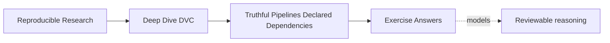
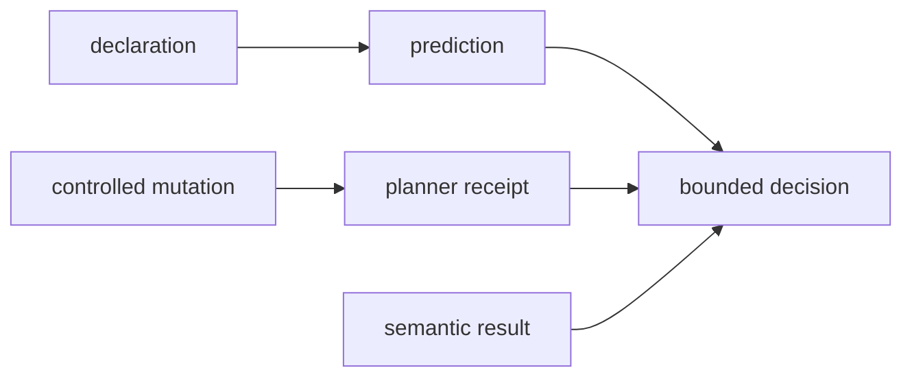
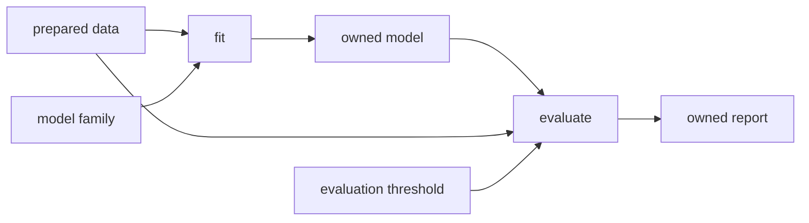

# Exercise Answers

<!-- page-maps:start -->
## Page Maps




<!-- page-maps:end -->

Compare reasoning, not prose. A strong answer connects an actual read or write to a
declaration edge, predicts a planner decision, checks result meaning, and limits its
conclusion to the tested claim.

## Answer: State a falsifiable stage claim

A suitable claim is:

> `declared_input` reads the probe implementation, source data, and
> `policy/threshold.txt`; it owns `results/declared-input.txt`. Changing the policy from
> `10` to `20` should mark the stage stale. Ordinary reproduction should write
> `threshold=20`, and a second unchanged reproduction should skip. This claim would be
> false if the stage skipped the policy mutation, retained `threshold=10`, failed to
> restore its declared output, or executed again without a declared change.

This is falsifiable because it specifies cause, planner response, semantic result, and
convergence. “The stage processes data correctly” specifies none of those.

## Answer: Build an influence ledger

Representative decisive rows are:

```text
stage	kind	name	read_or_written	declared	consequence_if_hidden
declared_input	file	policy/threshold.txt	read	yes	policy change would be missed
hidden_input	file	policy/threshold.txt	read	no	output can retain old threshold
declared_param	parameter	settings.multiplier	read	yes	control change invalidates stage
hidden_param	parameter	settings.multiplier	read	no	score can use old multiplier
undeclared_sidecar	output	results/declared-main.txt	written	yes	loss invalidates stage
undeclared_sidecar	output	results/undeclared-receipt.txt	written	no	loss remains invisible
```

The ledger must be derived from command behavior. Stage names happen to signal the
contrast in this specimen, but they are not evidence.

## Answer: Predict planner decisions

| Change | Declared-graph prediction | Truthful-contract expectation |
| --- | --- | --- |
| policy `10` to `20` | only `declared_input` stale | both readers should become stale |
| multiplier `2` to `3` | only `declared_param` stale | both readers should become stale |
| undeclared receipt removed | no stage stale | owner should become stale if receipt is promised |
| no change after convergence | all stages skip | all stages skip |

For the file mutation, the declared result should adopt `20` and hidden result should
retain `10`. For the parameter mutation, declared score should become `24` and hidden
score should remain `16`.

The split between prediction columns prevents a common error: reporting expected DVC
behavior as if it were acceptable pipeline behavior.

## Answer: Prove the hidden file influence

Observation:

- current policy is `20`;
- status names `declared_input` and omits `hidden_input`;
- ordinary reproduction produces `threshold=20` for the declared stage;
- the hidden result remains `threshold=10`.

Inference: only the declared stage exposes the policy path to DVC, so only that stage is
eligible for policy-driven invalidation. The paired commands read the same changed value;
the declaration edge is the controlled difference.

Rejected alternative: cache behavior does not explain why status already distinguishes
the stages before reproduction.

Decision: reject the hidden stage contract because its result disagrees with the current
policy while the declared graph considers it current.

## Answer: Repair and replay the file contract

The repair adds the real path:

```yaml
deps:
  - policy/threshold.txt
  - scripts/stage_contract_probe.py
```

Exact surrounding paths may differ in the disposable workspace. Acceptance requires:

1. converge with policy `10`;
2. mutate only the policy to `20`;
3. observe `hidden_input` under changed dependencies in status;
4. run ordinary reproduction;
5. observe `threshold=20`;
6. observe a skip on the next unchanged reproduction.

Force is excluded because it does not test whether the repaired declaration makes the
original cause visible. Deleting the output is excluded because it triggers a different
cause.

## Answer: Prove and repair the hidden parameter

The evidence chain is:

```text
baseline control: multiplier=2
changed control:  multiplier=3
declared result:  multiplier=3 score=24
hidden result:    multiplier=2 score=16
```

Status identifies `settings.multiplier` only for the stage that selects the key under
`params`. The hidden score is strong semantic evidence because the old control changes
the calculated result, not merely metadata.

Repair:

```yaml
params:
  - settings.multiplier
```

Declaring the entire parameter file as a generic file dependency would make unrelated
key edits invalidate the stage and would conceal which control supports the result. The
selected key documents intent and narrows invalidation.

Replay acceptance is the same three-part proof: planner sees the key, output adopts
multiplier `3` and score `24`, then the stage converges.

## Answer: Decide output ownership

| Decision question | Governed receipt | Disposable scratch |
| --- | --- | --- |
| does absence invalidate the result? | yes | no |
| may a consumer depend on it? | yes, through a declared edge | no |
| must ordinary repro restore it? | yes | no |
| where should it be written? | declared durable result path | isolated scratch or log path |

For the governed design:

```yaml
outs:
  - results/declared-main.txt
  - results/undeclared-receipt.txt
```

After convergence, deleting the receipt should mark `undeclared_sidecar` stale and
ordinary reproduction should restore the expected receipt value.

For scratch, no review, release, or downstream claim may depend on the file. Operational
use can still justify retention rules, but not pipeline ownership.

## Answer: Diagnose a false rerun

Suppose evaluation actually reads prepared incidents, a model, a policy, its
implementation, and `evaluate.threshold`. A useful matrix is:

| Mutation | Expected result |
| --- | --- |
| policy content changes meaningfully | evaluation stale; report reflects new policy |
| threshold changes | evaluation stale; reported decision counts change |
| unrelated raw archive added | evaluation unchanged |
| notebook prose changes | evaluation unchanged |

A narrowed declaration names the actual files and selected key. It must include imported
helpers that can alter evaluation behavior; reducing reruns by hiding code influence is
not precision.

Positive cases prove that necessary causes remain visible. Negative cases prove that
unrelated changes no longer create noise.

## Answer: Refactor an overloaded boundary

A model with independent provenance supports a split:



Expected propagation:

| Mutation | Fit | Evaluate |
| --- | --- | --- |
| model family | run | run after model changes |
| evaluation threshold | skip | run |
| prepared data | run | run |
| missing model | run | run after restoration |
| missing report | skip | run |

Keeping the stage together is defensible only when the model has no independent review,
reuse, restoration, or failure-recovery meaning. Fewer stages is not itself a reason.

## Answer: Assemble the review decision

A compact decision table is:

| Claim | Planner evidence | Semantic or ownership evidence | Decision |
| --- | --- | --- | --- |
| declared file influence | status names policy dependency | output adopts `20` | accept |
| hidden file influence | status omits stage | output retains `10` | reject |
| declared parameter | status names selected key | score becomes `24` | accept |
| hidden parameter | status omits stage | score remains `16` | reject |
| undeclared receipt ownership | empty status after deletion | receipt remains absent | reject if promised |

A suitable adversarial test removes a real metrics dependency from a publishing stage
while leaving the command read intact. Change one valid metric, capture status, reproduce
normally, and compare the published metric value or manifest identity. Reject the
contract if publishing skips and retains the old meaning.

A bounded conclusion:

> The specimen demonstrates that ordinary DVC planning responds to the tested declared
> file, selected parameter, and output boundaries, while paired omitted boundaries remain
> invisible. Replaying the original mutations demonstrates the proposed repairs. These
> results do not establish declaration completeness for commands not inspected and
> challenged in this packet.

That last sentence is part of the answer. Evidence about a specimen is not a universal
pipeline audit.

## Answer-review checklist

Before accepting your packet, verify that it:

- separates declared-graph predictions from correctness expectations;
- preserves status before reproduction;
- joins planner evidence to semantic or ownership evidence;
- repairs the cause rather than forcing a result;
- replays the exact original mutation;
- checks convergence after repair;
- limits conclusions to inspected commands and tested influences.
