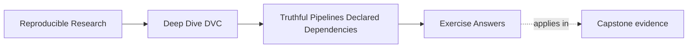
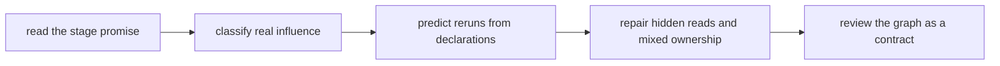

# Exercise Answers


<!-- page-maps:start -->
## Page Maps




<!-- page-maps:end -->

These answers are model explanations, not the only acceptable wording.

## How to use the answer page well

Do not read the model answer first and then reduce the whole module to "put more things
in `deps`."

A better rhythm is:

1. finish the exercise with your own contract packet
2. state the stage promise and the real influences on it
3. compare your reasoning with the model answer
4. revise anywhere you blurred file reads, control values, or ownership boundaries

What matters is whether the reasoning keeps declarations, real command behavior, and lock
evidence connected.

Strong Module 04 answers usually do five things:

- they read a stage declaration as a promise
- they place every influence in the right field for the right reason
- they predict reruns from declared edges instead of intuition
- they treat hidden reads as correctness defects
- they improve graph shape when provenance clarity needs it

The strongest self-study packets also leave behind six concrete artifacts:

- one stage-contract explanation
- one influence-classification table
- one rerun prediction sheet
- one repaired missing-dependency example
- one stage-boundary refactor
- one backward review of a real pipeline

If your answers rely only on "DVC will figure it out," the reasoning is still too thin.

## Answer 1: Read a stage contract

The stage promises:

- run `python -m incident_escalation_capstone.prepare`
- read `data/raw/service_incidents.csv`
- produce `data/prepared/incidents.parquet`

The stage should become stale when:

- the raw incidents file changes
- the command text changes
- the declared output is missing
- the recorded state no longer matches the declared current state

What still needs inspection:

- whether the command reads additional files such as schemas or reference tables
- whether it reads control values that belong in `params`
- whether it writes side artifacts that should be declared or cleaned elsewhere
- whether the repository convention also treats implementation files as explicit
  dependencies

The biggest hidden-risk category is undeclared influence: the command may depend on more
than the contract admits.

## Answer 2: Place each influence

Strong placement:

```yaml
deps:
  - models/escalation-model.json
  - data/prepared/incidents.parquet
  - data/reference/escalation_policy.csv
params:
  - evaluate.threshold
outs:
  - reports/evaluation.json
```

Why:

- file reads belong in `deps`
- reviewed control values belong in `params`
- governed durable products belong in `outs`

The temporary log usually stays outside the governed output contract if it is only
operational residue. It can still matter for debugging or incident review without
becoming a durable downstream artifact.

## Answer 3: Predict reruns

If the raw incidents file changes and `prepare` produces a new prepared output:

- `prepare` should rerun because its declared input changed
- `fit` should rerun because it depends on the prepared output
- `evaluate` should rerun because it depends on prepared data and likely on the updated
  model produced by `fit`

If `fit.model_family` changes:

- `fit` should rerun because its declared parameter changed
- `evaluate` should rerun if it consumes the model from `fit`
- `prepare` should remain stable because none of its declared inputs or controls changed

If `evaluate.threshold` changes:

- `evaluate` should rerun
- `prepare` and `fit` should remain stable

If an unrelated README changes:

- no stage should rerun unless the README was declared as a dependency, which would itself
  need justification

The main lesson is that rerun prediction follows declared edges, not feelings about which
part of the project changed.

## Answer 4: Diagnose stale output risk

Strong review response:

> The evaluation stage likely has a missing dependency. If the command reads
> `data/reference/escalation_policy.csv`, that file belongs in the stage's `deps`. This is
> more dangerous than an extra rerun because DVC can now skip evaluation after a
> meaningful input change, leaving a stale report that appears current. Add the policy CSV
> to `deps`, rerun the stage, and confirm `dvc.lock` now records the policy dependency and
> the updated evaluation evidence.

Concrete repair:

```yaml
deps:
  - models/escalation-model.json
  - data/prepared/incidents.parquet
  - data/reference/escalation_policy.csv
```

What lock evidence should show:

- the repaired dependency appears in the recorded stage state
- the affected output identity is refreshed after rerun

## Answer 5: Refactor a mixed stage

A strong split answer:

```yaml
stages:
  fit:
    cmd: python -m incident_escalation_capstone.fit
    deps:
      - data/prepared/incidents.parquet
    params:
      - fit.model_family
    outs:
      - models/escalation-model.json
  evaluate:
    cmd: python -m incident_escalation_capstone.evaluate
    deps:
      - data/prepared/incidents.parquet
      - models/escalation-model.json
    params:
      - evaluate.threshold
    outs:
      - reports/evaluation.json
```

Why this is often stronger:

- a model control change reruns fitting and then evaluation
- an evaluation threshold change reruns only evaluation
- the model has clear ownership as an intermediate
- review can separate "why did the model move?" from "why did the report move?"

A defensible keep-together answer exists only if the model has no independent reuse or
review value and the combined command truly owns one inseparable result boundary.

## Answer 6: Build a three-stage pipeline

A strong pipeline exposes one meaningful artifact boundary per stage and reaches "data and
pipelines are up to date" on the second run.

Why the second run matters:

- it shows the graph is not hiding undeclared change or unnecessary churn
- it demonstrates that the stage contracts converge when no declared influence changed

The explanation should follow edges from raw data through model output to evaluation
rather than relying on declaration order alone.

## Answer 7: Omit one dependency on purpose

The stage can now appear current while being stale because DVC cannot react to an edge
that was never declared. A successful command after a forced run would not repair the
contract defect; it would only hide it temporarily.

The real repair is:

- declare the omitted dependency honestly
- rerun the affected stage
- confirm the recorded state and output evidence changed accordingly

The main lesson is that hidden reads are provenance failures, not just incomplete YAML.

## Answer 8: Trace one parameter through the lockfile

The lock diff should show:

- the changed parameter value
- the stage invalidated by that parameter
- new hashes or identities for outputs that legitimately changed
- stability for unrelated stages

If too much reruns, the stage boundary may be too coarse or a dependency may be declared
more broadly than the semantic change requires.

## Answer 9: Repair shared-output ownership

Two independent writers to one output directory make cleanup, freshness, and ownership
ambiguous.

Prefer one of these repairs:

- give each producer its own exclusive output directory
- let each stage publish an intermediate artifact and create one aggregation stage with
  sole ownership of the final shared directory

Why this matters:

- DVC can reason more cleanly about what is stale, what should rerun, and what cleanup is
  safe when ownership is exclusive

## Answer 10: Review a pipeline as a contract

A strong review walks backward from trusted outputs and asks, for each stage:

- what product this stage owns
- what real inputs and controls influence that product
- whether the declaration matches observed command behavior
- what stale or partial residue could remain after failure
- what recorded evidence supports the contract

A good closing paragraph names both strengths and fragilities. For example:

> The pipeline is strongest where each stage owns one clear artifact boundary and every
> control is declared explicitly. It remains fragile where implementation reads are not
> reviewed against `deps`, where multiple outputs hide mixed ownership, or where rerun
> expectations depend on human memory rather than on the graph.

## Self-check

If your answers consistently explain:

- what the stage declaration promises
- where each real influence belongs
- how rerun prediction follows declared state
- why stale outputs should be repaired before convenience cleanup
- how graph shape affects provenance clarity

then you are using Module 04 correctly.
