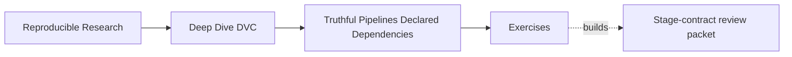
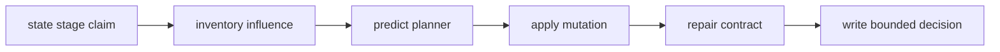
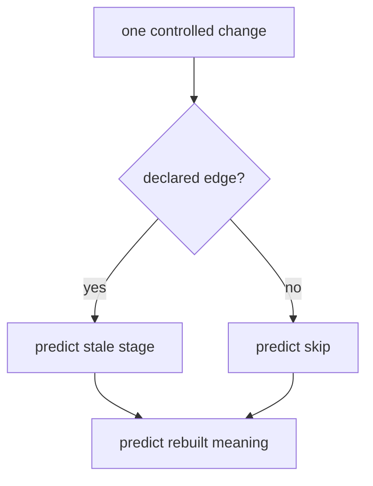

# Exercises

<!-- page-maps:start -->
## Page Maps




<!-- page-maps:end -->

These ten exercises build one review packet from the executable stage-contract specimen.
Do them in order. Each exercise leaves an artifact used later.

Create the learning directory:

```bash
packet=artifacts/learning/deep-dive-dvc/stage-contracts
mkdir -p "$packet"
```

Run the specimen when directed:

```bash
make PROGRAM=reproducible-research/deep-dive-dvc capstone-stage-contract-audit
audit=artifacts/audit/reproducible-research/deep-dive-dvc/stage-contracts
```

Do not edit the generated audit workspace in place. Copy it to a disposable directory
under `artifacts/learning/` for repair experiments.

## Exercise: State a falsifiable stage claim

Read `capstone/repro/stage-contracts/dvc.yaml` and the probe command it invokes. Choose
`declared_input`.

Write `contract-claim.md` containing:

- the durable result it promises;
- every real file read;
- every durable write;
- the mutation expected to make it stale;
- the result value expected after reproduction;
- what an unchanged second reproduction should do.

End with one sentence beginning “This claim would be false if…”.

**Acceptance evidence:** another learner can design a test from your claim without seeing
your intended answer.

## Exercise: Build an influence ledger

For all five specimen stages, inspect command arguments and implementation behavior.
Create `influence-ledger.tsv` with these columns:

```text
stage	kind	name	read_or_written	declared	consequence_if_hidden
```

Use `kind` values `file`, `parameter`, or `output`. Include the policy, multiplier, main
output, and sidecar receipt rows.

**Acceptance evidence:** the ledger reveals the three intentionally hidden contract
surfaces without relying on stage names.

## Exercise: Predict planner decisions

Before reading generated status receipts, create `planner-predictions.tsv`.

Predict the stale stages and result values for:

- policy value `10` changing to `20`;
- multiplier `2` changing to `3`;
- the undeclared receipt disappearing;
- no state changing after a converged run.

Give each prediction a declaration-based reason. Do not use “DVC should know.”



**Acceptance evidence:** your predictions distinguish what the graph will do from what a
truthful graph ought to do.

## Exercise: Prove the hidden file influence

Run the audit. Use only:

- baseline and input-change declarations;
- `input-change-status.stdout.txt`;
- current policy value;
- declared and hidden output values.

Write `file-influence.md` with observation, inference, rejected alternative explanation,
and decision. Explain why the paired stages isolate the missing edge.

**Acceptance evidence:** name `threshold=20` and `threshold=10`, explain why the hidden
result is stale, and avoid blaming cache behavior.

## Exercise: Repair and replay the file contract

Copy the specimen workspace into a disposable learning directory. Add the policy path to
the hidden stage's `deps`.

Establish policy `10`, converge, mutate to `20`, preserve status, reproduce normally,
inspect the result, and reproduce again.

Append to `file-influence.md`:

- repaired declaration;
- status before reproduction;
- semantic value after reproduction;
- convergence result;
- why force was excluded.

**Acceptance evidence:** the original mutation becomes visible for the correct dependency
and the output adopts `threshold=20`.

## Exercise: Prove and repair the hidden parameter

Repeat the investigation for `settings.multiplier`. Create `parameter-influence.md`.

Your evidence must join:

- baseline multiplier `2`;
- changed multiplier `3`;
- status receipt;
- declared score `24`;
- hidden score `16`;
- selected parameter declaration;
- repaired replay and convergence.

Explain why declaring the selected key is clearer than declaring the whole parameter file
as a generic dependency.

**Acceptance evidence:** distinguish “the key exists in `params.yaml`” from “this stage
declares that key.”

## Exercise: Decide output ownership

Inspect `undeclared_sidecar` and the output-loss workspace. Create
`output-ownership.md` with two designs:

| Decision question | Governed receipt | Disposable scratch |
| --- | --- | --- |
| does absence invalidate the result? | | |
| may a consumer depend on it? | | |
| must ordinary repro restore it? | | |
| where should it be written? | | |

Implement the governed design in a disposable copy. Delete the receipt after convergence,
then preserve status and reproduction evidence.

**Acceptance evidence:** justify ownership from the consequence of absence, not the file
name or extension.

## Exercise: Diagnose a false rerun

Design a conservative evaluation stage that declares a broad `data/` dependency. First
list every actual file read, then design a mutation matrix with:

- two changes that must invalidate evaluation;
- two unrelated changes that should not;
- the result assertion for each positive case.

Narrow the dependency without hiding any real read. Save the matrix and rationale in
`invalidation-boundary.md`.

**Acceptance evidence:** positive cases defend completeness and negative cases defend
precision.

## Exercise: Refactor an overloaded boundary

Start from a stage that fits a model and evaluates it in one command. Create
`refactoring-contract.md` that:

- states the claim before refactoring;
- assigns ownership of the model and evaluation report;
- splits or deliberately retains the stage;
- predicts propagation for model-family, evaluation-threshold, and prepared-data changes;
- specifies missing-output restoration checks.

Include before-and-after Mermaid graphs.

**Acceptance evidence:** justify graph shape by ownership and review consequence, not
shorter YAML or stage count.

## Exercise: Assemble the review decision

Create `review-packet.md` that links the previous artifacts and contains:

1. scope of the reviewed specimen;
2. accepted contract claims;
3. rejected hidden file, parameter, and output claims;
4. repair evidence;
5. residual limits;
6. one adversarial mutation for a real capstone stage.

For the adversarial mutation, name the declaration edge removed, retained command
behavior, controlled mutation, planner receipt, semantic assertion, and expected rejection.

End with a decision table:

| Claim | Planner evidence | Semantic or ownership evidence | Decision |
| --- | --- | --- | --- |

**Acceptance evidence:** every decision links declaration, mutation, planner receipt, and
result meaning; no claim extends to stages you did not inspect.

## Completion checklist

Your packet should contain:

```text
contract-claim.md
influence-ledger.tsv
planner-predictions.tsv
file-influence.md
parameter-influence.md
output-ownership.md
invalidation-boundary.md
refactoring-contract.md
review-packet.md
```

You have finished when a missed-class learner can reconstruct not only what DVC did, but
why the graph produced that decision, why the result was acceptable or stale, and how the
repair survived the original challenge.
