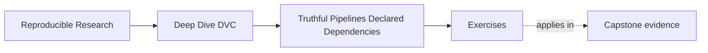
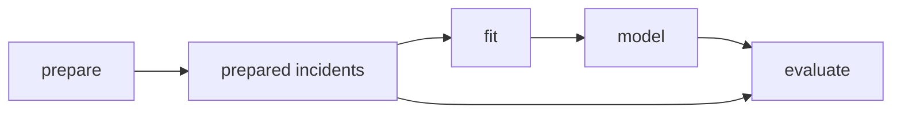

# Exercises


<!-- page-maps:start -->
## Page Maps




<!-- page-maps:end -->

Use these exercises to practice pipeline judgment, not only DVC vocabulary.

The goal of the day is to stop treating `dvc.yaml` as a place where commands happen to be
written down. A stage declaration is a contract. If the contract lies about what the
command reads, controls, or writes, a run can look clean while still being stale.

## How to work through this set

Treat the ten exercises as one full lab day on truthful stage contracts.

Before each answer:

1. name the stage claim under review
2. name the real influences on that claim
3. explain what `dvc repro` can and cannot infer from declarations alone

Do the exercises in order. The day is one progression:

- Exercises 1-3 read stage promises and predict reruns from declared state
- Exercises 4-5 diagnose lying graphs and decide when to refactor stage boundaries
- Exercises 6-8 build and break contracts in a small pipeline
- Exercises 9-10 repair ownership problems and review the full graph as evidence

Keep one contract packet as you go. By the end of the day it should contain:

- one explanation of why a stage declaration is a reviewable promise
- one table that separates file reads, control values, and outputs
- one rerun prediction sheet with reasons
- one repaired missing-dependency example
- one stage-boundary refactor with justification
- one audit worksheet joining DVC status to semantic values
- one repaired output-ownership decision
- one adversarial test design

If those eight artifacts are missing, you are probably still memorizing YAML fields instead
of learning how provenance contracts stay truthful.

## Recommended working layout

If you want one lab tree that can support the whole day, use something like:

```text
module04-lab/
├── artifacts/
├── data/
├── dvc.lock
├── dvc.yaml
├── params.yaml
└── src/
```

Keep one influence-classification table while you work:

| Real influence | Belongs in | Why | What goes wrong if omitted |
| --- | --- | --- | --- |

Also keep one rerun prediction table:

| Change | Stage that should rerun | Why | Stage that should remain stable |
| --- | --- | --- | --- |


Use that route on purpose. It keeps the day centered on truthful influence and ownership
instead of on command syntax alone.

## Exercise 1: Read a stage contract

You see this stage:

```yaml
stages:
  prepare:
    cmd: python -m incident_escalation_capstone.prepare
    deps:
      - data/raw/service_incidents.csv
    outs:
      - data/prepared/incidents.parquet
```

Write a short explanation of:

- what the stage promises
- what changes should make it stale
- what you still need to inspect before trusting the declaration
- one sentence naming the biggest hidden-risk category for this stage

Study note:
The YAML is not the proof. It is the claim that the proof should support.

## Exercise 2: Place each influence

An evaluation command reads:

- `models/escalation-model.json`
- `data/prepared/incidents.parquet`
- `data/reference/escalation_policy.csv`
- a threshold value from `params.yaml`
- a temporary log file written during the run

Decide which items belong in `deps`, which belong in `params`, which belong in `outs`, and
which should probably stay outside the output contract.

Explain your reasoning and include one sentence about why a temporary file can still
matter operationally without becoming a governed output.

Study note:
Module 04 gets clearer once you stop using file paths and control values as if they were
the same kind of influence.

## Exercise 3: Predict reruns

Use this graph:



Predict what should rerun when:

- the raw incidents file changes and `prepare` produces a new prepared output
- `fit.model_family` changes
- `evaluate.threshold` changes
- an unrelated README changes

Explain each prediction in terms of declared dependencies and parameters, not vague ideas
about "the pipeline changed."

Study note:
This is where students learn whether they are reasoning from the graph or from intuition.

## Exercise 4: Diagnose stale output risk

You review this report:

> I changed `data/reference/escalation_policy.csv`, ran `dvc repro`, and evaluation did not
> rerun. But the evaluation command uses that file.

Write a review response that explains:

- the likely graph problem
- why this is more dangerous than an extra rerun
- the concrete declaration repair
- what lock evidence should show after the repair and rerun

Study note:
False reruns waste time. Stale outputs can silently falsify trust.

## Exercise 5: Refactor a mixed stage

A stage currently fits a model and evaluates it in one command:

```yaml
stages:
  train_and_evaluate:
    cmd: python -m incident_escalation_capstone.train_and_evaluate
    deps:
      - data/prepared/incidents.parquet
    params:
      - fit.model_family
      - evaluate.threshold
    outs:
      - models/escalation-model.json
      - reports/evaluation.json
```

Propose either:

- a split into clearer stages, if you think the model is a meaningful intermediate
- a justification for keeping it together, if you think the combined boundary is more honest

Your answer should explain how the refactor affects rerun behavior, review clarity, and
ownership of intermediate artifacts.

Study note:
Good graph shape is not cosmetic. It changes what reviewers can understand and what DVC
can re-run precisely.

## Midday self-check

Before you move into pipeline construction, deliberate omission, and full review, make
sure your packet can already answer these questions clearly:

- what a stage declaration promises
- how file reads, control values, and outputs differ
- why `dvc repro` only reacts to declared influence
- why stale outputs are a correctness problem, not only a convenience issue

If you cannot answer those four questions in plain language, return to Exercises 1-5 and
make the packet more explicit before continuing.

## Exercise 6: Predict the stage-contract audit

Open `capstone/repro/stage-contracts/dvc.yaml`, but do not run the audit yet.

For each stage, record:

- every path or parameter the command really reads;
- every file the command writes;
- which of those influences and products are declared;
- what should happen after the relevant value changes or output disappears.

Then predict all eight decisions in `summary.tsv`:

| Finding | Expected result | Expected decision | Why |
| --- | --- | --- | --- |

Run:

```bash
make PROGRAM=reproducible-research/deep-dive-dvc capstone-stage-contract-audit
```

Compare your predictions with the generated summary. For every mismatch, write whether
you misunderstood command behavior, DVC declaration semantics, or `PASS / REJECT`.

**Acceptance check:** your worksheet must explain why all five stages can converge at
baseline while three contract defects remain.

## Exercise 7: Prove file under-rebuild

Use only these evidence surfaces:

- `evidence/input-change-status.stdout.txt`;
- `workspace/input-change/policy/threshold.txt`;
- `workspace/input-change/results/declared-input.txt`;
- `workspace/input-change/results/hidden-input.txt`;
- the two input-stage declarations.

Write a six-sentence proof:

1. state the mutation;
2. state which stage DVC marked stale;
3. state the declared output value after rebuild;
4. state the hidden output value;
5. identify the single declaration difference;
6. classify the hidden result.

Then repair `hidden_input` in a disposable copy of the specimen by adding the policy path
to `deps`. Repeat the mutation and show that the stage now appears in status and adopts
`threshold=20`.

**Acceptance check:** forcing the stage or deleting its output does not count as a repair.

## Exercise 8: Prove parameter under-rebuild

Repeat the same reasoning for `settings.multiplier`.

Your evidence packet must include:

- the baseline value `2`;
- the changed value `3`;
- the JSON status receipt;
- `multiplier` and `score` from both output files;
- the relevant `params` declaration;
- the lockfile entry for the declared stage.

Answer these questions:

1. Why does placing a key in `params.yaml` not make every stage depend on it?
2. Why is `score=16` stronger stale-output evidence than an unchanged timestamp?
3. What should remain stable when only this key changes?
4. How would a broad `params.yaml` file dependency weaken review precision?

Repair the hidden parameter case by declaring only `settings.multiplier`, then repeat the
mutation.

**Acceptance check:** show both planner evidence and the rebuilt semantic value.

## Exercise 9: Decide whether the receipt is output or scratch

Inspect the `undeclared_sidecar` stage and the output-loss workspace.

Create two defensible designs:

### Governed receipt

Assume `undeclared-receipt.txt` records a row count required before promotion.

- add it to `outs`;
- delete it after a baseline run;
- record the status response;
- reproduce the stage;
- prove the receipt returns.

### Disposable scratch

Assume the receipt is diagnostic residue.

- choose an internal scratch location;
- explain its cleanup policy;
- show that no stage or review contract consumes it;
- explain why its loss should not make the pipeline stale.

End with a decision table:

| Question | Governed receipt | Scratch |
| --- | --- | --- |
| absence changes trust | | |
| belongs in `outs` | | |
| consumer may depend on it | | |
| restoration required | | |

**Acceptance check:** do not decide from the `.txt` extension or the word “receipt.”

## Exercise 10: Design an adversarial contract review

Read `capstone/tests/test_stage_contract_audit.py`. Choose one existing mutation and
explain:

- which truthful claim it attacks;
- why the unmutated audit passes;
- which exact check becomes false;
- why another nearby finding is not enough to catch the defect.

Then design one additional mutation for a real stage in the capstone. Your proposal must
name:

- the declaration field to remove or broaden;
- the command behavior that still depends on it;
- the mutation to apply;
- the DVC receipt to capture;
- the artifact value or absence to inspect;
- the expected accepted or rejected decision.

Finish with a bounded review paragraph that states what the specimen proves and what
still requires repository-specific inspection.

**Acceptance check:** the proposed test must fail when the evidence contract is dishonest,
not merely when a command crashes.

## Mastery check

You have a strong grasp of this module if your answers consistently keep five ideas
visible:

- a stage contract is a reviewable promise, not only a command
- file reads and control values belong in different declaration fields
- `dvc repro` only reacts to declared influence
- stale outputs are a correctness risk, while false reruns are usually visible waste
- graph refactoring is valuable when it preserves or improves the provenance story
- planner receipts and semantic artifact values must be read together
- a repair is demonstrated only when the original mutation becomes visible for the right reason
