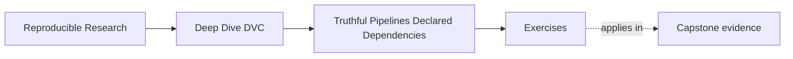
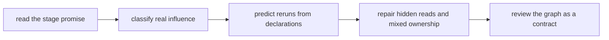
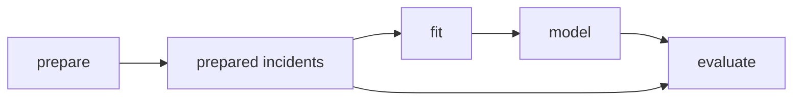

# Exercises


<!-- page-maps:start -->
## Page Maps




<!-- page-maps:end -->

Use these exercises to practice pipeline judgment, not only DVC vocabulary.

The goal of the day is to stop treating `dvc.yaml` as a place where commands happen to be
written down. A stage declaration is a contract. If the contract lies about what the
command reads, controls, or writes, a run can look clean while still being stale.

## How to work through this set

Treat the ten exercises as one full lab day on truthful stage contracts.

Before each answer:

1. name the stage claim under review
2. name the real influences on that claim
3. explain what `dvc repro` can and cannot infer from declarations alone

Do the exercises in order. The day is one progression:

- Exercises 1-3 read stage promises and predict reruns from declared state
- Exercises 4-5 diagnose lying graphs and decide when to refactor stage boundaries
- Exercises 6-8 build and break contracts in a small pipeline
- Exercises 9-10 repair ownership problems and review the full graph as evidence

Keep one contract packet as you go. By the end of the day it should contain:

- one explanation of why a stage declaration is a reviewable promise
- one table that separates file reads, control values, and outputs
- one rerun prediction sheet with reasons
- one repaired missing-dependency example
- one stage-boundary refactor with justification
- one full pipeline review from target outputs backward

If those six artifacts are missing, you are probably still memorizing YAML fields instead
of learning how provenance contracts stay truthful.

## Recommended working layout

If you want one lab tree that can support the whole day, use something like:

```text
module04-lab/
├── artifacts/
├── data/
├── dvc.lock
├── dvc.yaml
├── params.yaml
└── src/
```

Keep one influence-classification table while you work:

| Real influence | Belongs in | Why | What goes wrong if omitted |
| --- | --- | --- | --- |

Also keep one rerun prediction table:

| Change | Stage that should rerun | Why | Stage that should remain stable |
| --- | --- | --- | --- |


Use that route on purpose. It keeps the day centered on truthful influence and ownership
instead of on command syntax alone.

## Exercise 1: Read a stage contract

You see this stage:

```yaml
stages:
  prepare:
    cmd: python -m incident_escalation_capstone.prepare
    deps:
      - data/raw/service_incidents.csv
    outs:
      - data/prepared/incidents.parquet
```

Write a short explanation of:

- what the stage promises
- what changes should make it stale
- what you still need to inspect before trusting the declaration
- one sentence naming the biggest hidden-risk category for this stage

Study note:
The YAML is not the proof. It is the claim that the proof should support.

## Exercise 2: Place each influence

An evaluation command reads:

- `models/escalation-model.json`
- `data/prepared/incidents.parquet`
- `data/reference/escalation_policy.csv`
- a threshold value from `params.yaml`
- a temporary log file written during the run

Decide which items belong in `deps`, which belong in `params`, which belong in `outs`, and
which should probably stay outside the output contract.

Explain your reasoning and include one sentence about why a temporary file can still
matter operationally without becoming a governed output.

Study note:
Module 04 gets clearer once you stop using file paths and control values as if they were
the same kind of influence.

## Exercise 3: Predict reruns

Use this graph:



Predict what should rerun when:

- the raw incidents file changes and `prepare` produces a new prepared output
- `fit.model_family` changes
- `evaluate.threshold` changes
- an unrelated README changes

Explain each prediction in terms of declared dependencies and parameters, not vague ideas
about "the pipeline changed."

Study note:
This is where students learn whether they are reasoning from the graph or from intuition.

## Exercise 4: Diagnose stale output risk

You review this report:

> I changed `data/reference/escalation_policy.csv`, ran `dvc repro`, and evaluation did not
> rerun. But the evaluation command uses that file.

Write a review response that explains:

- the likely graph problem
- why this is more dangerous than an extra rerun
- the concrete declaration repair
- what lock evidence should show after the repair and rerun

Study note:
False reruns waste time. Stale outputs can silently falsify trust.

## Exercise 5: Refactor a mixed stage

A stage currently fits a model and evaluates it in one command:

```yaml
stages:
  train_and_evaluate:
    cmd: python -m incident_escalation_capstone.train_and_evaluate
    deps:
      - data/prepared/incidents.parquet
    params:
      - fit.model_family
      - evaluate.threshold
    outs:
      - models/escalation-model.json
      - reports/evaluation.json
```

Propose either:

- a split into clearer stages, if you think the model is a meaningful intermediate
- a justification for keeping it together, if you think the combined boundary is more honest

Your answer should explain how the refactor affects rerun behavior, review clarity, and
ownership of intermediate artifacts.

Study note:
Good graph shape is not cosmetic. It changes what reviewers can understand and what DVC
can re-run precisely.

## Midday self-check

Before you move into pipeline construction, deliberate omission, and full review, make
sure your packet can already answer these questions clearly:

- what a stage declaration promises
- how file reads, control values, and outputs differ
- why `dvc repro` only reacts to declared influence
- why stale outputs are a correctness problem, not only a convenience issue

If you cannot answer those four questions in plain language, return to Exercises 1-5 and
make the packet more explicit before continuing.

## Exercise 6: Build a three-stage pipeline

Create prepare, train, and evaluate stages with explicit dependencies, parameters, and
outputs. Run twice and use DVC evidence to show that the second run converges.

What to hand in:

- the three stage declarations
- the first-run evidence
- the second-run convergence evidence
- one sentence explaining why the second run staying still is meaningful

Study note:
A converged second run is one of the simplest demonstrations that the declared graph is
not thrashing needlessly.

## Exercise 7: Omit one dependency on purpose

Remove a real dependency from one stage, change that input, and observe the plan. Explain:

- why the stage can now look current while being stale
- why a successful command cannot compensate for a lying graph
- how you repaired the declaration
- what evidence changed after the repair

Study note:
This is the exercise that teaches why hidden reads are more serious than untidy YAML.

## Exercise 8: Trace one parameter through the lockfile

Change one tracked parameter and inspect the resulting `dvc.lock` changes. Identify:

- the stage invalidated
- the output identities replaced
- any stage that correctly remained unchanged
- one sign that your stage boundary may be too coarse if too much reruns

Study note:
The lockfile is where parameter influence stops being theory and becomes recorded state.

## Exercise 9: Repair shared-output ownership

Construct two stages that write into the same output directory. Redesign them so each
producer has exclusive ownership or a single aggregation stage publishes the shared
artifact.

What to hand in:

- the ambiguous original shape
- the repaired ownership shape
- one sentence explaining why ownership ambiguity harms cleanup and freshness reasoning

Study note:
Shared-output ownership often looks convenient until teams need trustworthy reruns and
cleanup behavior.

## Exercise 10: Review a pipeline as a contract

Review a real `dvc.yaml` from target outputs backward. For every stage, record:

- its purpose
- its inputs
- its controls
- its outputs
- its failure residue
- the evidence that its declared graph matches actual reads and writes

End with one paragraph explaining where the pipeline is strongest and where its contract
is still fragile.

Study note:
This final exercise matters because real review starts from the output a consumer trusts
and walks backward through the contract that produced it.

## Mastery check

You have a strong grasp of this module if your answers consistently keep five ideas
visible:

- a stage contract is a reviewable promise, not only a command
- file reads and control values belong in different declaration fields
- `dvc repro` only reacts to declared influence
- stale outputs are a correctness risk, while false reruns are usually visible waste
- graph refactoring is valuable when it preserves or improves the provenance story
