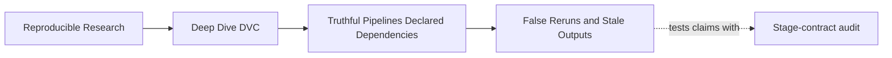
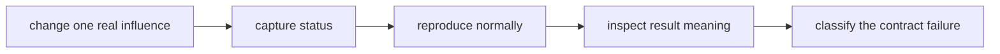
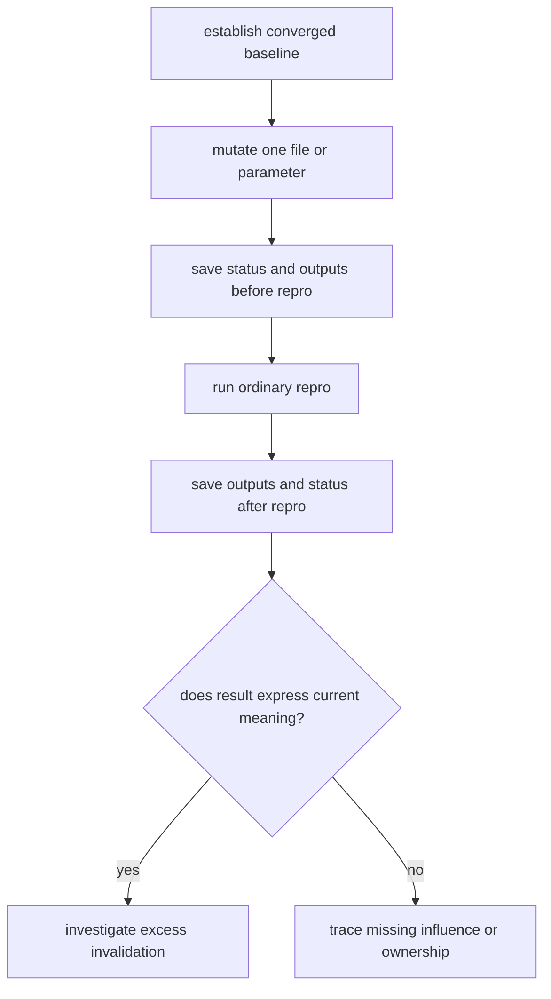
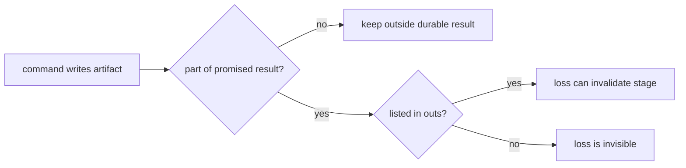

# False Reruns and Stale Outputs

<!-- page-maps:start -->
## Page Maps




<!-- page-maps:end -->

A surprising rerun and a surprising skip are not symmetric problems.

- A **false rerun** spends compute even though the result's meaning would not change.
- A **stale output** preserves an old result after a real influence changes.
- An **orphaned output** disappears or drifts because no stage owns it.

All three reveal a mismatch between command behavior and declared contract. Silent
staleness is the first correctness risk to remove; unnecessary reruns are narrowed only
after completeness is demonstrated.

## Start from consequences, not symptoms

Imagine that `policy/threshold.txt` changes from `10` to `20`.

| Observation after ordinary `dvc repro` | Classification | Consequence |
| --- | --- | --- |
| stage runs and output adopts `20` | expected invalidation | current result |
| stage skips and output remains `10` | stale output | wrong result can look current |
| unrelated stage runs but meaning is unchanged | false rerun | wasted time and review noise |
| undeclared receipt was deleted and stays absent | orphaned output | incomplete deliverable |

“It ran” is therefore not a verdict. “It skipped” is not one either. The verdict depends
on whether the result should have changed and whether every promised artifact exists.

## Use one controlled mutation

Do not begin by deleting caches, forcing stages, or changing several inputs. Preserve the
failure and vary one real influence.



Run the module specimen:

```bash
make PROGRAM=reproducible-research/deep-dive-dvc capstone-stage-contract-audit
audit=artifacts/audit/reproducible-research/deep-dive-dvc/stage-contracts
```

The audit holds commands and input values constant while changing declaration edges.
That paired design rules out “the commands behaved differently” as an explanation.

## Read a stale-output case

Both `declared_input` and `hidden_input` read `policy/threshold.txt`. Only the first lists
the path under `deps`.

After the file changes:

```text
status: declared_input is stale
status: hidden_input is absent
declared output after repro: threshold=20
hidden output after repro:   threshold=10
```

The absence of `hidden_input` from status is not a DVC detection bug. DVC faithfully
compared the graph it was given. The declaration is false because the command reads more
than the graph declares.

The same contrast appears for parameters. Both commands read `settings.multiplier`, but
only the declared stage selects that key:

```text
declared parameter output: multiplier=3 score=24
hidden parameter output:   multiplier=2 score=16
```

This evidence supports a precise claim: ordinary reproduction cannot refresh the hidden
result when that hidden influence changes.

## Diagnose false reruns without weakening truth

Suppose evaluation declares an entire source and data tree:

```yaml
stages:
  evaluate:
    cmd: python -m incident_escalation.evaluate
    deps:
      - data/
      - src/
      - models/escalation-model.json
    params:
      - evaluate.threshold
    outs:
      - reports/evaluation.json
```

A change to an unrelated plotting module now invalidates evaluation. That is evidence of
a broad boundary, not permission to remove declarations casually.

Use this order:

1. Trace every file opened and control value read by the command.
2. Establish a complete, conservative declaration.
3. Mutate each real influence and prove that the stage becomes stale.
4. Mutate plausible non-influences and identify unwanted reruns.
5. Narrow only those edges for which non-influence is demonstrated.

A safer contract might name the prepared data, model, evaluation implementation, and
threshold key. It should not omit shared helpers that the command actually imports merely
to make status quieter.

## Separate planner correctness from command correctness

Four outcomes are possible:

| Planner decision | Result meaning | Interpretation |
| --- | --- | --- |
| run | current | declared invalidation and execution agree |
| run | stale | command ignored or mishandled the changed influence |
| skip | current | change was irrelevant, or result matched by coincidence |
| skip | stale | declaration omitted a real influence |

The second row matters: a correct rerun decision cannot prove that application code used
the input correctly. The third also matters: one unchanged result cannot prove an input
is irrelevant. Choose a mutation expected to alter a meaningful result.

## Detect output-ownership failures

The specimen's `undeclared_sidecar` command writes a main file and a receipt, but only
declares the main file under `outs`.

Delete the receipt, then inspect ordinary status and reproduction:

```text
status: {}
repro: stage skipped
receipt: still absent
```

The graph has no promise to restore the receipt. If the receipt is part of the
deliverable, the repair is to declare it as an output or redesign the command so it is no
longer promised.



An existing artifact is not necessarily an owned artifact.

## Avoid repairs that erase the evidence

| Tempting action | Why it is incomplete |
| --- | --- |
| `dvc repro --force hidden_input` | refreshes once but leaves future changes invisible |
| delete the declared output | triggers work through output loss, not the missing cause |
| declare the repository root | hides the causal boundary and creates unrelated reruns |
| clear the cache | changes execution mechanics without repairing the graph |
| accept empty status | proves only agreement over declared state |

Use force only as a diagnostic contrast: if forcing the stage changes its output, you
have evidence that an invisible influence matters. Then repair the declaration and repeat
the original mutation under ordinary reproduction.

## Write an incident receipt

Before repair, record:

```text
real influence:
controlled mutation:
expected semantic change:
status before repro:
stages executed:
result after repro:
failure class:
declaration or command repair:
same mutation after repair:
second repro:
```

The final two fields matter. The same mutation must become visible for the intended
reason, and a second unchanged reproduction must converge.

## Review checkpoint

You can diagnose this boundary when you can:

- classify false rerun, stale output, and orphaned output by consequence;
- preserve pre-reproduction evidence;
- use a one-variable mutation and semantic result assertion;
- explain all four planner/result outcomes;
- narrow broad declarations only after proving completeness;
- reject force, deletion, and cache clearing as contract repairs;
- repeat the original mutation to prove the repaired edge.

The durable rule is:

> Status tells you what the declared graph noticed. Result inspection tells you whether
> that declaration was sufficient.
