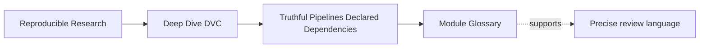
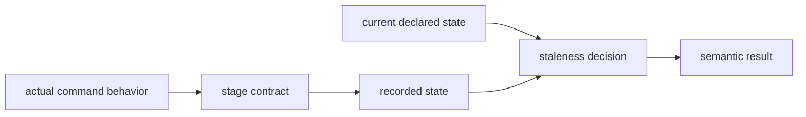
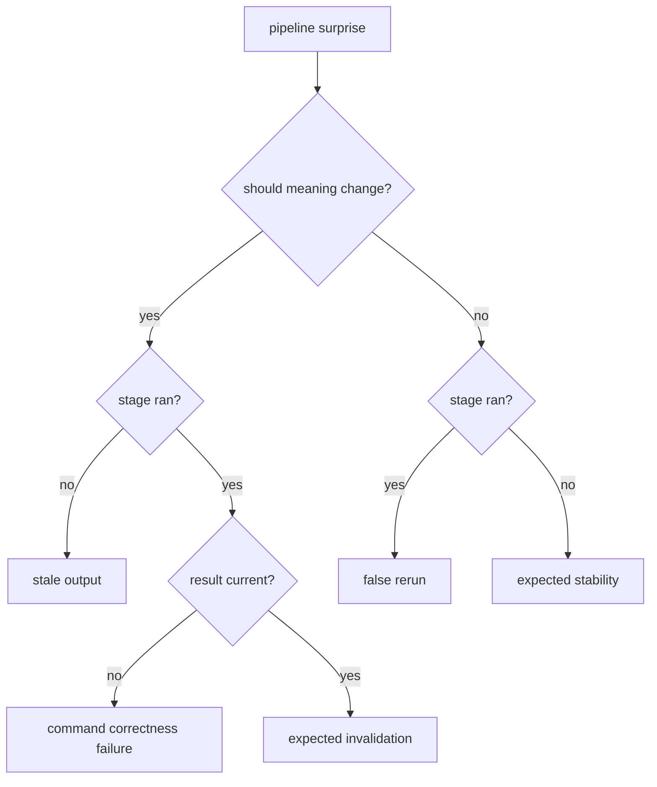

# Module Glossary

<!-- page-maps:start -->
## Page Maps

<!-- page-maps:end -->

Use this glossary when two nearby ideas begin to blur. The distinctions matter because a
stage may be current according to declared state while its result is stale according to
real, hidden influence.

## Declaration terms

| Term | Meaning | Boundary to remember |
| --- | --- | --- |
| stage contract | Reviewable claim that a command uses declared influences to produce and own declared results. | YAML states the claim; it does not prove completeness. |
| declared dependency | File or directory listed in `deps` because command behavior depends on its content. | Mere proximity to the command is not enough; real influence is. |
| declared parameter | Selected control listed in `params` so intentional control changes participate in invalidation and review. | Presence in `params.yaml` alone creates no stage edge. |
| declared output | Durable artifact listed in `outs` because the stage owns and must restore it. | A file the command happens to write is not automatically governed. |
| command contract | The behavior implied by command text and arguments. | Command changes can invalidate a stage, but command text does not reveal all runtime reads. |
| truthful stage | Stage whose declared dependencies, controls, outputs, and ownership match actual behavior closely enough for tested claims. | Truthfulness is established per inspected boundary, not by a tidy graph. |
| hidden influence | Real file, control, runtime fact, or upstream result that affects meaning without a reviewable edge. | Hidden influence can leave ordinary status empty. |

## Planner and evidence terms

| Term | Meaning | What it does not prove |
| --- | --- | --- |
| recorded state | Declared dependency identities, selected values, command, and output identities retained after execution, commonly in `dvc.lock`. | That undeclared behavior was captured. |
| staleness | Difference between current declared state and recorded declared state that gives DVC a reason to act. | That every semantically relevant change is visible. |
| status receipt | Preserved output from `dvc status`, preferably before reproduction. | That a stale stage will compute a correct result. |
| reproduction receipt | Record of stages run or skipped by ordinary `dvc repro`. | That a skipped result is semantically current. |
| convergence | A second unchanged reproduction has no work to execute. | Declaration completeness or scientific validity. |
| semantic freshness | Result meaning agrees with current real inputs and controls. | It cannot be inferred from empty status alone. |
| semantic assertion | Domain-level check on a value, row, statistic, or decision expected after a controlled mutation. | File existence or timestamp is usually too weak. |
| causal contrast | Paired case holding command and data behavior constant while varying one declaration edge. | It supports the tested edge, not every stage contract. |
| controlled mutation | Deliberate one-variable change used to challenge a contract. | Several simultaneous edits make attribution ambiguous. |
| repair replay | Repeating the original mutation after a declaration or command repair. | A forced fresh run is not a replay of normal planning. |

## Failure terms

| Term | Meaning | Primary consequence |
| --- | --- | --- |
| stale output | Result should change after a real influence changes, but ordinary planning skips it. | Hidden correctness risk. |
| false rerun | Stage runs even though the meaningful result should not change. | Visible compute and review cost. |
| orphaned output | Meaningful product lacks stage ownership, so loss or drift is not restored through its producer. | Incomplete or ambiguous deliverable. |
| command correctness failure | Planner runs the right stage, but command fails to adopt the changed influence correctly. | Current declaration with wrong application behavior. |
| broad dependency | Declaration includes unrelated state and creates excess invalidation. | Noise; narrow only after proving actual read completeness. |
| forced freshness | Current result obtained through `--force`, output deletion, or another bypass. | Does not repair future cause detection. |

## Ownership and refactoring terms

| Term | Meaning | Review test |
| --- | --- | --- |
| output ownership | One stage is responsible for producing and restoring a durable artifact. | Delete it: does the intended owner become stale and restore it? |
| producer | Stage that declares an artifact under `outs`. | There should be one unambiguous owner. |
| consumer | Stage that reads a produced artifact under `deps`. | Every actual durable consumer needs an edge. |
| shared intermediate | One owned artifact used by several consumers. | One producer, multiple declared consumer edges. |
| sidecar | Additional file written beside a main result. | Decide by consequence whether it is governed output or scratch. |
| scratch artifact | Execution residue with no downstream, release, or review claim. | Its loss should not invalidate the scientific result. |
| stage split | One command boundary becomes several stages with an owned intermediate. | Does the intermediate have independent review, reuse, or recovery meaning? |
| stage merge | Several boundaries become one atomic result boundary. | Is the removed intermediate truly meaningless outside the combined run? |
| graph refactoring | Change to stages, paths, or edges intended to preserve or clarify causal claims. | Challenge positive invalidation, negative stability, restoration, and convergence. |
| mutation matrix | Table of changes that should and should not invalidate a stage. | Positive rows defend completeness; negative rows defend precision. |

## Distinctions worth rehearsing

| Do not confuse | With | Deciding question |
| --- | --- | --- |
| declared current | semantically current | did every real influence participate in the decision? |
| parameter file present | parameter key declared | does this stage select the control under `params`? |
| file exists | output is owned | will ordinary reproduction restore its loss? |
| stage ran | result is correct | did a semantic assertion adopt the changed meaning? |
| stage skipped | stage is truthful | was every relevant influence declared? |
| audit finding passed | pipeline behavior accepted | is the finding's decision `ACCEPT` or `REJECT`? |
| forced refresh | contract repair | will the original mutation trigger ordinary reproduction next time? |
| more stages | clearer provenance | do the boundaries represent meaningful ownership and review? |

## Review vocabulary in one sentence

A precise review statement names the actual influence, declaration edge, controlled
mutation, status and reproduction receipts, semantic or ownership assertion, repair
replay, convergence result, and evidence limit.
