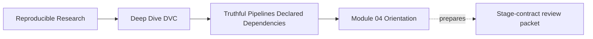
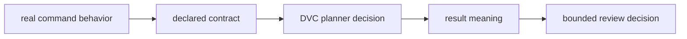
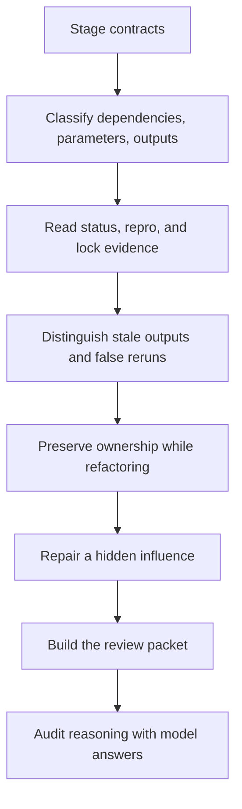

# Module 04: Truthful Pipelines and Declared Dependencies

<!-- page-maps:start -->
## Page Maps




<!-- page-maps:end -->

A DVC pipeline is trustworthy only when its declared graph matches the work commands
actually perform. A tidy `dvc.yaml` can still hide a file read, control value, or
meaningful output. In that case DVC may correctly follow the declaration and still leave
a scientifically stale result.

This module teaches you to review the chain:

> real reads, controls, and writes → declaration → planner decision → result meaning

The learning target is not “write valid stage YAML.” It is “demonstrate that ordinary
reproduction responds to the causes that matter and restores every promised result.”

## Prerequisites and time

Before starting, you should be able to:

- distinguish Git-tracked metadata from DVC-tracked data;
- interpret a content identity from Module 02;
- run commands in the course environment from Module 03;
- read YAML and basic JSON.

Allow one serious session:

| Work | Suggested time |
| --- | ---: |
| core lessons | 75 minutes |
| worked investigation | 35 minutes |
| exercises and evidence packet | 90–150 minutes |
| answer review | 30 minutes |

If you missed class, follow the route below. All commands, evidence paths, expected
contrasts, and answer reasoning are included.

## What you will produce

By the end, your learning directory will contain a review packet with:

- a falsifiable stage claim;
- an actual-read and actual-write ledger;
- planner predictions;
- hidden file and parameter proofs;
- an output-ownership decision;
- a false-rerun mutation matrix;
- a refactoring contract;
- a bounded review decision.

These artifacts matter because a correct-looking final `dvc.yaml` does not preserve how
you established its truth.

## First-pass study route



Read in that order. Do not begin with the answers or compact audit verdict. Prediction
before observation is part of the method.

## Module map

| Page | Question it answers |
| --- | --- |
| [Stage Contracts and Declared Truth](stage-contracts-and-declared-truth.md) | what exactly does a stage promise? |
| [Dependency, Parameter, and Output Boundaries](dependency-parameter-output-boundaries.md) | where does each real influence or product belong? |
| [DVC Repro, Staleness, and Lock Evidence](dvc-repro-staleness-and-lock-evidence.md) | what can status, repro, and lock evidence each establish? |
| [False Reruns and Stale Outputs](false-reruns-and-stale-outputs.md) | is the surprise inefficiency, stale meaning, or lost ownership? |
| [Safe Pipeline Refactoring and Shared Outputs](safe-pipeline-refactoring-and-shared-outputs.md) | how can graph shape change without losing causal truth? |
| [Worked Investigation: Repairing Hidden Stage Influences](worked-investigation-repairing-hidden-stage-influences.md) | how do you predict, observe, repair, and replay a defect? |
| [Exercises](exercises.md) | how do you build a complete review packet yourself? |
| [Exercise Answers](exercise-answers.md) | what reasoning and evidence make each decision defensible? |
| [Glossary](glossary.md) | which nearby terms must remain distinct? |

## Executable specimen

The module uses a five-stage specimen with paired declared and hidden influences:

```bash
make PROGRAM=reproducible-research/deep-dive-dvc capstone-stage-contract-audit
```

Generated evidence appears under:

```text
artifacts/audit/reproducible-research/deep-dive-dvc/stage-contracts/
```

The specimen demonstrates:

| Challenge | Truthful contrast | Defect contrast |
| --- | --- | --- |
| file changes `10` to `20` | declared stage reruns and adopts `20` | hidden stage skips and retains `10` |
| parameter changes `2` to `3` | declared stage reruns and score becomes `24` | hidden stage skips and score remains `16` |
| receipt disappears | declared ownership would trigger restoration | undeclared receipt stays absent |

Some audit findings intentionally report `PASS` with decision `REJECT`: the checker
successfully reproduced a contract defect. Always read result and decision together.

## Evidence-reading order

Use this order for any stage investigation:

1. inspect command behavior;
2. inspect `dvc.yaml`;
3. predict from declared edges;
4. apply one controlled mutation;
5. save `dvc status --json`;
6. run ordinary `dvc repro`;
7. inspect semantic result values or required artifact presence;
8. confirm a second reproduction converges;
9. state what the evidence does and does not establish.

Do not force the stage during acceptance. Force bypasses the planner decision under test.

## Choose a route when returning

| Symptom | Return to |
| --- | --- |
| unsure whether a value is a dependency or parameter | boundary lesson |
| empty status but result seems old | staleness lesson and worked investigation |
| too many stages rerun | false-rerun diagnosis, then mutation matrix |
| a generated artifact disappeared without response | output ownership |
| splitting or moving stages | safe refactoring |
| review note says only “repro passed” | exercises and answer reasoning |

## Completion standard

You are ready for Module 05 when you can:

- translate actual command behavior into a stage contract;
- predict staleness without running DVC first;
- preserve planner evidence before reproduction;
- join planner behavior to semantic output;
- distinguish a one-time refresh from a durable repair;
- assign one owner to every durable artifact;
- replay the original mutation and demonstrate convergence;
- write a conclusion no broader than the tested commands and influences.

The module's governing rule is:

> A declaration is a claim. A controlled mutation, planner receipt, semantic assertion,
> and convergence check turn that claim into reviewable evidence.
