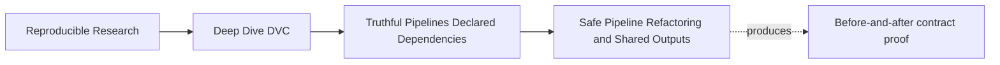
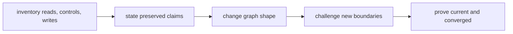
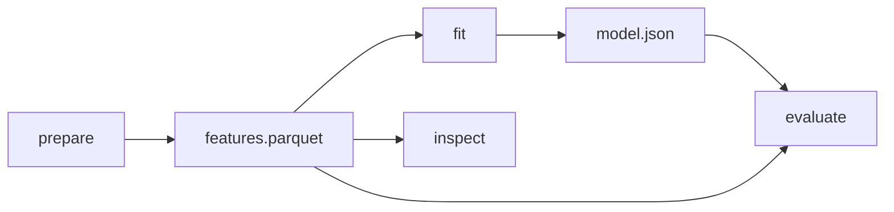
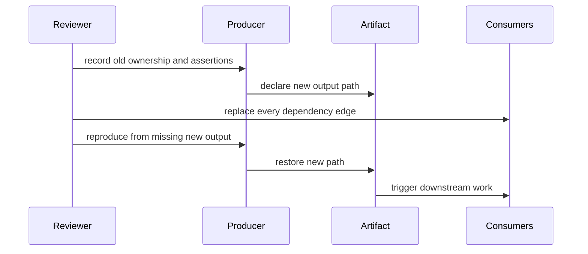

# Safe Pipeline Refactoring and Shared Outputs

<!-- page-maps:start -->
## Page Maps




<!-- page-maps:end -->

Refactoring a pipeline changes more than its diagram. Moving an output, splitting a
stage, merging commands, or narrowing a dependency can change:

- which mutation triggers work;
- which stage owns an artifact;
- how invalidation propagates;
- which evidence a reviewer can inspect;
- whether an interrupted run leaves a coherent result.

A safe refactor makes its preserved and changed contracts explicit before editing
`dvc.yaml`.

## Inventory the behavioral contract

For every affected stage, write an influence ledger:

| Contract surface | Questions |
| --- | --- |
| command | which program and arguments define behavior? |
| file reads | which content can change the result? |
| controls | which selected parameter keys affect behavior? |
| outputs | which durable artifacts must the stage restore? |
| consumers | which later stages read each output? |
| semantic assertion | what result value proves current meaning? |

Inspect application code, not just the existing declaration. A refactor that faithfully
copies an already incomplete `deps` list preserves the defect.

## Give every durable artifact one owner

A shared intermediate is produced once and consumed by several stages:



The producer declares `features.parquet` in `outs`; every consumer declares it in
`deps`. That creates one producer edge and several consumer edges.

```yaml
stages:
  prepare:
    cmd: python -m incident_escalation.prepare
    deps:
      - data/raw/incidents.csv
      - src/incident_escalation/prepare.py
    outs:
      - data/prepared/features.parquet

  fit:
    cmd: python -m incident_escalation.fit
    deps:
      - data/prepared/features.parquet
      - src/incident_escalation/fit.py
    outs:
      - models/escalation-model.json

  inspect:
    cmd: python -m incident_escalation.inspect
    deps:
      - data/prepared/features.parquet
      - src/incident_escalation/inspect.py
    outs:
      - reports/inspection.json
```

Do not let two stages write the same durable path. Shared consumption is normal; shared
ownership makes restoration and provenance ambiguous.

## Decide whether outputs belong together

A stage may own several outputs when they form one atomic scientific claim.

For example, an evaluation command may produce:

- `evaluation.json`;
- `error-slices.csv`;
- `calibration.svg`.

Keep them together when they share inputs and controls, are refreshed as one evaluation,
and failure should invalidate the set. Split them when one is optional debugging output,
has different inputs, changes on a different cadence, or has an independent consumer and
review meaning.

Use a consequence test:

| Question | Keep together when… | Split when… |
| --- | --- | --- |
| invalidation | every influence applies to every output | influences differ |
| failure | partial result is not useful | one result can succeed independently |
| review | artifacts support one claim | artifacts support distinct claims |
| reuse | consumers need the set | consumers need independent products |

The goal is not maximum stage count. It is honest ownership.

## Split an overloaded stage

Suppose one stage fits and evaluates:

```yaml
stages:
  train_and_evaluate:
    cmd: python -m incident_escalation.train_and_evaluate
    deps:
      - data/prepared/features.parquet
    params:
      - fit.model_family
      - evaluate.threshold
    outs:
      - models/escalation-model.json
      - reports/evaluation.json
```

This boundary makes an evaluation threshold change rerun model fitting. More importantly,
it hides the model as a meaningful handoff.

Split it only after defining the new intermediate:

```yaml
stages:
  fit:
    cmd: python -m incident_escalation.fit
    deps:
      - data/prepared/features.parquet
    params:
      - fit.model_family
    outs:
      - models/escalation-model.json

  evaluate:
    cmd: python -m incident_escalation.evaluate
    deps:
      - data/prepared/features.parquet
      - models/escalation-model.json
    params:
      - evaluate.threshold
    outs:
      - reports/evaluation.json
```

Now test three mutations:

1. `fit.model_family` reruns `fit`, then `evaluate` through the model.
2. `evaluate.threshold` reruns only `evaluate`.
3. prepared features rerun both consumers.

Those are contract assertions, not merely performance expectations.

## Merge only meaningless boundaries

Two adjacent stages may be better as one when their intermediate:

- has no independent interpretation;
- is never reviewed or reused;
- exists only as scratch;
- cannot be restored meaningfully on its own;
- makes failure recovery harder rather than clearer.

Before merging, list every downstream consumer. If another stage reads the intermediate,
removing it changes a public pipeline boundary. Either preserve a meaningful replacement
or update and test every consumer.

## Move or rename an output safely

An output path participates in producer ownership and every consumer dependency. Treat a
move as a graph migration:



Check that:

- the old path is no longer declared;
- no command still reads or writes it;
- the new path is owned by exactly one stage;
- all consumers declare the new path;
- deleting the new artifact marks its owner stale;
- ordinary reproduction rebuilds it and its consumers.

A successful run from an already populated workspace is too weak. Test restoration from
the missing new output.

## Narrow dependencies with a mutation matrix

Replacing `data/` with one file may remove false reruns, but it can also hide a lookup
table or schema read. Record both positive and negative cases:

| Mutation | Expected invalidation |
| --- | --- |
| prepared features change | stage stale |
| declared source module changes | stage stale |
| selected control changes | stage stale |
| unrelated notebook changes | stage unchanged |
| unused raw archive changes | stage unchanged |

Positive cases defend completeness. Negative cases defend precision. A refactor needs
both.

## Preserve a before-and-after proof

Save:

```text
graph-before.txt
declaration-before.yaml
contract-ledger.md
declaration-after.yaml
graph-after.txt
mutation-matrix.tsv
reproduction-receipts/
review-decision.md
```

The decision should distinguish:

- preserved claims;
- deliberately changed claims;
- removed artifacts;
- new ownership;
- acceptance evidence.

Do not claim lock-file similarity proves behavioral equivalence. A legitimate split or
path move changes lock structure. Prove the intended causal behavior instead.

## Review checkpoint

You can refactor safely when you can:

- inventory actual reads, controls, writes, and consumers;
- assign every durable artifact one producer;
- justify multi-output cohesion by consequence;
- test split-stage propagation with targeted mutations;
- merge only boundaries without independent meaning;
- migrate every edge when moving an output;
- demonstrate positive and negative invalidation cases;
- prove restoration and convergence after the new graph is in place.

The durable question is:

> Does the new graph preserve every intended scientific claim while making ownership and
> invalidation easier to inspect?
