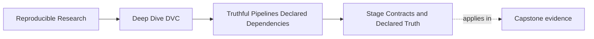
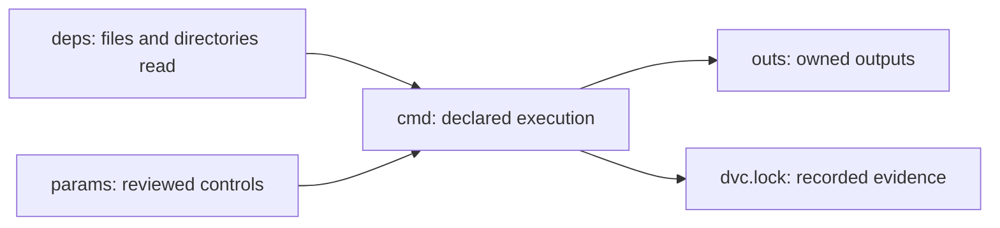
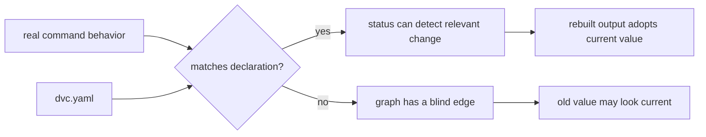

# Stage Contracts and Declared Truth


<!-- page-maps:start -->
## Page Maps




<!-- page-maps:end -->

A DVC stage is not just a convenient command wrapper.

It is a claim:

> When these declared inputs and controls have these recorded values, this command produces
> these declared outputs.

That claim is the smallest unit of pipeline truth in this module. If the stage claim is
honest, a reviewer can explain why the output exists. If the stage claim is incomplete,
the rest of the pipeline may look organized while still hiding the real cause of a result.

## The stage as a promise

A minimal stage has four parts:

```yaml
stages:
  prepare:
    cmd: python -m incident_escalation_capstone.prepare
    deps:
      - data/raw/service_incidents.csv
      - src/incident_escalation_capstone/prepare.py
    params:
      - prepare.minimum_severity
      - prepare.include_weekends
    outs:
      - data/prepared/incidents.parquet
```

Read that as a sentence:

> Run this command, using these files and these parameter values, and expect this output.

That sentence is more useful than "run the prepare script." It tells a future reviewer
what should cause a rerun and what should not.



The diagram is deliberately small. Do not start Module 04 by admiring a whole DAG. Start
with one stage and ask whether the declared story matches reality.

## What DVC can and cannot infer

DVC is strict about declared state, but it is not psychic.

If the command reads `data/raw/service_incidents.csv` and that file is in `deps`, DVC can
hash it and compare it with `dvc.lock`.

If the command reads `data/reference/team_roster.csv` but that file is missing from
`deps`, DVC has no reason to know it matters.

If the command uses `prepare.minimum_severity` from `params.yaml` and the key is listed
under `params`, DVC can notice meaningful control changes.

If the command hard-codes `minimum_severity = 3` inside Python, the control value becomes
code review archaeology instead of a pipeline control surface.

A truthful stage is not one that eliminates all judgment. It is one that puts the
important judgment where reviewers can see it.

## Put the promise under pressure

Reading a stage is necessary, but it is not enough. A deceptive stage can look plausible,
run successfully, create its output, and converge on a second run.

Use the executable audit from the repository root:

```bash
make PROGRAM=reproducible-research/deep-dive-dvc capstone-stage-contract-audit
```

Before opening `summary.tsv`, predict the outcome of three changes:

| Change | Declared case | Hidden case |
| --- | --- | --- |
| policy file changes from `10` to `20` | should appear in DVC status | should look current |
| parameter changes from `2` to `3` | should appear in DVC status | should look current |
| meaningful sidecar is deleted | not applicable | stage should still look current |

The hidden cases are expected to look current because the specimen intentionally withholds
the edge from DVC. “Current” describes agreement with the declared contract, not agreement
with every fact the command used.

### Read the file-influence evidence

The input-change workspace begins with two outputs:

```text
declared-input.txt  threshold=10
hidden-input.txt    threshold=10
```

After the policy file changes, `dvc status --json` names only `declared_input`. The audit
then reproduces that stage. The resulting values are:

```text
declared-input.txt  threshold=20
hidden-input.txt    threshold=10
```

This is the key reasoning move:

1. The policy value is now `20`.
2. The declared output records `20`.
3. The hidden output records `10`.
4. DVC reports no reason to rebuild the hidden stage.
5. Therefore the hidden output is semantically stale even though the declared graph says
   it is current.

Do not replace that argument with “the file is old.” File age is not the claim. The
artifact’s stored meaning disagrees with the current policy.

### Read the parameter evidence

The parameter case makes a different omission. Both commands read
`settings.multiplier`, but only one stage lists the key under `params`.

After the value changes from `2` to `3`, the rebuilt declared output says:

```text
multiplier=3
score=24
```

The hidden output still says:

```text
multiplier=2
score=16
```

This proves a subtle boundary:

> A value does not become a DVC stage parameter merely because it lives in
> `params.yaml`.

The stage declaration must name the key. Otherwise the file may be well organized for
humans while remaining invisible to DVC’s rerun decision.

### Read the output evidence

The sidecar stage writes a declared result and an undeclared receipt. The audit deletes
only the receipt and then asks DVC for status.

The empty status result means:

- the declared main output still agrees with the lock record;
- no declared dependency or command changed;
- the missing receipt is outside DVC’s ownership model.

The audit then runs `dvc repro undeclared_sidecar`. DVC skips the stage, and the receipt
remains absent.

That is acceptable only if the receipt is disposable scratch with no downstream or
review meaning. If anyone relies on it, the stage contract is incomplete.

## Separate four kinds of evidence

The audit gives you four layers. Keep their claims distinct:

| Evidence | Question it answers |
| --- | --- |
| `dvc.yaml` | What did the author declare? |
| `dvc.lock` | What declared state was recorded after execution? |
| `dvc status --json` | Which declared changes does DVC currently detect? |
| result contents | Does the artifact carry current semantic values? |

A trustworthy review joins all four. It does not assume that lock evidence proves the
declaration is complete, and it does not assume that an output value explains why DVC ran
or skipped.



The graph is truthful only on the `yes` path. Baseline success exists on both paths.

## A human reading method

When you inspect a stage, use this order:

1. Read the command out loud.
2. List what the command must read before it can succeed.
3. Check whether each real read appears in `deps` or `params`.
4. List what the command owns after it finishes.
5. Check whether each owned artifact appears in `outs`.
6. Compare the current declaration with `dvc.lock` when recorded evidence matters.

This is slower than scanning the stage name, but it catches the real failures.

For example, a stage named `train` may look obvious. But the name does not tell you
whether the command reads a prepared dataset, a feature schema, a model configuration, a
random seed, or a cached lookup table. The declaration must tell that story.

## Truthful does not mean enormous

One common overcorrection is to declare every nearby file as a dependency.

That makes the stage noisy:

```yaml
deps:
  - .
```

This usually creates needless reruns and hides the intended contract. The stage becomes
harder to review because the declared dependency says "anything here might matter."

Prefer a narrower claim when the command really has a narrower read surface:

```yaml
deps:
  - data/prepared/incidents.parquet
  - src/incident_escalation_capstone/fit.py
params:
  - fit.model_family
  - fit.regularization
  - fit.random_seed
outs:
  - models/escalation-model.json
```

That version gives the reviewer a better question:

> Are those the files and controls that actually influence model fitting?

If the answer is yes, the graph is stronger. If the answer is no, the missing influence
has a specific place to go.

## Stage names are labels, not proof

Names help you navigate, but a stage name is not evidence.

A stage named `evaluate` can still lie if it reads a model that is not declared. A stage
named `publish` can still lie if it writes a release file that is not owned. A stage named
`prepare` can still lie if it silently depends on an environment variable or a local file
outside the repository.

The stage contract lives in the fields and in the lock evidence, not in the label.

## Review checkpoint

You understand this core when you can take one DVC stage and explain:

- what the command promises to do
- which declared files and parameter keys influence it
- which outputs it owns
- which important reads or writes would make the declaration deceptive if omitted
- why a reviewer should inspect `dvc.yaml` and `dvc.lock` together
- which status receipt and output value would falsify the stage promise

That is the foundation for the rest of Module 04. The whole DAG is only trustworthy when
its individual stage contracts are honest enough to review.
