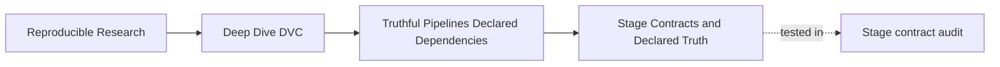
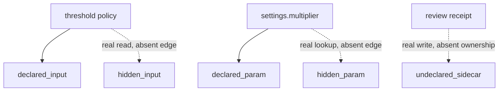

# Stage Contracts and Declared Truth

<!-- page-maps:start -->
## Page Maps




<!-- page-maps:end -->

A DVC stage is a promise about causality:

> When any declared influence changes or an owned artifact is lost, the planner can detect
> that the recorded result no longer represents current state.

The command's real behavior determines the needed contract. Stage names and plausible
YAML do not.

## Inventory behavior before editing declarations

For every command, list:

| Behavior | Contract question |
| --- | --- |
| reads a file | is the file in `deps` or represented truthfully elsewhere? |
| reads a control value | is the exact key in `params`? |
| writes an artifact | is it an owned `out`, metric, plot, or documented scratch? |
| calls a service or process state | is it governed externally or materialized? |
| mutates shared state | is that authority explicit and appropriate? |

The inventory begins from source code, command flags, system calls, and consumer
expectations. DVC cannot infer arbitrary behavior by inspecting Python.

## Run the paired specimen

```bash
make PROGRAM=reproducible-research/deep-dive-dvc capstone-stage-contract-audit
audit=artifacts/audit/reproducible-research/deep-dive-dvc/stage-contracts
```

Read:

```bash
column -t -s $'\t' "$audit/summary.tsv"
cat "$audit/route.txt"
```

Five stages share controlled behavior:

| Stage | Real influence or artifact | Declaration |
| --- | --- | --- |
| `declared_input` | reads policy file | policy in `deps` |
| `hidden_input` | reads same policy file | policy omitted |
| `declared_param` | reads `settings.multiplier` | key in `params` |
| `hidden_param` | reads same key | key omitted |
| `undeclared_sidecar` | writes result and receipt | only main result in `outs` |



Dashed edges exist in program behavior but not planner state.

## Baseline convergence is necessary but weak

All five stages execute successfully at baseline. A second reproduction skips them, and
status is empty.

```bash
jq '.findings[] |
  select(.finding == "BASELINE_CONVERGES")' "$audit/report.json"
```

This proves:

- commands can run in baseline conditions;
- recorded declared state settles;
- ordinary repro converges.

It does not prove:

- every real read is declared;
- every consumed parameter is selected;
- every meaningful artifact is owned;
- hidden changes will invalidate results.

Convergence tests unchanged declarations. Contract completeness requires adversarial
changes.

## Test file influence

The audit changes:

```text
policy/threshold.txt: 10 -> 20
```

Status names only `declared_input`.

After reproducing the declared stage:

```text
declared output: threshold=20
hidden output:   threshold=10
```

The hidden stage is semantically stale: its output disagrees with current policy, but no
declared edge tells DVC.

```bash
jq '.findings[] |
  select(
    .finding == "DECLARED_INPUT_CHANGE_IS_STALE" or
    .finding == "DECLARED_INPUT_REBUILDS_CURRENT_VALUE" or
    .finding == "HIDDEN_INPUT_CHANGE_IS_INVISIBLE"
  )' "$audit/report.json"
```

## Test parameter influence

The audit changes:

```text
settings.multiplier: 2 -> 3
```

Status names only `declared_param`. After reproduction:

```text
declared: multiplier=3, score=24
hidden:   multiplier=2, score=16
```

Merely storing a value in `params.yaml` does not make it part of every stage. The stage
must select the key it consumes.

## Test output ownership

The sidecar stage writes:

```text
results/declared-main.txt
results/undeclared-receipt.txt
```

Only the main result is declared. The audit deletes the receipt, then status remains empty
and repro skips.

If the receipt supports review, recovery, or downstream use, the stage contract is
deceptive. If it is disposable scratch, no consumer or claim should depend on it.

## Join declaration, planner, and semantic evidence

| Evidence layer | Question |
| --- | --- |
| source/command | what does the process actually read and write? |
| `dvc.yaml` | what causal contract is declared? |
| `dvc.lock` | what declared state was recorded after execution? |
| status receipt | which declared change is currently detected? |
| repro receipt | which stage executed or skipped? |
| result values | does output reflect current influence? |
| missing-artifact check | can loss of an owned artifact be detected? |

A truthful review uses multiple layers. Status can reveal a planner decision but not
semantic freshness of hidden output. Output can reveal stale meaning but not why DVC
skipped.

## Repair the missing edge

For hidden file influence:

```yaml
deps:
  - data/source.txt
  - policy/threshold.txt
  - scripts/render.py
```

For hidden parameter:

```yaml
params:
  - settings.multiplier
```

For meaningful receipt:

```yaml
outs:
  - results/declared-main.txt
  - results/undeclared-receipt.txt
```

Then acceptance must prove:

1. baseline settles;
2. isolated influence change makes the stage stale;
3. ordinary repro executes it;
4. output adopts current meaning;
5. missing owned output makes the stage stale;
6. second repro converges.

YAML appearance is not acceptance evidence.

## Keep contracts narrow and complete

Overdeclaring can cause false reruns. Underdeclaring can preserve false confidence.

Choose the smallest truthful boundary:

- declare exact files rather than broad directories when ownership is stable;
- select exact parameter keys;
- own artifacts whose absence affects claims or consumers;
- keep disposable scratch outside the result contract;
- document external influences with enforceable evidence.

## Review checkpoint

You understand stage truth when you can:

- derive the contract from real reads, controls, and writes;
- explain why baseline convergence permits hidden defects;
- prove file and parameter staleness with paired stages;
- explain why a missing sidecar can remain invisible;
- distinguish `dvc.yaml`, lock, status, repro, and semantic evidence;
- specify repair acceptance rather than only a YAML diff.

The standard is:

> Every influence needed for a correct rerun decision and every artifact needed for a
> trusted result has a truthful, testable ownership edge.
