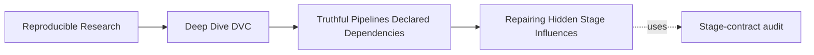

# Worked Investigation: Repairing Hidden Stage Influences


<!-- page-maps:start -->
## Page Maps




<!-- page-maps:end -->

This investigation starts with an executable failure rather than a hypothetical pipeline.
You will predict, observe, explain, repair, and replay one hidden file influence. You will
then transfer the method to hidden parameters and output ownership.

## Establish the case without reading the verdict

Run:

```bash
make PROGRAM=reproducible-research/deep-dive-dvc capstone-stage-contract-audit
audit=artifacts/audit/reproducible-research/deep-dive-dvc/stage-contracts
```

Read only the baseline declaration first:

```bash
sed -n '1,240p' "$audit/workspace/baseline/dvc.yaml"
```

Two stages run closely related commands. Both read `policy/threshold.txt`, but only
`declared_input` lists it under `deps`. At the baseline, both outputs contain
`threshold=10`. The equal baseline values make the defect easy to miss.

## Predict from declared edges

Before opening status receipts, write:

| Question after changing `10` to `20` | Prediction |
| --- | --- |
| Which stage will status name? | `declared_input` |
| Which stage will ordinary repro execute? | `declared_input` |
| Which output will contain `20`? | declared output |
| Which output will retain `10`? | hidden output |
| Will a second repro execute either stage? | no |

These predictions follow from the declaration, not from what a scientifically correct
pipeline ought to do.

## Preserve the planner receipt

Open:

```bash
cat "$audit/evidence/input-change-status.stdout.txt"
```

Status names the changed policy path for `declared_input` and says nothing about
`hidden_input`. This is the evidence to preserve before reproduction. Reproduction will
make the declared stage current and may erase the stale-status condition.

## Join planner evidence to semantic evidence

Inspect the two results:

```bash
cat "$audit/workspace/input-change/results/declared-input.txt"
cat "$audit/workspace/input-change/results/hidden-input.txt"
```

The declared result contains `threshold=20`; the hidden result contains `threshold=10`.

```mermaid
sequenceDiagram
  participant Policy
  participant DVC
  participant Declared
  participant Hidden

  Policy->>Policy: mutate 10 to 20
  DVC->>Declared: declared edge changed; execute
  DVC-->>Hidden: no edge changed; skip
  Declared-->>DVC: threshold=20
  Hidden-->>DVC: threshold=10 remains
```

The correct explanation is:

> DVC made decisions consistent with both declarations. One declaration exposed the real
> file read and one concealed it. The concealed stage therefore retained a semantically
> stale result under ordinary reproduction.

Do not call this a cache problem or a planner bug. Those diagnoses point away from the
missing edge.

## Design the repair

The minimal repair adds the real file read:

```yaml
stages:
  hidden_input:
    cmd: >-
      python scripts/stage_contract_probe.py
      --policy policy/threshold.txt
      --output results/hidden-input.txt
    deps:
      - scripts/stage_contract_probe.py
      - policy/threshold.txt
    outs:
      - results/hidden-input.txt
```

The script remains declared because implementation changes can alter result meaning. The
specific policy path replaces neither the script nor the output declaration.

## Prove the repair with the original challenge

Do not accept the repair because the YAML looks plausible. In a disposable copy:

1. establish a converged baseline with policy value `10`;
2. change only the policy value to `20`;
3. capture `dvc status --json`;
4. run ordinary `dvc repro hidden_input`;
5. assert that the output contains `threshold=20`;
6. run ordinary reproduction again and assert that it skips.

Acceptance requires all three:

```text
planner: original mutation names repaired stage
result: output adopts current policy value
convergence: unchanged second run skips
```

Force is excluded because it bypasses the decision the repair is meant to correct.

## Transfer the reasoning to a parameter

Now read:

```bash
cat "$audit/evidence/param-change-status.stdout.txt"
cat "$audit/workspace/param-change/results/declared-param.txt"
cat "$audit/workspace/param-change/results/hidden-param.txt"
```

The declared result uses multiplier `3` and records score `24`; the hidden result retains
multiplier `2` and score `16`. The analogous repair is not to declare all of
`params.yaml` as a file dependency. Select the control the command actually consumes:

```yaml
params:
  - settings.multiplier
```

Then replay a `2` to `3` mutation and assert planner, result, and convergence evidence.

## Transfer the reasoning to output ownership

The `undeclared_sidecar` command writes both a main output and a receipt. Only the main
output is declared.

Read the output-loss receipts and inspect the directory:

```bash
cat "$audit/evidence/output-loss-status.stdout.txt"
cat "$audit/evidence/output-loss-repro.stdout.txt"
find "$audit/workspace/output-loss/results" -maxdepth 1 -type f -print
```

Status is empty, repro skips, and the receipt remains absent. Decide whether the receipt
is part of the promised result:

- If yes, declare it under `outs` and prove deletion is detected and repaired.
- If no, keep it outside the durable result surface and do not present it to consumers.

An output repair is about ownership, not merely adding another YAML line.

## Write the review argument

A bounded review note separates observation, inference, repair, proof, and limit:

> Changing the policy from `10` to `20` marked only the stage that declared the policy
> path. Ordinary reproduction updated that stage to `threshold=20`; the paired hidden
> stage retained `threshold=10`. The difference is explained by the missing dependency
> edge. The repair declares the policy path and is accepted only if the same mutation
> marks the repaired stage stale, rebuilds `threshold=20`, and then converges. This proves
> the tested file influence on this stage; it does not prove that unrelated stages have
> complete declarations.

That statement is stronger than “fixed pipeline” because another reviewer can challenge
each clause.

## Preserve the investigation packet

Keep:

```text
declaration-before.yaml
influence-ledger.tsv
prediction.tsv
status-before.json
result-before.txt
repro.stdout.txt
result-after.txt
declaration-after.yaml
repair-status.json
repair-result.txt
convergence.stdout.txt
review-decision.md
```

The packet retains the original failure and the repaired behavior. Without the original
mutation replay, the edit is plausible rather than demonstrated.

## Review checkpoint

You have completed the investigation when you can:

- predict planner behavior before reading receipts;
- preserve status before reproduction;
- distinguish declared consistency from semantic currency;
- locate repair in the declaration rather than force or cache handling;
- replay the exact mutation against the repaired stage;
- transfer the method across file, parameter, and output boundaries;
- state a conclusion whose scope is no broader than the evidence.
