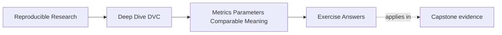

# Exercise Answers

<!-- page-maps:start -->
## Page Maps

<!-- page-maps:end -->

These answers are model explanations, not the only acceptable wording.

## How to use the answer page well

Do not read the model answer first and then collapse every comparison back into "the
score went up."

A better rhythm is:

1. finish the exercise with your own comparison packet
2. name the claim, metric definition, population, and nearby controls
3. compare your reasoning with the model answer
4. revise anywhere your answer skips schema continuity, parameter meaning, or bounded
   interpretation

What matters is whether the reasoning keeps metric meaning, parameter controls, and
decision discipline connected.

Strong Module 05 answers usually do five things:

- they say what the metric actually claims
- they identify which controls change the meaning of the comparison
- they detect schema changes before reading score movement as improvement
- they treat plots as supporting evidence, not visual authority
- they predeclare decision rules instead of improvising them after the run

The strongest self-study packets also leave behind six concrete artifacts:

- one metric claim explanation
- one control-classification table
- one schema continuity judgment
- one manual recomputation
- one decision rule
- one independent-review packet

If your answers rely only on "higher is better," the reasoning is still too thin.

## Answer 1: Explain the metric claim

The metric appears to claim:

- the incident escalation workflow produced a positive-class F1 value of `0.82`
- the metric was computed at a fixed threshold
- the evaluation population contained `420` records

Additional meaning a reviewer still needs:

- which records those `420` cases represent
- which class counts as positive
- what fixed threshold was used
- whether the F1 definition is binary, macro, or something else
- which model, data identity, and parameter values produced the metric

Why population size is useful but not enough:

- it helps catch obvious population movement
- it does not prove the same records, labels, split logic, or metric definition were used

A bounded release question this metric could support is:

> Does the current candidate maintain acceptable positive-class escalation quality under
> the declared threshold policy for the governed evaluation population?

## Answer 2: Classify parameter controls

Likely comparison controls:

- `fit.model_family`
- `fit.random_seed`
- `evaluate.threshold`
- `evaluate.minimum_population_size`

Probably not part of the semantic comparison surface:

- `plot.title`
- `tmp.file_suffix`

Why:

- the first four can alter learned behavior, evaluation meaning, or whether the result is
  valid for review
- the last two usually affect presentation or temporary plumbing rather than semantic
  interpretation

One edge case:

- a cosmetic field becomes semantically important if downstream automation or published
  consumer contracts depend on it as an identifier rather than as mere decoration

## Answer 3: Diagnose schema drift

Strong review note:

> This is a meaning-changing schema change, not a simple improvement. The previous metric
> was positive-class F1 at a fixed threshold. The new metric is macro F1 after threshold
> search. The new value may be useful, but it should not be read as an increase from
> `0.81` to `0.84` for the same metric. The review should either keep the old metric for
> continuity or clearly mark the new metric as a new comparison contract.

What the team should preserve for continuity:

- the prior metric key and definition, or an explicit compatibility policy that states how
  the new schema relates to the old one

## Answer 4: Interpret metric and parameter diffs

Strong interpretation:

> Fixed-threshold F1 increased from `0.81` to `0.84`, but the evaluation threshold also
> changed from `0.65` to `0.50`. That means this is not a same-threshold model
> improvement claim. It may support a threshold-policy review or a combined-control
> comparison, but the conclusion must state that the evaluation rule changed with the
> metric.

One conclusion that would be too strong:

- "The model improved by three F1 points under the same evaluation conditions."

The main lesson is that parameter movement changes what the metric movement can mean.

## Answer 5: Review a plot for release evidence

Before trusting the plot, check:

- whether it uses the same evaluation population or a clearly documented new one
- whether binning or aggregation rules stayed stable
- whether sorting and rendering are deterministic enough for review
- whether the shape supports or contradicts the scalar metric movement
- whether the plot speaks to the actual release decision rather than only looking cleaner

Responsible release sentence:

> The calibration plot uses the same governed population and binning rule as the prior
> comparison and supports the fixed-threshold review, but it does not replace the scalar
> metric and threshold-policy decision.

## Answer 6: Design a stable metric schema

A stable schema makes meaning explicit rather than relying on field names alone. Strong
records include:

- metric name
- unit or scale
- population definition
- aggregation rule
- direction of better
- schema version

The incompatible record should fail because its unit, aggregation, population, or version
changes comparison meaning. A reviewer should detect incompatibility quickly by checking
version and semantic fields before reading the score.

## Answer 7: Separate tuning controls from run policy

Values that alter learned behavior, data selection, or evaluation meaning belong in
governed semantic inputs. Worker counts, cache locations, debug flags, and log verbosity
usually belong to execution policy unless the repository has evidence that they change
meaning.

The main lesson is that `params.yaml` should hold comparison-relevant controls, not every
operational detail the run happened to use.

## Answer 8: Recompute a comparison manually

The manual calculation should:

- confirm the direction and magnitude of the change
- check whether the same denominator or population is being compared
- confirm how rounding was applied
- verify that missing values or renamed keys are not being silently ignored

A strong final judgment says whether the numeric diff is both arithmetically correct and
semantically comparable. The most common hidden mistake is comparing correct numbers from
different populations or definitions.

## Answer 9: Set a decision threshold before seeing results

A defensible rule names:

- the primary metric and its required improvement
- tolerable regression on safeguards
- the minimum evidence needed for acceptance
- an abstain outcome when population, schema, or control continuity is unclear

Why this matters:

- precommitment prevents teams from rewriting the decision rule to fit a favored result

## Answer 10: Build a reviewable comparison packet

An independent reviewer should be able to:

- identify both runs
- confirm comparable data and environment surfaces
- understand parameter differences
- reproduce the metric interpretation
- distinguish measured fact from your narrative

What another learner should judge confidently:

- whether the runs are comparable and what changed

Any remaining confusion should expose a missing artifact, unclear schema, or weak control
explanation rather than requiring spoken history to fill the gap.

## Self-check

If your answers consistently explain:

- what a metric claims
- which controls change the comparison
- whether schema movement preserves meaning
- what DVC diffs show without proving
- how plots and release notes should bound interpretation

then you are using Module 05 correctly.
