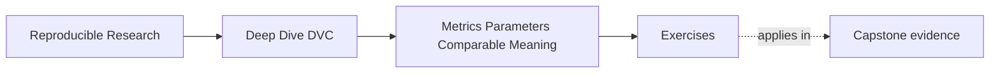
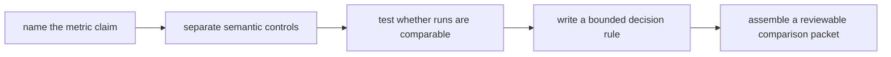

# Exercises


<!-- page-maps:start -->
## Page Maps




<!-- page-maps:end -->

Use these exercises to practice comparison judgment, not only metric vocabulary.

The goal of the day is to stop treating a metric value as if it explains itself. A
number is only meaningful when the population, definition, controls, and release question
stay visible. If those surfaces blur, a precise metric can still support a bad decision.

## How to work through this set

Treat the ten exercises as one full lab day on comparable meaning.

Before each answer:

1. name the release or research claim under review
2. name the metric definition supporting that claim
3. name the nearby controls that could change the meaning of the comparison

Do the exercises in order. The day is one progression:

- Exercises 1-3 identify what a metric claims and how schema changes can break continuity
- Exercises 4-5 connect metric movement to parameter movement and supporting plots
- Exercises 6-8 define stable schemas and test comparisons by hand
- Exercises 9-10 turn the lesson into a precommitted decision rule and a review packet

Keep one comparison packet as you go. By the end of the day it should contain:

- one plain-language metric claim
- one table separating semantic controls from presentation or temporary settings
- one schema continuity judgment
- one manual recomputation of a comparison
- one predeclared acceptance rule
- one reviewable comparison packet that another learner can judge without oral history

If those six artifacts are missing, you are probably still reading metrics as isolated
numbers instead of as governed evidence.

## Recommended working layout

If you want one lab tree that can support the whole day, use something like:

```text
module05-lab/
├── artifacts/
├── metrics/
├── notes/
├── params.yaml
├── plots/
└── publish/
```

Keep one meaning table while you work:

| Surface | Example | What it tells you | What it cannot tell you alone |
| --- | --- | --- | --- |
| metric value | scalar in `metrics.json` | observed score | whether the definition stayed stable |
| parameter control | `params.yaml` entry | semantic setting used | whether the population stayed constant |
| evaluation population | count, selection rule, split identity | who was measured | whether the metric definition stayed comparable |
| plot artifact | calibration or tradeoff chart | shape and distribution context | release decision by itself |

Also keep one comparison rule table:

| Question | Needed evidence | Unsafe shortcut to avoid |
| --- | --- | --- |


Use that route on purpose. It keeps the day centered on comparable meaning instead of on
scoreboard thinking.

## Exercise 1: Explain the metric claim

You see this metric file:

```json
{
  "incident_escalation": {
    "positive_class_f1_at_fixed_threshold": 0.82,
    "evaluation_population_size": 420
  }
}
```

Write a short explanation of:

- what the metric appears to claim
- what additional meaning a reviewer still needs
- why the population size is useful but not enough by itself
- one sentence naming the release question this metric could help answer

Study note:
The point is not to dismiss scalar metrics. The point is to stop asking them to carry the
whole interpretation alone.

## Exercise 2: Classify parameter controls

A workflow has these values:

- `fit.model_family`
- `fit.random_seed`
- `evaluate.threshold`
- `evaluate.minimum_population_size`
- `plot.title`
- `tmp.file_suffix`

Decide which values probably belong in the comparison surface and which probably do not.

Explain your reasoning and include one sentence about an edge case where a cosmetic field
might unexpectedly become semantically important.

Study note:
Many weak review packets treat every setting as equally important or ignore meaningful
controls because they are buried in configuration.

## Exercise 3: Diagnose schema drift

A previous release used:

```json
{
  "incident_escalation": {
    "positive_class_f1_at_fixed_threshold": 0.81
  }
}
```

A new run uses:

```json
{
  "incident_escalation": {
    "macro_f1_after_threshold_search": 0.84
  }
}
```

Write a review note that explains whether this is:

- a simple improvement
- an additive metric change
- a meaning-changing schema change

Then add one sentence explaining what the team should preserve if it wants continuity
across releases.

Study note:
This is where many students learn that a score increase can be numerically real and still
be non-comparable.

## Exercise 4: Interpret metric and parameter diffs

You see:

```text
dvc metrics diff
incident_escalation.positive_class_f1_at_fixed_threshold  0.81 -> 0.84

dvc params diff
evaluate.threshold  0.65 -> 0.50
```

Write the strongest defensible interpretation.

Avoid saying only "F1 improved." Also state one conclusion that would be too strong.

Study note:
Module 05 becomes much easier once parameter changes are treated as meaning changes, not
as footnotes.

## Exercise 5: Review a plot for release evidence

A calibration plot is included in a release review.

Describe what you would check before using the plot as evidence:

- population
- aggregation or binning
- sorting or rendering stability
- relationship to the metric movement
- relationship to the release decision

Then write one sentence that uses the plot responsibly in a release note.

Study note:
Plots often persuade people too quickly. This exercise is about restoring discipline.

## Midday self-check

Before you move into schema design, manual recomputation, and decision rules, make sure
your packet can already answer these questions clearly:

- what a metric value actually claims
- which parameters change the meaning of the comparison
- when a schema change destroys continuity
- why a plot supports a bounded claim instead of replacing the numeric review

If you cannot answer those four questions in plain language, return to Exercises 1-5 and
make the packet more explicit before continuing.

## Exercise 6: Design a stable metric schema

Define a machine-readable metric document with:

- units
- population
- aggregation
- direction
- schema version

Produce two valid records and one intentionally incompatible record.

What to hand in:

- the schema shape
- the two comparable records
- the one incompatible record
- one sentence explaining how a reviewer should detect incompatibility quickly

Study note:
Stable schemas reduce accidental semantic drift before release review even begins.

## Exercise 7: Separate tuning controls from run policy

Classify ten settings from a real experiment as one of:

- model parameter
- data-selection control
- evaluation rule
- execution policy

Explain which belong in `params.yaml` and which should stay elsewhere.

Study note:
This exercise matters because comparison packets become noisy or incomplete when semantic
and operational settings are mixed carelessly.

## Exercise 8: Recompute a comparison manually

Use two metric files and calculate the reported change independently. Check:

- sign
- denominator
- rounding
- missing values
- whether the compared populations match

What to hand in:

- the manual computation
- the final comparison judgment
- one sentence naming the most likely hidden mistake in this kind of review

Study note:
If you never recompute by hand, you will eventually trust a neat diff that compares the
wrong things correctly.

## Exercise 9: Set a decision threshold before seeing results

Write an acceptance rule for one metric before running a candidate. Include:

- tolerance
- secondary safeguards
- what happens when evidence is incomplete
- the abstain condition

Study note:
Precommitment matters because it keeps the decision rule from moving to match a favored
candidate.

## Exercise 10: Build a reviewable comparison packet

Assemble:

- parameter diff
- metric diff
- data identity
- environment identity
- a short interpretation for two runs

Ask another learner to decide whether the comparison is valid without verbal context.

What to hand in:

- the packet itself
- one sentence describing what the other learner could judge confidently
- one sentence naming what confusion remained, if any

Study note:
This final exercise matters because a strong comparison should survive outside the memory
of the person who ran it.

## Mastery check

You have a strong grasp of this module if your answers consistently keep five ideas
visible:

- metrics are claims about a population, definition, and review decision
- parameters can change what a metric comparison means
- metric schemas must stay stable or announce meaning-changing changes
- `dvc metrics diff` shows numeric movement but not semantic validity
- plots and release metrics need the same comparison discipline as scalar values
