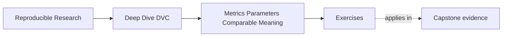

# Exercises


<!-- page-maps:start -->
## Page Maps




<!-- page-maps:end -->

Use these exercises to practice comparison judgment, not only metric vocabulary.

The goal of the day is to stop treating a metric value as if it explains itself. A
number is only meaningful when the population, definition, controls, and release question
stay visible. If those surfaces blur, a precise metric can still support a bad decision.

## How to work through this set

Treat the ten exercises as one full lab day on comparable meaning.

Before each answer:

1. name the release or research claim under review
2. name the metric definition supporting that claim
3. name the nearby controls that could change the meaning of the comparison

Do the exercises in order. The day is one progression:

- Exercises 1-3 identify what a metric claims and how schema changes can break continuity
- Exercises 4-5 connect metric movement to parameter movement and supporting plots
- Exercises 6-8 define stable schemas and test comparisons by hand
- Exercises 9-10 turn the lesson into a precommitted decision rule and a review packet

Keep one comparison packet as you go. By the end of the day it should contain:

- one plain-language metric claim
- one table separating semantic controls from presentation or temporary settings
- one schema continuity judgment
- one manual recomputation of a comparison
- one predeclared acceptance rule
- one reviewable comparison packet that another learner can judge without oral history

If those six artifacts are missing, you are probably still reading metrics as isolated
numbers instead of as governed evidence.

## Recommended working layout

If you want one lab tree that can support the whole day, use something like:

```text
module05-lab/
├── artifacts/
├── metrics/
├── notes/
├── params.yaml
├── plots/
└── publish/
```

Keep one meaning table while you work:

| Surface | Example | What it tells you | What it cannot tell you alone |
| --- | --- | --- | --- |
| metric value | scalar in `metrics.json` | observed score | whether the definition stayed stable |
| parameter control | `params.yaml` entry | semantic setting used | whether the population stayed constant |
| evaluation population | count, selection rule, split identity | who was measured | whether the metric definition stayed comparable |
| plot artifact | calibration or tradeoff chart | shape and distribution context | release decision by itself |

Also keep one comparison rule table:

| Question | Needed evidence | Unsafe shortcut to avoid |
| --- | --- | --- |


Use that route on purpose. It keeps the day centered on comparable meaning instead of on
scoreboard thinking.

## Exercise 1: Explain the metric claim

You see this metric file:

```json
{
  "incident_escalation": {
    "positive_class_f1_at_fixed_threshold": 0.82,
    "evaluation_population_size": 420
  }
}
```

Write a short explanation of:

- what the metric appears to claim
- what additional meaning a reviewer still needs
- why the population size is useful but not enough by itself
- one sentence naming the release question this metric could help answer

Study note:
The point is not to dismiss scalar metrics. The point is to stop asking them to carry the
whole interpretation alone.

## Exercise 2: Classify parameter controls

A workflow has these values:

- `fit.model_family`
- `fit.random_seed`
- `evaluate.threshold`
- `evaluate.minimum_population_size`
- `plot.title`
- `tmp.file_suffix`

Decide which values probably belong in the comparison surface and which probably do not.

Explain your reasoning and include one sentence about an edge case where a cosmetic field
might unexpectedly become semantically important.

Study note:
Many weak review packets treat every setting as equally important or ignore meaningful
controls because they are buried in configuration.

## Exercise 3: Diagnose schema drift

A previous release used:

```json
{
  "incident_escalation": {
    "positive_class_f1_at_fixed_threshold": 0.81
  }
}
```

A new run uses:

```json
{
  "incident_escalation": {
    "macro_f1_after_threshold_search": 0.84
  }
}
```

Write a review note that explains whether this is:

- a simple improvement
- an additive metric change
- a meaning-changing schema change

Then add one sentence explaining what the team should preserve if it wants continuity
across releases.

Study note:
This is where many students learn that a score increase can be numerically real and still
be non-comparable.

## Exercise 4: Interpret metric and parameter diffs

You see:

```text
dvc metrics diff
incident_escalation.positive_class_f1_at_fixed_threshold  0.81 -> 0.84

dvc params diff
evaluate.threshold  0.65 -> 0.50
```

Write the strongest defensible interpretation.

Avoid saying only "F1 improved." Also state one conclusion that would be too strong.

Study note:
Module 05 becomes much easier once parameter changes are treated as meaning changes, not
as footnotes.

## Exercise 5: Review a plot for release evidence

A calibration plot is included in a release review.

Describe what you would check before using the plot as evidence:

- population
- aggregation or binning
- sorting or rendering stability
- relationship to the metric movement
- relationship to the release decision

Then write one sentence that uses the plot responsibly in a release note.

Study note:
Plots often persuade people too quickly. This exercise is about restoring discipline.

## Midday self-check

Before you move into schema design, manual recomputation, and decision rules, make sure
your packet can already answer these questions clearly:

- what a metric value actually claims
- which parameters change the meaning of the comparison
- when a schema change destroys continuity
- why a plot supports a bounded claim instead of replacing the numeric review

If you cannot answer those four questions in plain language, return to Exercises 1-5 and
make the packet more explicit before continuing.

## Exercise 6: Predict the metric contract audit

Inspect these files without running the audit:

```text
capstone/repro/metric-contracts/
├── dvc.yaml
├── params.yaml
└── cases/
```

For each non-baseline case, predict:

- the primary numeric delta
- whether `dvc params diff` will be empty
- which semantic field changes or disappears
- `ACCEPT`, `REJECT`, or `ABSTAIN`

Then run:

```bash
make PROGRAM=reproducible-research/deep-dive-dvc capstone-metric-contract-audit
```

What to hand in:

- prediction table
- generated `summary.tsv`
- corrected classifications with evidence paths
- explanation of why `PASS / REJECT` is not contradictory

Study note:
Prediction forces you to reason from the contract instead of memorizing the generated
labels.

## Exercise 7: Reconstruct and recompute the accepted claim

Use:

```text
workspace/comparable-candidate/evidence/
```

Recompute F1 from each confusion matrix:

```text
precision = TP / (TP + FP)
recall    = TP / (TP + FN)
F1        = 2 * precision * recall / (precision + recall)
```

Then independently calculate the delta and compare it with
`dvc-metrics-diff.json`.

Do not stop at arithmetic. Reconstruct the full claim from:

- schema version
- population identity and row count
- threshold
- metric name and definition
- unit and aggregation

What to hand in:

- baseline precision, recall, and F1
- candidate precision, recall, and F1
- independently calculated delta
- one bounded same-contract comparison sentence
- list of release claims this packet still cannot support

Study note:
A correct recomputation proves arithmetic. Contract continuity is the separate reason the
arithmetic can enter one comparison.

## Exercise 8: Defeat two plausible shortcuts

Investigate:

```text
workspace/population-drift/evidence/
workspace/unit-drift/evidence/
```

Shortcut A says:

> Both populations contain 120 rows, so they are comparable.

Shortcut B says:

> The primary metric key stayed the same, so the `77.5241` increase is valid.

For each shortcut:

- quote the evidence that makes it tempting
- quote the evidence that defeats it
- explain why DVC still reports a numeric delta
- write the strongest safe review note
- name the repair needed before direct comparison

What to hand in:

- two evidence tables
- two bounded review notes
- one paragraph distinguishing arithmetic validity from semantic validity

Study note:
The dangerous shortcut usually contains one true observation. Your job is to show why it
is insufficient.

## Exercise 9: Separate policy change, schema evolution, and missing evidence

Compare:

```text
workspace/control-drift/evidence/
workspace/additive-metric/evidence/
workspace/schema-version-drift/evidence/
workspace/missing-population-identity/evidence/
```

Classify each as:

- compatible extension
- incompatible direct comparison
- useful result that answers a different policy question
- abstention because required evidence is missing

For control drift, join `dvc-metrics-diff.json` to `dvc-params-diff.json`.

For schema cases, inspect `metric_keys.added`, `metric_keys.removed`, and the contract
version. Explain why adding a field differs from crossing a version boundary without a
mapping.

What to hand in:

- four-row classification table
- threshold-policy question the control-drift result can answer
- compatibility rule for the additive metric
- repair for the version boundary
- evidence request for the missing-population case

Study note:
“Reject direct comparison” does not mean “discard the run.” State which new question or
repair makes the result useful.

## Exercise 10: Produce an independent comparison review

Build a packet another learner can review without oral context. Include:

- the baseline claim
- predictions and corrections from Exercise 6
- manual recomputation from Exercise 7
- rejected shortcuts from Exercise 8
- classifications and repairs from Exercise 9
- a predeclared release rule for the accepted candidate

Your release rule must name:

- minimum primary improvement
- at least two secondary safeguards
- required population and contract continuity
- behavior when evidence is incomplete
- explicit abstention condition

Ask the reviewer to answer:

1. Which comparisons are semantically valid?
2. Which valid comparison, if any, passes the release rule?
3. Which rejected result could answer a different question?
4. Which evidence defect requires abstention rather than a negative conclusion?

What to hand in:

- packet index with relative paths
- reviewer decisions
- disagreements and the evidence used to resolve them
- one sentence naming any judgment the packet still cannot support

Study note:
A strong packet does not make every decision automatic. It makes the remaining judgment
and its evidence boundary explicit.

## Mastery check

You have a strong grasp of this module if your answers consistently keep five ideas
visible:

- metrics are claims about a population, definition, and review decision
- parameters can change what a metric comparison means
- metric schemas must stay stable or announce meaning-changing changes
- `dvc metrics diff` shows numeric movement but not semantic validity
- plots and release metrics need the same comparison discipline as scalar values
