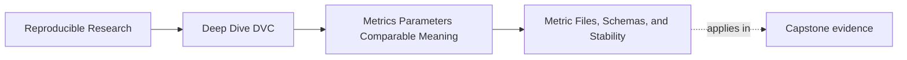
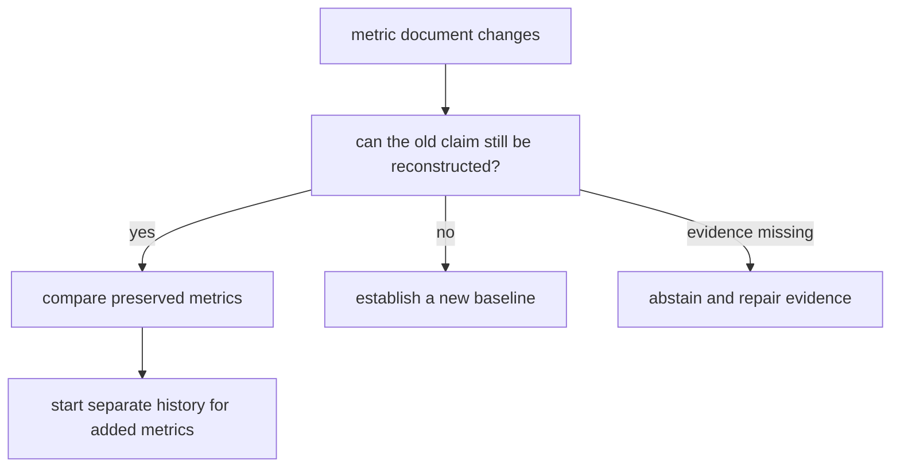

# Metric Files, Schemas, and Stability


<!-- page-maps:start -->
## Page Maps




<!-- page-maps:end -->

A metric file is small, but it carries a lot of meaning.

When a workflow writes `metrics/metrics.json`, reviewers are not only looking at values.
They are trusting a structure:

- which keys exist
- what each key means
- which units the values use
- which population the values describe
- whether missing values are allowed
- whether new keys are additive or meaning-changing

That structure is a schema, even if nobody wrote a formal schema file.

## A simple metric file still has a contract

Example:

```json
{
  "incident_escalation": {
    "positive_class_f1_at_fixed_threshold": 0.81,
    "precision_at_fixed_threshold": 0.78,
    "recall_at_fixed_threshold": 0.84,
    "evaluation_population_size": 420
  }
}
```

This file says more than four numbers. It says the metrics belong to incident escalation,
the threshold is fixed, and the population size is part of review.

That is easier to defend than:

```json
{
  "f1": 0.81,
  "precision": 0.78,
  "recall": 0.84
}
```

Short keys are not always wrong, but vague keys make future comparison harder.

## Schema drift changes interpretation

Schema drift happens when the file structure changes in a way that affects meaning.

Examples:

- `f1` changes from positive-class F1 to macro F1
- `accuracy` changes from all incidents to only high-confidence incidents
- `population_size` disappears
- a value changes from a fraction to a percentage
- null handling changes without explanation
- a nested key moves and downstream review scripts silently read the old path

Some changes are legitimate. The problem is not change. The problem is pretending that a
meaning-changing file change is just a normal metric update.

When schema meaning changes, say so in review and avoid comparing old and new values as
if they were the same measurement.

## Stable additions versus breaking changes

Adding a new metric can be safe if existing metric meanings stay unchanged.

Example of a mostly additive change:

```json
{
  "incident_escalation": {
    "positive_class_f1_at_fixed_threshold": 0.81,
    "precision_at_fixed_threshold": 0.78,
    "recall_at_fixed_threshold": 0.84,
    "evaluation_population_size": 420,
    "false_positive_rate_at_fixed_threshold": 0.09
  }
}
```

The existing keys still mean the same thing. Reviewers can compare them across runs while
learning about the new key.

Example of a breaking change:

```json
{
  "incident_escalation": {
    "macro_f1_after_threshold_search": 0.84,
    "precision_after_threshold_search": 0.79,
    "recall_after_threshold_search": 0.91
  }
}
```

This may be a better evaluation design, but it is not the same metric contract. It should
not be interpreted as a simple improvement over fixed-threshold F1.

## Audit schema evolution with paired documents

The generated audit separates four changes that are easy to blur:

```text
artifacts/audit/reproducible-research/deep-dive-dvc/metric-contracts/workspace/
├── additive-metric/evidence/
├── unit-drift/evidence/
├── schema-version-drift/evidence/
└── missing-population-identity/evidence/
```

For each case, compare `baseline-metrics.json` with `candidate-metrics.json` before reading
`comparison.json`.

### Additive evolution

The additive candidate keeps the primary metric:

```text
positive_class_f1_at_fixed_threshold
```

with the same:

- definition
- unit
- aggregation
- population identity
- threshold
- schema version

It adds:

```text
false_positive_rate_at_fixed_threshold
```

The generated comparison records:

```json
{
  "added": ["false_positive_rate_at_fixed_threshold"],
  "removed": []
}
```

The prior F1 series remains comparable. The new false-positive-rate series starts at this
record; it does not gain imaginary history.

### Unit drift behind a stable key

The unit-drift candidate keeps the primary key and changes:

```text
fraction -> percent
```

That is a breaking semantic change even though:

- the JSON path is stable
- the metric definition text is stable
- the population is stable
- DVC can subtract the numbers

The generated DVC delta is `77.5241`. A parser sees valid numbers under one path. A
reviewer sees incompatible scales.

### Version drift

The schema-version candidate changes:

```text
1 -> 2
```

while preserving the other fields. The audit rejects the direct comparison because the
new version announces an unproven compatibility boundary.

A version number is a warning and routing mechanism, not proof by itself:

- equal versions do not guarantee equal meaning if authors silently changed definitions
- different versions do not prove values are incomparable if a reviewed compatibility
  mapping exists

In this specimen no mapping exists, so the safe decision is rejection.

### Missing evidence

The missing-population candidate still contains:

```json
{
  "rows": 120
}
```

It omits population identity. This is not a harmless optional-field change. The reviewer
can no longer establish that the same records were measured.

The correct response is not to assume continuity from equal counts. It is to abstain until
identity evidence is restored.

## Classify changes by preserved claims

Use this decision table instead of classifying by JSON syntax alone:

| Change | Existing primary claim preserved? | Direct historical comparison |
| --- | --- | --- |
| add a new metric; preserve old contract | yes | allowed for existing metric |
| rename or remove primary metric | no | blocked unless mapped |
| change fraction to percent | no | blocked until normalized under an explicit contract |
| change schema version without mapping | unproven | blocked |
| omit population identity | unproven | abstain |
| reorder deterministic JSON keys | yes | allowed; review noise only |



The question is not whether the file changed. Metric files should change when results do.
The question is whether a reviewer can reconstruct the same measurement contract on both
sides.

## Metric files should be boring to parse

Metric files are not a place for surprise.

Prefer:

- deterministic key names
- deterministic ordering when humans review diffs
- explicit units in names or documentation
- stable nesting
- clear missing-value behavior
- one canonical output path for the metric surface

Avoid:

- timestamped keys
- randomly ordered tables
- metric names that depend on the data slice at runtime
- mixed units under similar names
- silently replacing a metric definition while keeping the key

DVC can track file changes, but a stable file shape makes those changes easier for people
to review.

## Where to document meaning

The metric meaning can live in more than one place:

- the metric file key names
- a release review guide
- a model evaluation guide
- a schema or contract note
- the code that computes the metric
- the review note attached to a release

Do not rely on only one of these if the metric supports important decisions. A reviewer
should not need to reverse-engineer the metric definition from Python after every release.

## Review checkpoint

You understand this core when you can inspect a metric file and answer:

- what each key means
- whether the unit and population are clear
- whether a file change is additive or meaning-changing
- whether old and new values are safe to compare
- which documentation or review surface explains the metric contract

Create a four-row classification from the generated cases above. For each row, name one
field that is stable, one field that changes or disappears, and the resulting review
decision.

The goal is a metric file that ages well. Two years later, the team should still know what
the number meant.
