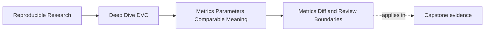
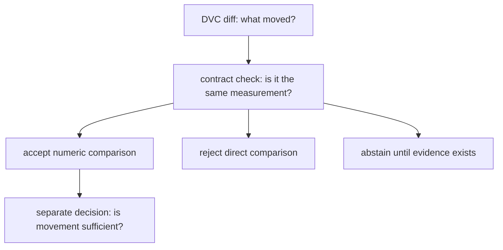

# Metrics Diff and Review Boundaries


<!-- page-maps:start -->
## Page Maps




<!-- page-maps:end -->

`dvc metrics diff` is useful because it is narrow.

It answers a specific question:

> Which tracked metric values changed between two revisions?

That is an important question. It is not the whole review.

Module 05 teaches you to use the diff without asking it to do semantic judgment it cannot
do.

## What the diff can show

A metric diff can show that a value changed:

```text
Path                    Metric                                           Old    New    Change
metrics/metrics.json    incident_escalation.positive_class_f1_at_fixed_threshold  0.81   0.84   +0.03
```

That gives the reviewer a starting point:

- which metric moved
- in which direction
- by how much
- across which compared revisions

That is valuable. It replaces hand inspection of files with a focused comparison.

But it does not prove why the value moved, and it does not prove the comparison is valid.

## What the diff cannot judge

The diff does not know whether:

- the evaluation population changed
- the metric definition changed
- the threshold changed
- the model family changed
- the schema changed while keeping a similar key
- a plot supports the same conclusion
- the change is large enough for release
- the change violates a product or science constraint

Those are review questions.

This boundary is not a weakness. It is a separation of concerns. DVC reports the recorded
difference. People interpret whether the difference supports a decision.

## Observe the boundary in one audit

Run:

```bash
make PROGRAM=reproducible-research/deep-dive-dvc capstone-metric-contract-audit
```

The summary contains these rows:

```text
COMPARABLE_CANDIDATE        PASS  ACCEPT  0.0458
POPULATION_DRIFT            PASS  REJECT  0.0458
CONTROL_DRIFT               PASS  REJECT  0.0458
SCHEMA_VERSION_DRIFT        PASS  REJECT  0.0458
MISSING_POPULATION_IDENTITY PASS  REJECT  0.0458
```

`PASS` means the audit reproduced the expected evidence. It does not mean every
comparison is acceptable. The decision column answers that separate question.

Open the `dvc-metrics-diff.json` file in each matching workspace. DVC reports the primary
metric movement in all five cases. It should. The numbers changed.

Then open `comparison.json`:

- the comparable candidate preserves every required semantic field
- population drift changes the evaluated identity
- control drift changes the threshold
- schema-version drift crosses an unproven compatibility boundary
- the missing-evidence case cannot establish population continuity



The final policy decision remains separate even after compatibility passes. An accepted
comparison can still fail release safeguards.

## Write two-layer review notes

A useful review note separates mechanical fact from semantic judgment.

For the comparable candidate:

> **Mechanical fact:** DVC reports F1 movement from `0.7368` to `0.7826`.
> **Semantic judgment:** Schema, population identity, threshold, definition, unit, and
> aggregation match, so the `0.0458` delta is a valid same-contract comparison. Release
> acceptance still requires a declared policy.

For population drift:

> **Mechanical fact:** DVC reports the same `0.0458` F1 delta.
> **Semantic judgment:** The population identity changed despite an equal row count, so
> the delta does not support a same-population improvement claim.

For missing population identity:

> **Mechanical fact:** DVC reports a `0.0458` F1 delta.
> **Semantic judgment:** Population continuity cannot be established. Review must abstain
> until the missing identity evidence is restored.

The distinction between rejection and abstention matters:

- reject when evidence demonstrates incompatible contracts
- abstain when evidence needed to judge compatibility is missing

The generated report represents both as `REJECT` at the gate because neither may proceed
as a direct comparison. The review note should still name the different repair.

## Pair metrics diff with parameter diff

Metric movement should usually be reviewed beside parameter movement.

Example:

```text
$ dvc metrics diff
metrics/metrics.json:
  incident_escalation.positive_class_f1_at_fixed_threshold  0.81 -> 0.84

$ dvc params diff
params.yaml:
  evaluate.threshold  0.65 -> 0.50
```

The first command says F1 moved. The second command changes the interpretation. A
threshold movement means the reviewer should not casually say "the model improved under
the same evaluation policy."

A stronger note is:

> F1 increased while the evaluation threshold changed, so this comparison mixes model
> behavior and policy control change. It may support a threshold review, not a clean
> same-control model improvement claim.

That is the kind of reasoning Module 05 is building.

## Compare against the right baseline

Another common failure is comparing the wrong two revisions.

The diff can be accurate and still answer the wrong question if the baseline is wrong:

- comparing against a local scratch commit
- comparing against a previous experiment instead of the release baseline
- comparing after a schema change without acknowledging the break
- comparing against a run with different data identity

The review question should come first:

> What decision are we trying to make, and which prior state is the fair comparison?

Only then should the diff be treated as decision evidence.

## Read no-change carefully

No metric diff does not always mean nothing important happened.

Possible interpretations:

- the metric truly stayed stable
- the changed behavior is not captured by that metric
- the metric file did not update because a stage was stale or skipped incorrectly
- the metric definition drifted while producing a similar value
- a plot or slice changed even though the aggregate stayed stable

No-change is useful evidence only after the comparison surface is trusted.

## A review sequence

Use this sequence for serious metric review:

1. Name the decision the comparison is supposed to support.
2. Confirm the baseline revision is the right comparison.
3. Run or inspect the metric diff.
4. Inspect parameter differences that affect the metric.
5. Confirm population and metric schema stayed comparable.
6. Look at plots only after the metric contract is clear.
7. Write the conclusion with any comparability limits.

In the generated packet, perform the sequence by joining:

1. `dvc-metrics-diff.json`
2. `dvc-params-diff.json`
3. `baseline-metrics.json`
4. `candidate-metrics.json`
5. `comparison.json`

Do not begin with `comparison.json`. Predict the decision from source evidence, then use
the generated classification to check your reasoning.

The sequence is deliberately human. It keeps the tool output inside a review argument.

## Review checkpoint

You understand this core when you can explain:

- what `dvc metrics diff` can show
- why it cannot prove semantic validity
- why parameter diffs change metric interpretation
- why baseline choice matters
- why no-change can still need review
- how to write a conclusion that separates numeric movement from meaning

Choose one accepted and two rejected rows from `summary.tsv`. Write each two-layer review
note without using the words “better” or “worse” until compatibility has been established.

The goal is not to distrust DVC diffs. It is to use them precisely.
