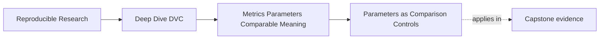
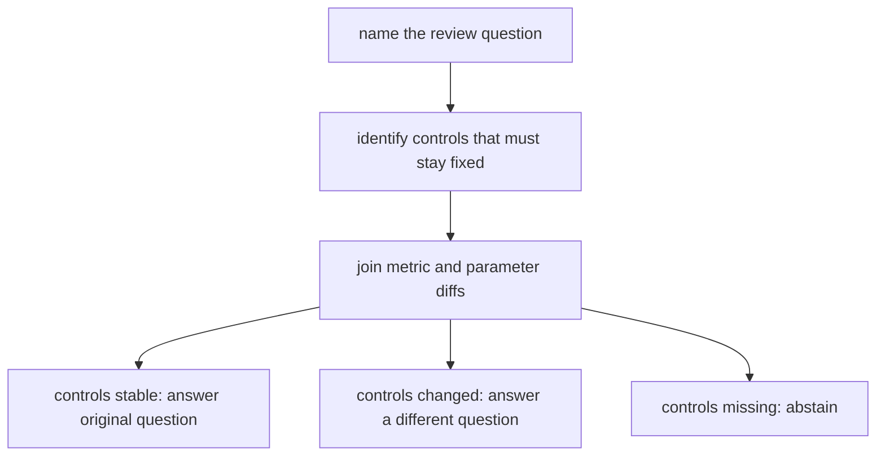

# Parameters as Comparison Controls


<!-- page-maps:start -->
## Page Maps




<!-- page-maps:end -->

Parameters are part of the result story.

If a parameter influences training, evaluation, filtering, or publishing, it is not an
incidental knob. It is part of the comparison surface.

That means a reviewer should be able to answer:

> Which controls changed between these two results, and do those changes still allow the
> comparison we are making?

DVC helps by tracking declared parameter values. You still have to decide which values
deserve that treatment.

## Controls that belong in review

Good parameter candidates usually affect the meaning of a result:

- model family
- regularization strength
- random seed
- train/test split policy
- feature inclusion toggles
- label filtering thresholds
- evaluation threshold
- minimum population size
- release acceptance tolerance

Example:

```yaml
fit:
  model_family: logistic_regression
  regularization: 0.2
  random_seed: 20260411
evaluate:
  threshold: 0.65
  minimum_population_size: 400
```

When these values are declared in `dvc.yaml`, DVC can record them in lock evidence and
show changes with `dvc params diff`.

```yaml
stages:
  evaluate:
    cmd: python -m incident_escalation_capstone.evaluate
    deps:
      - models/escalation-model.json
      - data/prepared/incidents.parquet
    params:
      - evaluate.threshold
      - evaluate.minimum_population_size
    outs:
      - metrics/metrics.json
```

Now an evaluation threshold change is not a private code edit. It is a declared control
change.

## Not every constant is a parameter

The answer is not "put every value in `params.yaml`."

Some values are ordinary implementation details:

- a local variable name
- a formatting width
- a retry delay for a non-resulting network call
- a temporary file suffix
- an internal chunk size that does not change semantics or intended comparison

The review question is:

> Would changing this value alter the result, the comparison, or the release judgment?

If yes, it probably belongs in the parameter surface. If no, forcing it into
`params.yaml` may add noise rather than clarity.

## Parameter drift changes the comparison

Suppose two runs report:

```json
{
  "positive_class_f1_at_fixed_threshold": 0.81
}
```

and:

```json
{
  "positive_class_f1_at_fixed_threshold": 0.84
}
```

The improvement looks simple until `dvc params diff` shows:

```text
Path                  Old    New
evaluate.threshold    0.65   0.50
```

Now the review question changes. The team is no longer comparing model behavior under the
same threshold. It may be comparing a threshold policy change.

That can still be valuable, but the conclusion must be honest:

- "model quality improved under the same controls" is not justified
- "the threshold policy changed and the resulting F1 improved" may be justified

The parameter diff changes what the metric diff means.

## Join the two diffs before writing the claim

The metric-contract audit gives you two candidates with the same numeric movement:

```text
baseline F1  = 0.7368
candidate F1 = 0.7826
delta        = 0.0458
```

Open these directories:

```text
artifacts/audit/reproducible-research/deep-dive-dvc/metric-contracts/workspace/
├── comparable-candidate/evidence/
└── control-drift/evidence/
```

Each contains both:

- `dvc-metrics-diff.json`
- `dvc-params-diff.json`

The comparable candidate has an empty parameter diff:

```json
{}
```

The control-drift candidate reports:

```json
{
  "params.yaml": {
    "decision.threshold": {
      "old": 0.65,
      "new": 0.5,
      "diff": -0.15
    }
  }
}
```

The metric receipt is not wrong in either case. The parameter receipt changes the claim
you may attach to it.

| Evidence | Strongest supported interpretation |
| --- | --- |
| metric changed; semantic controls stable | same-control metric movement |
| metric changed; threshold changed | combined behavior and threshold-policy movement |
| metric changed; a relevant control is missing | comparison requires abstention or repair |

For the control-drift case, write:

> F1 increased by `0.0458` while the fixed-threshold policy changed from `0.65` to `0.50`.
> This supports investigation of the new threshold policy, not a same-threshold model
> improvement claim.

Do not write:

> F1 improved by `0.0458`.

The shorter sentence hides the changed control and implies continuity that the evidence
does not support.

## Controls define the comparison question

A parameter change does not make a run bad. It changes the question.

Suppose the team wants to answer:

> Did candidate predictions improve under the release threshold already in force?

Then `decision.threshold` must stay fixed. The control-drift candidate cannot answer that
question.

Suppose instead the team wants to answer:

> What precision-recall behavior results from lowering the operational threshold?

Then changing `decision.threshold` is the point of the run. The candidate can enter that
investigation, but it needs threshold-specific safeguards and must not be described as a
same-control model comparison.



This is why parameter placement starts with review intent. A value belongs on the
comparison surface when changing it changes which question the result can answer.

## Hidden controls are stale-result risk

The most dangerous parameter is the influential value that DVC cannot see.

Examples:

- a threshold hard-coded in Python
- a split seed read from an unlisted config file
- an environment variable controlling evaluation behavior
- a default value that changed in a library call
- a command-line flag used in documentation but not declared in `dvc.yaml`

Some of these belong directly in `params.yaml`. Some may belong in environment management
or command declaration. The important point is that influential controls need a review
home.

If a threshold matters to the result, hiding it in code makes every metric comparison
harder to defend.

## A simple placement rule

Use this table as a starting point:

| Value | Usual placement | Reason |
| --- | --- | --- |
| model family | `params.yaml` and stage `params` | changes the model being compared |
| evaluation threshold | `params.yaml` and stage `params` | changes metric interpretation |
| random seed | `params.yaml` and stage `params` | controls repeatability and comparison |
| Python package version | lockfile or environment evidence | runtime control, not a DVC metric parameter by itself |
| plot title | usually code or report configuration | usually presentation, unless release policy depends on it |
| publish acceptance tolerance | `params.yaml` or release contract | affects release decision |

The table is not a replacement for judgment. It is a way to name the comparison role of a
value before deciding where it lives.

## Review checkpoint

You understand this core when you can:

- name the controls that affect a metric comparison
- decide whether a value belongs in `params.yaml`
- explain how `dvc params diff` changes metric interpretation
- identify hidden controls that make comparisons weak
- avoid turning `params.yaml` into a junk drawer of harmless constants

Use the two evidence directories above to write one accepted same-control claim and one
rejected overclaim. Name the exact parameter receipt that separates them.

Parameter discipline is not bureaucracy. It is how future reviewers learn what changed
beside the number.
