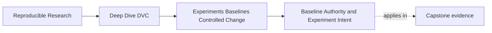
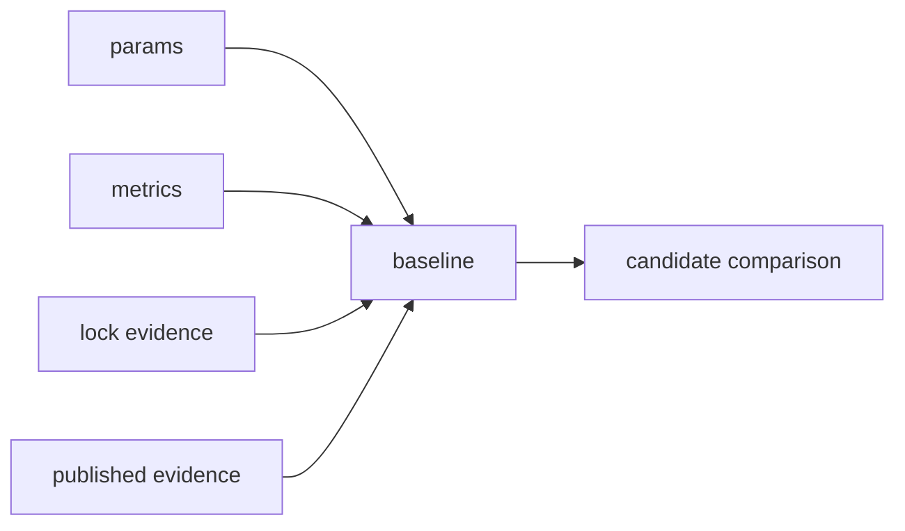
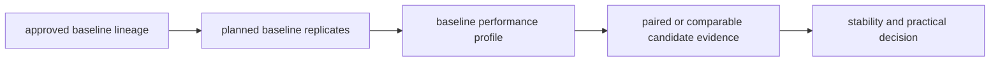

# Baseline Authority and Experiment Intent


<!-- page-maps:start -->
## Page Maps




<!-- page-maps:end -->

An experiment is only meaningful when it has something stable to compare against.

That stable reference is the baseline.

In this module, a baseline is not just "the current files." It is the recorded state that
the team is willing to use as the comparison anchor:

- declared data identity
- declared pipeline graph
- declared parameters
- recorded metrics
- known environment assumptions
- published or reviewable evidence

If the baseline is fuzzy, experiments become storytelling.

## What the baseline protects

A good baseline protects the question:

> Compared with what?

Without that answer, a candidate result can look better for the wrong reason.

Example:

```text
baseline:
  model_family: logistic_regression
  evaluate.threshold: 0.65
  positive_class_f1_at_fixed_threshold: 0.81

candidate:
  model_family: logistic_regression
  evaluate.threshold: 0.50
  positive_class_f1_at_fixed_threshold: 0.84
```

The candidate may be valuable, but the baseline immediately clarifies that the threshold
changed. The review should discuss a threshold-control change, not pretend the model
improved under identical controls.

## Intent comes before execution

Before running a candidate, write the intent in one sentence.

Weak:

> Try some stuff and see if the metric improves.

Stronger:

> Lower the escalation threshold from `0.65` to `0.50` to test whether recall improves
> enough to justify a precision tradeoff.

That sentence tells a reviewer:

- what changed
- why the change exists
- which metric movement would matter
- which tradeoff needs review

The intent does not need to be long. It needs to be specific enough that the experiment
does not become a pile of unrelated changes.

## Baseline evidence should be inspectable

The baseline should not live only in memory.

Useful evidence includes:

- `params.yaml` for current controls
- `metrics/metrics.json` for current results
- `dvc.lock` for recorded execution state
- `publish/v1/params.yaml` and `publish/v1/metrics.json` for promoted state
- review notes or guides that describe release meaning



The point is not to create paperwork. The point is to keep comparison from depending on
who remembers the run.

## Four states that are easy to call "the baseline"

Teams often use *baseline* for several different things:

| State | What it tells you | Why it may not be authoritative |
| --- | --- | --- |
| current workspace | what is on disk now | it may contain candidate or unrelated edits |
| experiment parent | which Git commit the run started from | the commit may not be the approved comparison anchor |
| latest successful run | what executed most recently | success does not establish review authority |
| approved baseline | the state accepted for this comparison question | this is the anchor the candidate must preserve or explicitly replace |

Those states can coincide, but do not assume they do.

Imagine that `main` records threshold `0.65`. A learner changes the threshold to `0.50`,
runs a candidate, and then edits the baseline note to say the baseline used `0.60`. The
Git parent is unchanged and the candidate executes. The comparison anchor is still
corrupted because its claim no longer matches the recorded baseline.

That is the defect reproduced as `MUTATED_BASELINE_CONTRACT` in the capstone audit.

## Build a baseline proof packet

Before the candidate exists, capture enough state to answer four questions:

1. **Identity:** which governed revision and baseline name authorize comparison?
2. **Controls:** which parameters belong to that state?
3. **Population:** which records or cohort define evaluation?
4. **Meaning:** which metric schema and expected results make the anchor recognizable?

The experiment specimen records those answers in:

```text
experiment-contract.json
params.yaml
data/evaluation.csv
metrics/metrics.json
```

The generated audit preserves the resolved baseline in:

```text
workspace/controlled-threshold/workspace/evidence/baseline-params.json
workspace/controlled-threshold/workspace/evidence/baseline-metrics.json
```

The first file shows declared controls. The second carries population identity, metric
schema, and quantitative results. Neither is sufficient alone.

Run:

```bash
make PROGRAM=reproducible-research/deep-dive-dvc capstone-experiment-comparability-audit
```

Then compare the baseline evidence in `controlled-threshold` and
`mutated-baseline-contract`. Both candidates run. Only one still has an honest anchor.

## Intent constrains the allowed change set

A useful intent is not merely a sentence attached after execution. It constrains what the
candidate is allowed to change.

The specimen says:

```json
{
  "intent": "lower the escalation threshold to test recall gain against precision cost",
  "allowed_changes": ["decision.threshold"],
  "target_threshold": 0.5
}
```

These fields answer different questions:

- `intent` states the causal question
- `allowed_changes` bounds attribution
- `target_threshold` makes the planned intervention testable

If `decision.review_capacity` also changes, the candidate has violated its own scope even
when that second change is declared. Declaration makes a change visible; it does not make
the change relevant to the stated question.

## Baseline authority can expire

A baseline is not permanent just because it exists.

It may stop being a fair comparison anchor when:

- the evaluation population changes
- the metric definition changes
- the pipeline graph changes meaningfully
- the environment strategy changes
- the release goal changes
- a data correction invalidates prior results

When that happens, do not hide the break inside an experiment. Name it as baseline
boundary work. The team may need a new baseline before candidate comparisons are fair
again.

## Decide between a candidate and a new baseline

Use this decision table before running:

| Proposed change | Ordinary candidate? | Why |
| --- | --- | --- |
| lower one governed threshold on the same records | yes | the baseline question and metric meaning remain intact |
| replace the evaluation cohort | no | population continuity breaks |
| rename a metric without changing its definition | possibly, with schema review | consumers may still depend on the old contract |
| redefine recall to exclude a class | no | the same metric name would carry different meaning |
| correct mislabeled baseline records | no | prior results no longer describe a trustworthy anchor |
| vary one model hyperparameter | yes, if all other comparison controls remain stable | attribution remains bounded |

“No” does not mean the change is forbidden. It means the work must establish and approve
a new baseline before ranking candidates against it.

## Diagnose the baseline before reading the score

When a candidate report arrives, use this order:

1. identify the approved baseline
2. verify its recorded controls and expected result
3. verify its population and metric schema
4. name the candidate intent and allowed changes
5. only then inspect candidate movement

This order is deliberately conservative. Reading a promising score first makes it easier
to rationalize a broken comparison after the fact.

## A baseline is not a prison

Baseline discipline does not mean "never change anything important."

It means important changes should be described honestly.

Changing a threshold can be a valid experiment. Changing the evaluation population may be
valid too, but it changes the comparison claim. Replacing the metric definition may be
necessary, but it should not be smuggled into a candidate run and compared as if nothing
else moved.

The baseline gives exploration a stable reference point. It does not forbid learning.

## A stochastic baseline is a distribution, not a lucky run

When the workflow contains meaningful randomness, one approved seed is a lineage anchor
but a weak performance anchor.

Suppose five baseline runs produce F1 values:

```text
0.741, 0.752, 0.738, 0.747, 0.744
```

Approving only `0.752` because it is the best run makes every later comparison start from
an unusually favorable reference. Approving only `0.738` creates the opposite bias.

A stochastic baseline packet should preserve:

| Surface | Required content |
| --- | --- |
| lineage | code, data, runtime, pipeline, and parameter authority |
| variation plan | seed or sampling controls allowed to vary |
| replicate identities | one record for every included run |
| summary rule | center and spread chosen before candidate review |
| failed-run policy | which failures remain in the evidence and how they count |
| practical policy | minimum gain and safeguards |



The profile does not replace exact run records. It gives candidate movement a reference
distribution.

## Match candidate evidence to baseline evidence

Comparison design should be symmetric:

- one baseline seed versus one candidate seed supports only that paired contrast;
- a baseline replicate distribution versus one candidate run creates unequal evidence;
- paired baseline and candidate runs under the same planned seeds can isolate the
  intervention more clearly;
- a new evaluation sample requires renewed baseline evidence on that sample.

Do not borrow old baseline uncertainty estimates after changing data, runtime, metric
contract, or training procedure. Those changes can alter the variation process itself.

## Record why the baseline profile is authoritative

Extend the proof packet:

```text
baseline/profile.json
baseline/replicates.tsv
baseline/variation-contract.json
baseline/failures.tsv
baseline/approval.md
```

The approval should say whether the baseline authority covers:

- exact reconstruction of one run;
- expected behavior across declared seeds;
- a governed evaluation population;
- a time window;
- a runtime family;
- a promotion policy.

These scopes are not interchangeable.

## Renew the anchor without hiding history

A new baseline may be justified when:

- evaluation population authority changes;
- metric semantics change;
- runtime or training method changes the variation profile;
- a promoted candidate becomes governed reference;
- the old profile no longer represents current operations.

Preserve the old anchor and state the transition:

```text
old baseline:
reason it no longer answers the current question:
new baseline inputs and variation plan:
cross-boundary comparison allowed?:
approval:
```

If cross-boundary comparison is not justified, report two eras rather than drawing one
continuous improvement line.

## Review checkpoint

You understand this core when you can explain:

- what state the baseline represents
- which files make the baseline inspectable
- what one candidate run intends to test
- why baseline authority can expire
- when a change should be treated as baseline boundary work rather than an ordinary experiment
- why an unchanged Git parent does not prove that the baseline contract stayed honest
- which four surfaces form a minimal baseline proof packet
- why a stochastic baseline needs planned replicate evidence rather than a selected run
- when baseline and candidate uncertainty evidence are symmetric enough to compare
- when a changed variation process requires a renewed baseline

Controlled change starts with a baseline that means something.
