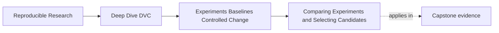
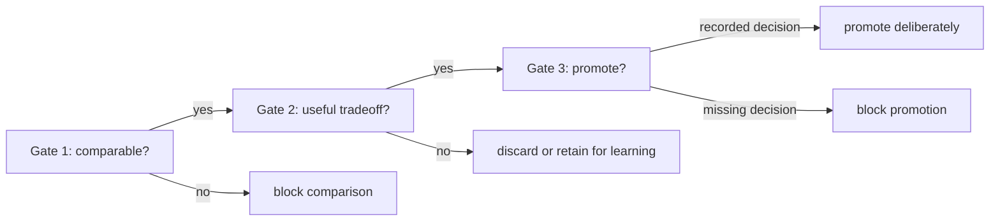

# Comparing Experiments and Selecting Candidates


<!-- page-maps:start -->
## Page Maps




<!-- page-maps:end -->

Experiment comparison is not a leaderboard ritual.

The candidate with the highest single metric is not automatically the candidate that
should move forward. A good comparison asks whether the candidate is comparable, what
tradeoff it makes, and whether the result supports the intent that created it.

## Start with comparability

Before ranking candidates, ask whether they can be compared.

Useful checks:

- same baseline or an explicitly named baseline change
- same evaluation population
- same metric definitions
- declared parameter changes
- no hidden data or environment drift
- no unrelated pipeline change mixed into the candidate

If these checks fail, the right next step is not to pick a winner. It is to repair the
comparison story.

## Use gates, not one blended score

Review in three gates:



Each gate has a different burden:

| Gate | Required evidence | Possible outcome |
| --- | --- | --- |
| comparability | baseline, intent, changed controls, population, metric schema, successful run | block or compare |
| usefulness | metric movement, safeguards, uncertainty, operational objective | discard, retain, or keep for promotion review |
| promotion | decision owner, evidence links, resulting Git state, rollback or rejection reason | promote or block |

A candidate cannot compensate for failing an earlier gate by scoring highly at a later
one.

## Read the generated comparison

Run:

```bash
make -C programs/reproducible-research/deep-dive-dvc/capstone experiment-comparability-audit
```

The controlled case compares:

| Surface | Baseline | Candidate |
| --- | ---: | ---: |
| threshold | `0.65` | `0.50` |
| population count | `8` | `8` |
| population digest | unchanged | unchanged |
| metric schema | `classification-v1` | `classification-v1` |
| precision | `1.0000` | `0.8333` |
| recall | `0.6000` | `1.0000` |
| F1 | `0.7500` | `0.9091` |

The result is eligible for discussion because the comparison controls hold. The policy
then asks whether recall gain is at least `0.15` and precision remains at least `0.60`.
Both safeguards pass.

The audit returns `KEEP_FOR_PROMOTION_REVIEW`, not `PROMOTE`.

## Compare the whole review surface

A candidate can improve one metric and make another worse.

Example:

```text
baseline:
  threshold: 0.65
  f1: 0.81
  precision: 0.78
  recall: 0.84

candidate:
  threshold: 0.50
  f1: 0.84
  precision: 0.75
  recall: 0.95
```

This is not simply "better." It is a threshold tradeoff.

If the release goal is to reduce missed escalations, the candidate may be promising. If
the release goal is to avoid false alarms, it may be unacceptable. The metric values do
not decide without the review objective.

Use explicit deltas:

```text
recall:    0.6000 -> 1.0000  (+0.4000)
precision: 1.0000 -> 0.8333  (-0.1667)
f1:        0.7500 -> 0.9091  (+0.1591)
```

Then translate them into operational meaning:

- two previously missed positive incidents are now escalated
- one negative incident now becomes a false escalation
- the candidate meets the minimum precision safeguard

This translation makes the release objective challengeable. “F1 improved” hides the
actual exchange.

## Use candidate tables carefully

Candidate tables are helpful when they do not hide meaning.

```text
candidate                         threshold    f1     precision    recall    review note
baseline                          0.65         0.81   0.78         0.84      current release
lower-threshold-for-recall        0.50         0.84   0.75         0.95      recall gain, precision cost
stricter-threshold-for-precision  0.75         0.77   0.86         0.68      precision gain, recall cost
```

This table is useful because it shows the control that moved and the tradeoff, not only a
ranked metric.

Weak table:

```text
candidate    f1
a            0.84
b            0.81
c            0.77
```

That table invites a winner without explaining what changed.

Do not include incomparable candidates in the same ranked section. Keep a separate
eligibility column or rejected-candidate table:

| Candidate | Comparable? | Decision | Reason |
| --- | --- | --- | --- |
| controlled threshold | yes | keep for promotion review | bounded recall-precision tradeoff |
| mixed controls | no | block comparison | attribution exceeds intent |
| population drift | no | block comparison | different evaluation records |
| metric schema drift | no | block comparison | metric meaning changed |

A blocked row is not “last place.” It is outside the ranking population.

## Selection is a decision, not a discovery

The review should distinguish:

- observed metric movement
- parameter or data changes that explain the movement
- known tradeoffs
- release objective
- reason to keep, discard, or promote the candidate

A strong candidate note might say:

> Keep `lower-threshold-for-recall` for promotion review because it improves recall from
> `0.84` to `0.95` on the same evaluation population, with an expected precision drop from
> `0.78` to `0.75`. This matches the current release objective only if the precision cost
> remains acceptable.

That is a decision argument. It is stronger than "best F1."

## Separate observed, inferred, and decided claims

A review note should label its reasoning:

| Claim type | Example |
| --- | --- |
| observed | recall increased from `0.60` to `1.00` |
| observed | precision decreased from `1.00` to `0.8333` |
| verified continuity | population digest and metric schema are unchanged |
| inferred | the lower threshold caused the measured tradeoff |
| policy judgment | the precision cost is acceptable for promotion review |
| governance decision | the candidate is approved for governed history |

The causal inference is defensible only because the change set is bounded and controls
remain stable. The governance decision requires a named owner and durable record beyond
the experiment metrics.

## Treat inconclusive runs honestly

Not every candidate needs to be promoted or fully explained.

Some runs are inconclusive:

- metric movement is within expected noise
- tradeoff does not match the release objective
- comparability evidence is incomplete
- output changed but the reason is unclear
- candidate combined too many changes to interpret

Inconclusive is a valid outcome. The bad outcome is pretending uncertainty is a win.

There are at least three different non-winning outcomes:

| Outcome | Meaning | Next action |
| --- | --- | --- |
| blocked comparison | evidence cannot support ranking | repair scope or establish a new baseline |
| comparable but unattractive | evidence is valid, tradeoff misses the objective | discard or retain for learning |
| comparable but uncertain | evidence is valid, decision burden is unmet | gather bounded additional evidence |

Do not call all three “failed experiments.” Their lessons and repair paths differ.

## Write a decision that can be reviewed

For `CONTROLLED_THRESHOLD`, a defensible note is:

> Keep the threshold `0.50` candidate for promotion review. Against the approved
> `incident-review-v1` baseline, it raises recall from `0.60` to `1.00` and lowers
> precision from `1.00` to `0.8333`. The population digest and `classification-v1`
> metric schema remain unchanged, and `decision.threshold` is the only changed control.
> The candidate passes the stated recall-gain and minimum-precision safeguards. This is
> not yet authorization to update the governed baseline.

Every sentence maps to evidence or names the remaining decision boundary.

## Review checkpoint

You understand this core when you can:

- check comparability before ranking candidates
- compare metrics with parameters and review intent
- explain tradeoffs instead of naming only the highest metric
- identify inconclusive candidates
- write a selection note that another reviewer can challenge
- keep blocked candidates outside metric rankings
- distinguish observed movement, causal inference, policy judgment, and promotion authority

Candidate selection is where experiments become engineering judgment instead of metric
shopping.
