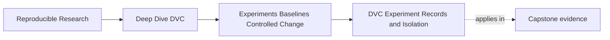
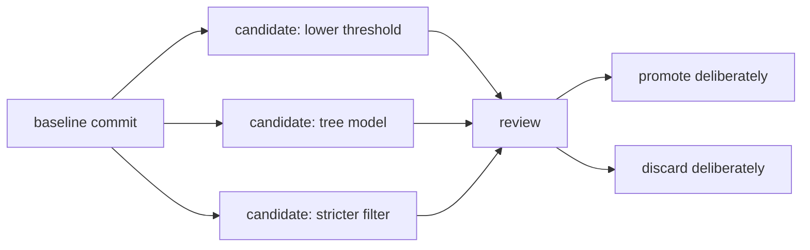

# DVC Experiment Records and Isolation


<!-- page-maps:start -->
## Page Maps




<!-- page-maps:end -->

DVC experiments help teams explore without turning every candidate into a permanent Git
commit.

That is useful, but it is easy to overstate.

DVC experiment commands help record and compare candidate runs. They do not make every
candidate scientifically valid, semantically comparable, or ready to promote.

## What an experiment record is for

An experiment record gives a candidate run a reviewable handle:

- which baseline commit it came from
- which declared parameters changed
- which metrics were produced
- which outputs were produced
- which command and pipeline state were involved

That means you can ask:

> What changed compared with the baseline, and what evidence did the run produce?

This is already stronger than "I ran a notebook last night."

## A small command sequence

A simple candidate run might look like:

```bash
dvc exp run --set-param evaluate.threshold=0.50
dvc exp show
dvc exp diff
```

Read that sequence as a review loop:

- run a candidate with a declared parameter change
- inspect the candidate beside other runs
- compare the candidate against its baseline

The commands are not magic. They are a disciplined way to preserve enough context for a
decision.

## Read each command as a narrow receipt

The three commands answer different mechanical questions:

| Command | Strongest supported claim | Claim it does not support |
| --- | --- | --- |
| `dvc exp run` | DVC executed a candidate from available repository and workspace state | the candidate is comparable or useful |
| `dvc exp show` | DVC can enumerate recorded experiment revisions and selected values | every displayed row shares one valid comparison contract |
| `dvc exp diff` | DVC can describe selected differences between revisions | the differences are allowed by the experiment intent |

This matters because polished command output is persuasive. A row in `dvc exp show` looks
rankable even when its population or metric definition changed.

The audit stores the raw receipts under:

```text
workspace/<case>/workspace/evidence/receipts.json
```

Find these keys:

```text
candidate_run
experiment_show
experiment_diff
```

In `POPULATION_DRIFT`, all three commands can succeed. The comparison still blocks because
the candidate population digest differs from the baseline.

## Know which state DVC is recording

An experiment can combine:

- the Git commit used as its parent
- committed pipeline declarations
- uncommitted workspace changes included in the run
- parameter overrides
- generated outputs and metrics
- DVC's experiment revision

Those layers are useful, but they create a common misunderstanding:

> The experiment has the same Git parent, therefore it has the same baseline.

The parent identifies ancestry. It does not prove that the uncommitted population, metric
schema, or experiment contract remained stable.

The audit checks `baseline_git_commit_is_unchanged` separately from:

- `baseline_matches_recorded_contract`
- `evaluation_population_is_stable`
- `metric_schema_is_stable`

That separation shows why one green ancestry check cannot substitute for semantic
continuity.

## Inspect before and after records together

An opaque experiment identifier is useful for addressing a run, but it is not enough for
review. Preserve or resolve these surfaces:

```text
baseline Git commit
baseline params
baseline metrics and population identity
candidate params
candidate metrics and population identity
experiment command receipts
candidate intent and allowed changes
```

Then ask:

1. Did the candidate run?
2. Did the intended control change?
3. Did any additional control change?
4. Did the population remain identical?
5. Did metric meaning remain identical?
6. Does the observed tradeoff meet the review policy?

The first question is mechanical. The remaining questions make the record interpretable.

## Isolation from Git history

DVC experiments can keep exploratory runs separate from main Git history.

That matters because a candidate may be:

- promising but not verified
- useful for learning but not for release
- inferior to the baseline
- based on a control change that needs discussion
- a dead end that should not become a permanent commit



The separation gives exploration room without letting every trial rewrite the baseline
story.

## Isolation protects history, not the candidate

DVC experiment isolation reduces premature Git commits. It does not create a sandbox in
which every input is scientifically independent.

For example:

```text
baseline commit
  |
  +-- controlled threshold candidate
  +-- population-drift candidate
  +-- metric-schema candidate
```

All three may remain outside normal Git history. Only the first is an ordinary comparison.
The other two need boundary work before ranking.

Isolation therefore answers:

> Has this exploratory result been promoted into governed Git history?

It does not answer:

> Does this exploratory result deserve to be compared with the approved baseline?

## What isolation does not solve

DVC experiment isolation does not automatically solve:

- poor experiment design
- hidden environment drift
- incomparable metric definitions
- undeclared pipeline inputs
- data changes that invalidate the baseline
- a better metric that fails the release objective

Those are still engineering and review problems.

For example, if a candidate changes the evaluation population without saying so, DVC may
record the run cleanly. The comparison can still be misleading.

The tool preserves evidence. It does not replace judgment.

## Run the audit as a command-reading lab

From the repository root:

```bash
make -C programs/reproducible-research/deep-dive-dvc/capstone experiment-comparability-audit
```

Choose `controlled-threshold` and `population-drift`.

For each case:

1. read `candidate_run` in `receipts.json`
2. confirm the return code is zero
3. compare `experiment_show` and `experiment_diff`
4. inspect `finding.json`
5. explain why equal command success leads to different comparison decisions

If your explanation stops at “the data changed,” make it more precise. Name the failed
claim: the candidate no longer measures the same population, so metric movement cannot be
attributed only to the threshold intervention.

## Naming and notes matter

Experiment records become much easier to review when the candidate has a clear label or
note.

Weak:

```text
exp-a31c4
```

Better review language:

```text
lower-evaluation-threshold-for-recall
```

The exact mechanics for naming or annotating can vary by workflow, but the principle is
stable: the candidate should carry intent, not only an opaque identifier.

Two years later, the team should not need to remember why a candidate existed.

## Workspace discipline still matters

Experiments can touch the workspace. Learners should keep the workspace understandable:

- know which baseline commit the candidate came from
- avoid unrelated local edits while reviewing candidates
- inspect parameter and metric differences before applying anything
- avoid treating applied experiment state as promoted history until it is committed and reviewed

This discipline prevents the common failure where a candidate result quietly becomes the
new local truth without a promotion decision.

Before and after any `dvc exp apply`, capture:

```bash
git status --short
git diff -- params.yaml dvc.yaml
dvc status
```

The first two expose workspace and declaration changes. The third exposes DVC pipeline
state. None records a promotion decision by itself.

## Review checkpoint

You understand this core when you can explain:

- what a DVC experiment record helps preserve
- how experiment candidates stay separate from main Git history
- what `dvc exp show` and `dvc exp diff` help review
- which validity questions DVC does not answer by itself
- why clear candidate intent matters beside command output
- why a shared Git parent is weaker than a verified baseline contract
- how a successful experiment receipt differs from comparison evidence

DVC experiments are an evidence surface for exploration. They are not a substitute for a
clear experiment question.
