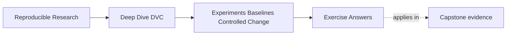
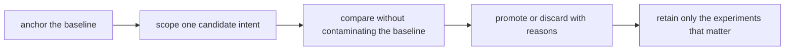

# Exercise Answers

<!-- page-maps:start -->
## Page Maps

<!-- page-maps:end -->

These answers are model explanations, not the only acceptable wording.

## How to use the answer page well

Do not read the model answer first and then reduce every experiment to "keep the best
row."

A better rhythm is:

1. finish the exercise with your own experiment packet
2. name the baseline, candidate intent, and promotion question
3. compare your reasoning with the model answer
4. revise anywhere your answer skips contamination risk, tradeoff review, or post-apply
   inspection

What matters is whether the reasoning keeps baseline authority, candidate scope, evidence,
and promotion decisions connected.

Strong Module 06 answers usually do five things:

- they treat baseline as evidence, not memory
- they keep candidate intent focused enough to interpret
- they describe what DVC experiment recording preserves without overclaiming
- they write promotion notes in terms of tradeoffs and release goals
- they preserve only the experiments that actually matter to future review

The strongest self-study packets also leave behind six concrete artifacts:

- one baseline description
- one candidate-scope judgment
- one tradeoff review note
- one contamination repair
- one promotion review
- one retention policy

If your answers rely only on "this candidate scored highest," the reasoning is still too
thin.

## Answer 1: Name the baseline

Strong baseline description:

> The baseline uses `evaluate.threshold: 0.65` and reports F1 `0.81`, precision `0.78`,
> and recall `0.84`. Candidate experiments should compare against the same declared
> parameter surface, metric definition, evaluation population, and governed Git state
> unless a baseline boundary change is explicitly reviewed.

Evidence to inspect:

- `params.yaml`
- `metrics/metrics.json`
- `dvc.lock`
- published baseline files such as `publish/v1/params.yaml` and `publish/v1/metrics.json`
- any release or prediction review guide that explains the metric meaning

What would make the baseline no longer clean:

- uncommitted semantic changes
- changed data or evaluation population without baseline review
- metric schema changes that silently alter meaning

Baseline must be evidence, not memory, because later reviewers need to reconstruct the
comparison from files rather than from what the original runner remembers.

## Answer 2: Scope a candidate

This should usually be separate candidate runs.

Reasoning:

- lowering `evaluate.threshold` tests a policy tradeoff
- switching `fit.model_family` tests a model choice
- removing weekends changes the evaluation population and may require boundary review

What the team loses by combining them too early:

- clean attribution of which change caused the metric movement
- a stable interpretation of baseline continuity
- the ability to promote only one justified change

A defensible combined run exists only if the team explicitly proposes a full policy shift,
not a clean single-factor comparison.

## Answer 3: Interpret a candidate table

Strong review note:

> The candidate lowers `evaluate.threshold` from `0.65` to `0.50`. F1 rises from `0.81`
> to `0.84`, and recall rises from `0.84` to `0.95`. Precision falls from `0.78` to
> `0.75`. This candidate is promising if the release objective prioritizes reducing missed
> escalations enough to justify more false positives. It is unattractive if precision
> stability or operator workload is the stronger business constraint.

The main lesson is to name the tradeoff rather than celebrating the higher F1 alone.

## Answer 4: Identify what DVC experiments do not prove

Strong response:

> DVC experiments help record candidate runs, parameter differences, metrics, and
> comparison evidence without immediately rewriting main Git history. They do not prove
> that the candidate is semantically comparable, environmentally stable, aligned with the
> release objective, or safe to promote. Those questions still require review of baseline,
> control changes, metric meaning, and release policy.

Example of a well-recorded but non-promotable candidate:

- a candidate with better recall that changed the evaluation population or metric schema
  at the same time, making the comparison non-comparable

## Answer 5: Decide promotion or discard

Before applying the candidate, inspect:

- parameter diff
- metric diff
- baseline identity
- evaluation population evidence
- metric schema continuity
- whether unrelated workspace changes exist

After applying the candidate, check:

- `git diff`
- `git status`
- expected updates to `params.yaml`, metrics, lockfiles, or published artifacts
- no unrelated semantic drift
- any capstone-specific review path outputs

Strong promotion note should include:

- baseline and candidate identities
- threshold changed from `0.65` to `0.50`
- recall improved while precision decreased
- the release objective prioritizes missed-escalation reduction
- comparison surfaces remained stable, if verified
- exact Git state preserved by the promotion commit

One reason to reject promotion even if recall improved:

- the precision loss violates a release safeguard or the comparison packet cannot prove
  stable metric meaning and population continuity

## Answer 6: Queue a controlled parameter sweep

A good sweep has:

- a stated hypothesis
- bounded parameter values that matter scientifically
- a table shape with one candidate per row and stable metric columns

The sweep should be narrow enough that each candidate still teaches something. Wider
search becomes noise when values are arbitrary or when the team cannot explain why those
settings belong in the hypothesis space.

## Answer 7: Reproduce one experiment outside the queue

The reconstructed run should identify:

- the exact code state
- the tracked data identity
- parameter values
- environment identity

Then it should compare the reproduced metrics with the experiment record.

A mismatch that forces deeper audit is:

- different metrics or artifacts despite matching declared code, data, parameters, and
  environment, because that suggests either missing evidence or an undeclared influence

## Answer 8: Detect a contaminated baseline

Uncommitted semantic changes blur whether the result belongs to the named baseline or to
an unrecorded intermediate state. Strong evidence names the dirty paths and shows that the
candidate is no longer a clean comparison against the last committed baseline.

The repair is not to rename the candidate after the fact. The repair is to:

- commit the intended baseline first, or
- discard the contaminated run, or
- isolate unrelated work before rerunning

The main lesson is that provenance breaks at the baseline boundary before it breaks in the
experiment table.

## Answer 9: Write a promotion review

The note must make the decision reconstructable months later. A strong note names:

- baseline identity
- candidate identity
- exact changed controls
- observed tradeoffs
- known limitations or open risks
- the Git revision and promoted files that preserve the chosen state

Rejection is appropriate when:

- the gain violates safeguards
- the candidate changes too many semantic surfaces at once
- evidence is incomplete
- the candidate cannot be reproduced independently

## Answer 10: Manage experiment retention

Strong retention policy:

- disposable: keep only short-lived learning notes; cleanup is allowed quickly
- reproducible: retain semantic inputs, metric outputs, and enough metadata to rerun
- decision-relevant: also retain comparison rationale and baseline linkage
- release-relevant: retain durable artifacts, provenance, and recovery evidence

Why this matters:

- not every experiment deserves long-term weight, but important decisions become
  unreviewable if the key evidence is cleaned away too early

## Self-check

If your answers consistently explain:

- what baseline state anchors the comparison
- what each candidate is trying to learn
- what DVC experiment evidence can and cannot prove
- which tradeoffs matter for selection
- why promotion needs applying, inspecting, and committing a defensible state

then you are using Module 06 correctly.
