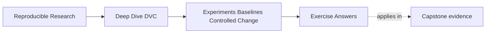
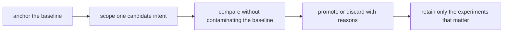

# Exercise Answers


<!-- page-maps:start -->
## Page Maps




<!-- page-maps:end -->

These answers are model explanations, not the only acceptable wording.

## How to use the answer page well

Do not read the model answer first and then reduce every experiment to "keep the best
row."

A better rhythm is:

1. finish the exercise with your own experiment packet
2. name the baseline, candidate intent, and promotion question
3. compare your reasoning with the model answer
4. revise anywhere your answer skips contamination risk, tradeoff review, or post-apply
   inspection

What matters is whether the reasoning keeps baseline authority, candidate scope, evidence,
and promotion decisions connected.

Strong Module 06 answers usually do five things:

- they treat baseline as evidence, not memory
- they keep candidate intent focused enough to interpret
- they describe what DVC experiment recording preserves without overclaiming
- they write promotion notes in terms of tradeoffs and release goals
- they preserve only the experiments that actually matter to future review

The strongest self-study packets also leave behind six concrete artifacts:

- one baseline description
- one candidate-scope judgment
- one tradeoff review note
- one contamination repair
- one promotion review
- one retention policy

If your answers rely only on "this candidate scored highest," the reasoning is still too
thin.

## Answer 1: Predict the decision gates

Model table:

| Case | DVC runs? | Comparable? | Promotable now? | Decision |
| --- | --- | --- | --- | --- |
| controlled threshold | yes | yes | no decision yet | `KEEP_FOR_PROMOTION_REVIEW` |
| mixed control change | yes | no | no | `BLOCK_COMPARISON` |
| mutated baseline contract | yes | no | no | `BLOCK_COMPARISON` |
| population drift | yes | no | no | `BLOCK_COMPARISON` |
| metric schema drift | yes | no | no | `BLOCK_COMPARISON` |
| missing candidate intent | yes | no | no | `BLOCK_COMPARISON` |
| unsafe promotion request | yes | yes | no | `BLOCK_PROMOTION` |

The important correction for many learners is the first column: all seven candidates can
execute. The defects are in interpretation or authority, not command completion.

`PASS` in the generated summary means each defect was classified as expected. It does not
mean the blocked candidate passed review.

## Answer 2: Prove the baseline anchor

The controlled proof table should contain:

| Required fact | Contract claim | Recorded evidence | Match? |
| --- | --- | --- | --- |
| threshold | `0.65` | baseline params `0.65` | yes |
| population ID | `incident-review-v1` | baseline metric population ID | yes |
| metric schema | `classification-v1` | baseline metric schema | yes |
| expected metrics | F1 `0.75`, precision `1.0`, recall `0.6` | baseline metrics | yes |

The mutated case differs only in its current contract threshold claim of `0.60`. The
recorded baseline still says `0.65`, so `baseline_matches_recorded_contract` fails.

The unchanged Git commit proves that experiment ancestry did not move. It cannot prove
that an uncommitted contract claim remained honest.

A durable repair is to restore the approved contract from governed history. If `0.60`
really should become authoritative, create and review a new baseline instead of rewriting
what the old run meant.

## Answer 3: Audit the changed paths

Model classification:

| Case | Changed path | Role | Treatment |
| --- | --- | --- | --- |
| controlled | `decision.threshold` | planned intervention | continue |
| mixed | `decision.threshold` | planned intervention | keep in threshold candidate |
| mixed | `decision.review_capacity` | unrelated policy control | split into another candidate |
| schema drift | `decision.threshold` | planned intervention | candidate change |
| schema drift | `evaluation.metric_schema` | comparison control | establish a new baseline |

The exact allowed set is `["decision.threshold"]`.

“Declared” means a system can observe a value. “Allowed” means the value belongs to the
predeclared causal question. An extra declared change can still make attribution invalid.

## Answer 4: Bound the DVC receipts

Model receipt table:

| Receipt | What it proves | What it cannot prove |
| --- | --- | --- |
| candidate run | DVC executed the candidate from available state | stable baseline, population, schema, or policy value |
| experiment show | DVC recorded and can display experiment revisions and selected values | every row is eligible for one ranking |
| experiment diff | DVC can expose selected revision differences | every difference belongs to candidate intent |

Both controlled and population-drift candidates can have zero return codes. Only the
population records establish whether the evaluated incident identities are unchanged.

The precise surrounding claim is:

> The baseline and candidate contain the same evaluation record IDs under the same
> population contract.

## Answer 5: Interpret the controlled tradeoff

Calculations:

```text
recall delta:    1.0000 - 0.6000 = +0.4000
precision delta: 0.8333 - 1.0000 = -0.1667
F1 delta:        0.9091 - 0.7500 = +0.1591
additional true escalations:  2
additional false escalations: 1
```

The candidate exceeds the required recall gain of `0.15` and remains above minimum
precision `0.60`.

Recall-oriented note:

> Keep the candidate for promotion review because it recovers two previously missed
> positive incidents while adding one false escalation, and it remains above the precision
> safeguard.

Zero-false-positive note:

> Reject promotion under this policy because precision falls below `1.00` and one negative
> incident is escalated, despite the recall gain.

The strongest audit decision is `KEEP_FOR_PROMOTION_REVIEW`. The audit can verify the
stated safeguards; it cannot supply organizational authority.

## Answer 6: Diagnose continuity failures

Model table:

| Case | Friendly name | Deeper identity evidence | Change | Why ranking blocks |
| --- | --- | --- | --- | --- |
| population drift | `incident-review-v1` remains | record count and ID digest | ninth incident added | cohort differs |
| metric schema drift | familiar metric keys remain | `metric_schema` | `classification-v1` to `classification-v2` | meaning differs |

A stable label is only a claim. The record digest and schema identifier are evidence that
the underlying comparison contract stayed continuous.

Population drift needs an approved new cohort identity and baseline result. Schema drift
needs a defined schema migration, interpretation guide, and new baseline metrics.

## Answer 7: Design bounded repairs

Model repair map:

| Failure | Repair | New evidence |
| --- | --- | --- |
| mixed controls | split threshold and capacity questions | separate intents and changed-path sets |
| mutated baseline contract | restore the approved contract | contract matching recorded baseline |
| population drift | establish a new population baseline | approved record identity and baseline metrics |
| metric schema drift | establish a new metric baseline | schema definition and recomputed anchor |
| missing intent | write intent before rerun | intent, allowed paths, target intervention |

Rerunning only proves the modified state can execute again. It does not restore the old
population, metric meaning, or experiment question.

## Answer 8: Separate comparison from promotion

Both controlled and unsafe-promotion cases pass:

- baseline contract match
- candidate intent
- allowed changed paths
- intended threshold
- population continuity
- metric schema continuity
- reproduction
- tradeoff safeguards
- unchanged baseline Git commit

Only `promotion_decision_is_recorded` fails in the unsafe request.

Model decision record:

```text
candidate: threshold 0.50 experiment
baseline: approved-incident-triage
decision: approve for governed adoption
owner: incident policy maintainer
observed tradeoff: recall +0.40; precision -0.1667
comparison evidence: controlled-threshold finding and metric records
reason: recall gain exceeds policy target and precision remains above safeguard
resulting commit or rejection: record after clean apply and verification
```

`promotion-request.json` is insufficient because it contains desire without owner,
reasoning, evidence, or resulting state.

## Answer 9: Plan a safe apply

Model route:

1. Before apply, capture `git status --short`, `git diff`, `dvc status`, and candidate
   diff. Stop if unrelated changes exist.
2. Apply the candidate, then repeat Git and DVC observations. Stop if changed paths exceed
   the approved candidate.
3. Reproduce and run verification. Stop if outputs, safeguards, or continuity evidence
   differ from review.
4. Commit only the verified state and attach the commit to the decision record.

The new baseline record needs its governed commit, threshold, population identity and
digest, metric schema, expected metrics, and decision authority.

## Answer 10: Retain evidence by decision value

One defensible policy:

| Cases | Retention | Minimum evidence | Cleanup trigger |
| --- | --- | --- | --- |
| controlled, unsafe promotion | active until decision closes | baseline, candidate, receipts, decision | promotion or rejection recorded |
| mixed, population, schema, mutated baseline | regression specimens | finding, minimal reproducer, enforcement test | replaced by stronger equivalent coverage |
| missing intent | decision summary or regression specimen | failed check and repair rule | policy is enforced elsewhere |

Another policy may retain every case as executable course proof. The invariant is that
promotion lineage and regression enforcement must survive cleanup; bulky exploratory
outputs need not.

## Self-check

If your answers consistently explain:

- what baseline state anchors the comparison
- what each candidate is trying to learn
- what DVC experiment evidence can and cannot prove
- which tradeoffs matter for selection
- why promotion needs applying, inspecting, and committing a defensible state
- where comparison stops before ranking
- why promotion authority is separate from valid candidate evidence

then you are using Module 06 correctly.
