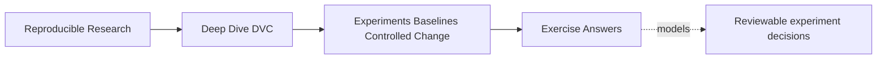
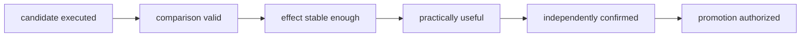

# Exercise Answers

<!-- page-maps:start -->
## Page Maps




<!-- page-maps:end -->

These answers model the reasoning boundary. They do not turn the modeled stochastic
scenario into capstone-generated evidence. Compare your authority, evidence chain,
decision, and limit rather than matching wording.

## Answer: Predict the decision gates

| Case | Result | Decision | Deciding boundary |
| --- | --- | --- | --- |
| controlled threshold | `PASS` | `KEEP_FOR_PROMOTION_REVIEW` | only intended threshold changes |
| mixed control change | `PASS` | `BLOCK_COMPARISON` | unrelated capacity control breaks attribution |
| mutated baseline contract | `PASS` | `BLOCK_COMPARISON` | candidate anchor differs from approval evidence |
| population drift | `PASS` | `BLOCK_COMPARISON` | evaluation membership changes |
| metric schema drift | `PASS` | `BLOCK_COMPARISON` | result meaning changes |
| missing candidate intent | `PASS` | `BLOCK_COMPARISON` | allowed change set cannot be judged |
| unsafe promotion request | `PASS` | `BLOCK_PROMOTION` | comparison passes; authority is absent |

A reversing condition must repair the deciding boundary. A better metric cannot reverse
population drift; another successful run cannot create promotion authority.

## Answer: Prove the baseline authority

The controlled baseline is:

```text
id: approved-incident-triage
threshold: 0.65
population: incident-review-v1
record count: 8
population digest: recorded in baseline metrics
metric schema: classification-v1
expected precision: 1.0
expected recall: 0.6
expected F1: 0.75
allowed candidate change: decision.threshold
```

Bounded claim:

> For the identified eight records, fixed evaluator, recorded controls, and
> `classification-v1`, threshold `0.65` produces the baseline confusion outcomes and
> metrics.

It does not claim a representative production sample, training-seed stability, or
uncertainty beyond those eight fixed records.

A changed cohort, evaluator meaning, or baseline contract requires new authority before
ordinary candidate ranking.

## Answer: Classify every changed surface

Representative rows:

| Case and field | Role | Allowed? | Reason |
| --- | --- | --- | --- |
| controlled `decision.threshold` | intervention | yes | matches intent |
| controlled metrics and lock | consequences | yes | produced by intervention |
| mixed review capacity | unrelated control | no | attribution exceeds intent |
| population record set and digest | comparison control | no | measurement cohort changes |
| metric schema | baseline boundary | no | result meaning changes |

DVC visibility answers “was this state recorded?” Experiment scope answers “does this
state belong in the causal question?” A visible mixed control remains disallowed.

## Answer: Bound DVC experiment receipts

| Receipt | Observation supported | Claim not supported |
| --- | --- | --- |
| candidate run | command returned successfully | candidate is comparable |
| experiment show | recorded candidate state and metrics exist | population and metric meaning are continuous |
| experiment diff | declared state differs from baseline | every difference was intended or allowed |

Controlled threshold and population drift both execute. The first preserves population
identity and schema; the second changes cohort membership. Command success therefore
supports execution evidence for both and comparison evidence for neither without the
contract checks.

## Answer: Decide the deterministic comparison

| Metric | Baseline | Candidate | Delta |
| --- | ---: | ---: | ---: |
| recall | 0.6000 | 1.0000 | +0.4000 |
| precision | 1.0000 | 0.8333 | -0.1667 |
| F1 | 0.7500 | 0.9091 | +0.1591 |

Two additional positive incidents are escalated and one negative incident becomes a
false escalation. Recall gain exceeds `0.15`; precision remains above `0.60`.

| Case | Execution | Comparison | Promotion |
| --- | --- | --- | --- |
| controlled threshold | pass | pass | keep for review |
| population drift | pass | block | not reached |
| unsafe promotion request | pass | pass | block |

Decision: `KEEP_FOR_PROMOTION_REVIEW`.

Limit: this fixed-cohort deterministic result does not establish generalization,
stochastic stability, or authorization.

## Answer: Design a replicate contract

One defensible contract:

```json
{
  "baseline": "approved-training-v4",
  "intervention": {"fit.learning_rate": 0.03},
  "preserved_controls": {
    "data.split_id": "governed-split-v4",
    "evaluate.metric_schema": "classification-v2"
  },
  "replicate_control": "fit.random_seed",
  "replicate_values": [11, 23, 37, 41, 53],
  "primary_metric": "f1",
  "summary": "mean_paired_difference",
  "minimum_practical_gain": 0.01,
  "safeguards": ["precision policy passes in every replicate"],
  "failed_run_rule": "retain failure and abstain until classified"
}
```

Five cached reads repeat one artifact identity. Replicates require independently executed
observations with recorded planned variation.

## Answer: Reconstruct the replicate evidence

| Seed | Paired F1 difference |
| ---: | ---: |
| 11 | +0.015 |
| 23 | -0.003 |
| 37 | +0.023 |
| 41 | +0.007 |
| 53 | +0.016 |

```text
sum = 0.058
mean paired difference = 0.058 / 5 = 0.0116
```

The mean exceeds the `0.010` practical threshold and all listed precision safeguards
pass. Four of five differences are positive; seed 23 reverses direction.

Decision: retain the configuration for independent confirmation, assuming the replicate
set was predeclared and complete. The evidence does not support “candidate always
improves F1.”

## Answer: Expose winner selection

An acceptable ledger might contain:

| Identity | Status | Comparable | Result category | Disposition |
| --- | --- | --- | --- | --- |
| lr-001 | planned | yes | below practical gain | discard |
| lr-003 | planned | yes | nominated | confirm |
| lr-010 | planned | yes | safeguard failure | reject |
| lr-030 | planned | yes | dominated by lr-003 | discard |
| depth-2 | exploratory | yes | unattractive | retain summary |
| depth-4 | exploratory | yes | promising but weaker | retain summary |
| depth-6 | exploratory | yes | latency safeguard failure | reject |
| split-v5 | exploratory | no | population changed | block comparison |
| schema-v3 | exploratory | no | metric meaning changed | block comparison |
| mixed-policy | exploratory | no | mixed intervention | block comparison |
| seed-best | exploratory | yes | lucky single run | do not nominate |
| runtime-drift | exploratory | no | environment boundary changed | investigate |

Only reporting `lr-003` hides eleven other attempts and makes its result look
preordained. Incomparable candidates remain outside ranking, while comparable non-winners
remain part of the selection history.

## Answer: Design independent confirmation

```text
frozen candidate: learning_rate=0.03 with all other governed controls fixed
selection evidence: five paired development runs
confirmation authority: newly governed incident cohort
population identity: recorded digest and approval
primary metric: F1 paired against baseline
practical rule: mean difference >= 0.010
safeguards: precision and latency policies pass
retuning rule: any control change creates a new candidate and confirmation claim
accept: primary and safeguards pass with complete evidence
reject: comparable evidence fails predeclared rule
abstain: identity, replicate, or safeguard evidence missing
```

Changing the candidate after seeing confirmation consumes that confirmation boundary.
The revised candidate returns to exploration and needs new independent evidence.

## Answer: Write the promotion decision

A defensible scenario can promote only if a confirmation outcome is explicitly supplied.
For example:

> `PROMOTE` the frozen `learning_rate=0.03` configuration from baseline
> `approved-training-v4`, contingent on the scenario's stated independent confirmation.
> Five predeclared paired development runs produced a mean F1 difference of `+0.0116`,
> above the `0.010` practical threshold; four were positive, one was negative, and all
> precision safeguards passed. The complete twelve-candidate search ledger is retained.
> The governed confirmation cohort passed the unchanged rule and safeguards. Apply the
> exact candidate to a clean workspace, verify declared outputs, record the resulting
> commit as the new baseline, and retain the old baseline objects and tested rollback.

Without actual confirmation evidence, the correct decision is `ABSTAIN` or
`KEEP_FOR_CONFIRMATION`, not promotion.

The deterministic threshold audit remains a separate `KEEP_FOR_PROMOTION_REVIEW` result.
Its evidence must not be cited as confirmation for the modeled training candidate.

## Answer-review checklist

Accept your packet only if it:

- separates audit result from review decision;
- states a finite baseline claim;
- distinguishes visibility from allowed scope;
- bounds DVC receipts;
- preserves deterministic evidence limits;
- treats seed as planned variation;
- reports every replicate direction and failure;
- preserves the full candidate search;
- freezes the candidate before confirmation;
- promotes an authorized configuration and state, not a metric maximum.
