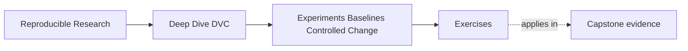
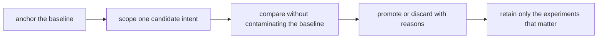
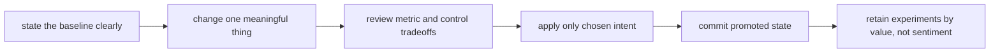

# Exercises


<!-- page-maps:start -->
## Page Maps




<!-- page-maps:end -->

Use these exercises to practice controlled exploration, not only DVC command vocabulary.

The goal of the day is to stop treating experiments as a scoreboard of random tries. A
baseline anchors meaning. A candidate should test a focused idea. A promotion decision
should preserve exact evidence and tradeoffs, not only the highest metric row.

## How to work through this set

Treat the ten exercises as one full lab day on controlled change.

Before each answer:

1. name the baseline being protected
2. name the candidate intent being tested
3. explain what evidence would justify promotion or discard

Do the exercises in order. The day is one progression:

- Exercises 1-3 anchor baseline authority and scope candidate intent
- Exercises 4-5 separate DVC experiment recording from human review and promotion
- Exercises 6-8 run controlled exploration without contaminating the baseline
- Exercises 9-10 turn experiment evidence into a durable promotion and retention policy

Keep one experiment packet as you go. By the end of the day it should contain:

- one baseline description with evidence files
- one candidate-scope decision
- one tradeoff review note
- one contamination example and repair
- one promotion review
- one experiment-retention policy

If those six artifacts are missing, you are probably still treating experiments as
convenient runs instead of as governed comparison surfaces.

## Recommended working layout

If you want one lab tree that can support the whole day, use something like:

```text
module06-lab/
├── artifacts/
├── experiments/
├── metrics/
├── notes/
├── params.yaml
└── publish/
```

Keep one baseline and candidate table while you work:

| Run | Baseline or candidate | Intended change | Evidence files | Promotion status |
| --- | --- | --- | --- | --- |

Also keep one decision table:

| Candidate | Benefit | Cost | Unknowns | Decision |
| --- | --- | --- | --- | --- |



Use that route on purpose. It keeps the day centered on controlled learning instead of on
accumulating ungoverned experiment history.

## Exercise 1: Predict the decision gates

Before running the audit, copy this table into your experiment packet:

| Case | Will DVC run? | Comparable? | Promotable now? | Expected decision |
| --- | --- | --- | --- | --- |
| controlled threshold |  |  |  |  |
| mixed control change |  |  |  |  |
| mutated baseline contract |  |  |  |  |
| population drift |  |  |  |  |
| metric schema drift |  |  |  |  |
| missing candidate intent |  |  |  |  |
| unsafe promotion request |  |  |  |  |

Fill it from the case names alone. For every “no,” name the claim you expect to fail.

Then run:

```bash
make PROGRAM=reproducible-research/deep-dive-dvc capstone-experiment-comparability-audit
```

Compare your predictions with `summary.tsv`. Do not change a prediction silently; annotate
why your original model was wrong.

What to hand in:

- completed prediction table
- corrected table
- one paragraph about the most important mistaken assumption

## Exercise 2: Prove the baseline anchor

Use `controlled-threshold` and `mutated-baseline-contract`.

For each case, inspect:

```text
experiment-contract.json
evidence/baseline-params.json
evidence/baseline-metrics.json
finding.json
```

Build a baseline proof table:

| Required fact | Contract claim | Recorded evidence | Match? |
| --- | --- | --- | --- |
| threshold |  |  |  |
| population ID |  |  |  |
| metric schema |  |  |  |
| expected metrics |  |  |  |

Explain why an unchanged Git commit does not rescue the mutated contract.

What to hand in:

- both proof tables
- the exact failed check
- a repair that does not rewrite the old baseline claim

## Exercise 3: Audit the changed paths

Compare:

```text
CONTROLLED_THRESHOLD
MIXED_CONTROL_CHANGE
METRIC_SCHEMA_DRIFT
```

For each candidate, classify every changed path as:

- planned intervention
- comparison control
- unrelated control
- deterministic consequence

Then compare the actual changed paths with `allowed_changes` in the experiment contract.

What to hand in:

- one change-role table per candidate
- a decision to split, rebaseline, or continue
- one sentence explaining why “declared” is weaker than “allowed”

## Exercise 4: Bound the DVC receipts

Open `receipts.json` for `controlled-threshold` and `population-drift`.

For `candidate_run`, `experiment_show`, and `experiment_diff`, record:

| Receipt | Return code | What it proves | What it cannot prove |
| --- | ---: | --- | --- |
| candidate run |  |  |  |
| experiment show |  |  |  |
| experiment diff |  |  |  |

Explain why the two cases can have similar successful receipts but different comparison
decisions.

What to hand in:

- both receipt tables
- one precise claim that only the surrounding population evidence can establish

## Exercise 5: Interpret the controlled tradeoff

Use the controlled baseline and candidate metric files. Calculate:

- recall delta
- precision delta
- F1 delta
- number of additional true escalations
- number of additional false escalations

Check the result against:

```text
minimum recall gain: 0.15
minimum precision:   0.60
```

Write two decision notes:

1. a policy that prioritizes missed-escalation reduction
2. a policy that tolerates no additional false escalations

The evidence is identical. The policy judgment should differ.

What to hand in:

- calculations
- both decision notes
- the strongest decision the audit itself is allowed to make

## Midday self-check

Before you move into sweeps, contamination, and retention policy, make sure your packet
can already answer these questions clearly:

- why the baseline contract and baseline evidence must agree
- why actual changed paths must match candidate intent
- what successful DVC receipts do and do not prove
- why metric policy is reviewed only after comparability

If you cannot answer those four questions in plain language, return to Exercises 1-5 and
make the packet more explicit before continuing.

## Exercise 6: Diagnose continuity failures

Compare `population-drift` and `metric-schema-drift`.

Complete:

| Case | Friendly ID or name | Deeper identity evidence | What changed | Why ranking blocks |
| --- | --- | --- | --- | --- |
| population drift |  |  |  |  |
| metric schema drift |  |  |  |  |

Explain why a stable population ID does not prove stable records and why a familiar metric
key does not prove stable meaning.

What to hand in:

- completed continuity table
- exact evidence needed to approve a new baseline for each case

## Exercise 7: Design bounded repairs

Write a repair plan for:

- mixed control change
- mutated baseline contract
- population drift
- metric schema drift
- missing candidate intent

Each plan must choose one:

```text
split candidate
restore approved baseline
establish new baseline
rewrite intent before rerun
```

Do not propose editing `finding.json` or weakening an audit check.

What to hand in:

- failure, owner, repair, and new evidence for all five cases
- one explanation of why rerunning alone cannot repair semantic continuity

## Exercise 8: Separate comparison from promotion

Inspect `controlled-threshold` and `unsafe-promotion-request`.

List every comparison check that both cases pass. Then identify the single promotion check
that differs.

Draft a promotion decision record with:

```text
candidate
baseline
decision
owner
observed tradeoff
comparison evidence
reason
resulting commit or rejection
```

What to hand in:

- shared comparison evidence
- completed decision record
- one sentence explaining why `promotion-request.json` is insufficient

## Exercise 9: Plan a safe apply

Assume the controlled candidate receives approval.

Write the exact observation sequence for:

- before `dvc exp apply`
- immediately after apply
- after reproduction and verification
- after the promotion commit

For each observation, state what would make you stop.

What to hand in:

- ordered command and evidence route
- stop conditions
- the fields needed to name the resulting state as the next approved baseline

## Exercise 10: Retain evidence by decision value

Classify all seven audit cases as:

- retain active candidate
- retain decision summary only
- retain as regression specimen
- discard after review

For every classification, name:

- durable learning value
- minimum retained evidence
- cleanup trigger
- owner

There is no single required retention class for every case. Your policy must be internally
consistent and preserve the evidence needed to defend promotion, rejection, or future
regression tests.

## Mastery check

You have a strong grasp of this module if your answers consistently keep five ideas
visible:

- a baseline anchors comparison
- a candidate should have a focused intent
- DVC experiments preserve candidate evidence without replacing review judgment
- selection should describe tradeoffs, not only best metrics
- promotion should happen only after applying, inspecting, and committing an intended state
- invalid candidates stay outside metric rankings
- a valid comparison can still be blocked at the promotion boundary
