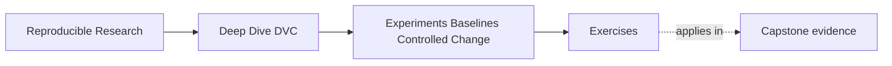
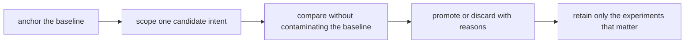
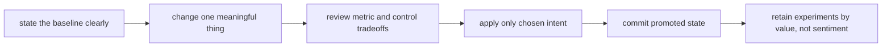

# Exercises


<!-- page-maps:start -->
## Page Maps




<!-- page-maps:end -->

Use these exercises to practice controlled exploration, not only DVC command vocabulary.

The goal of the day is to stop treating experiments as a scoreboard of random tries. A
baseline anchors meaning. A candidate should test a focused idea. A promotion decision
should preserve exact evidence and tradeoffs, not only the highest metric row.

## How to work through this set

Treat the ten exercises as one full lab day on controlled change.

Before each answer:

1. name the baseline being protected
2. name the candidate intent being tested
3. explain what evidence would justify promotion or discard

Do the exercises in order. The day is one progression:

- Exercises 1-3 anchor baseline authority and scope candidate intent
- Exercises 4-5 separate DVC experiment recording from human review and promotion
- Exercises 6-8 run controlled exploration without contaminating the baseline
- Exercises 9-10 turn experiment evidence into a durable promotion and retention policy

Keep one experiment packet as you go. By the end of the day it should contain:

- one baseline description with evidence files
- one candidate-scope decision
- one tradeoff review note
- one contamination example and repair
- one promotion review
- one experiment-retention policy

If those six artifacts are missing, you are probably still treating experiments as
convenient runs instead of as governed comparison surfaces.

## Recommended working layout

If you want one lab tree that can support the whole day, use something like:

```text
module06-lab/
├── artifacts/
├── experiments/
├── metrics/
├── notes/
├── params.yaml
└── publish/
```

Keep one baseline and candidate table while you work:

| Run | Baseline or candidate | Intended change | Evidence files | Promotion status |
| --- | --- | --- | --- | --- |

Also keep one decision table:

| Candidate | Benefit | Cost | Unknowns | Decision |
| --- | --- | --- | --- | --- |



Use that route on purpose. It keeps the day centered on controlled learning instead of on
accumulating ungoverned experiment history.

## Exercise 1: Name the baseline

You have a published baseline with:

```yaml
evaluate:
  threshold: 0.65
```

and:

```json
{
  "f1": 0.81,
  "precision": 0.78,
  "recall": 0.84
}
```

Write a short baseline description that explains:

- what state the candidate experiments compare against
- which evidence files a reviewer should inspect
- what would make this baseline no longer clean
- one sentence explaining why baseline must be evidence, not memory

Study note:
If the baseline is vague, every candidate discussion becomes vague too.

## Exercise 2: Scope a candidate

Suppose you want to try:

- lower `evaluate.threshold` from `0.65` to `0.50`
- switch `fit.model_family` from logistic regression to tree boosting
- remove weekends from the evaluation data

Decide whether this should be one candidate run or separate candidate runs.

Explain your reasoning and state what the team would lose if all three were combined too
early.

Study note:
Focused intent is one of the simplest ways to make experiments educational instead of
confusing.

## Exercise 3: Interpret a candidate table

You see:

```text
candidate                   threshold    f1     precision    recall
baseline                    0.65         0.81   0.78         0.84
lower-threshold-for-recall  0.50         0.84   0.75         0.95
```

Write a review note that explains:

- what changed
- what improved
- what got worse
- what release objective would make the candidate promising
- what objective would make it unattractive

Study note:
The strongest note names the tradeoff directly instead of celebrating whichever number is
largest.

## Exercise 4: Identify what DVC experiments do not prove

A teammate says:

> We used `dvc exp run`, so the winning candidate is automatically valid.

Write a response that explains:

- what DVC experiments help record
- what still requires human review
- one example of a candidate that could be well-recorded but still not promotable

Study note:
Tools can preserve evidence without deciding what the evidence means.

## Exercise 5: Decide promotion or discard

A candidate changes `evaluate.threshold` from `0.65` to `0.50`.

It improves recall, reduces precision, keeps the same reported evaluation population size,
and matches the release objective of reducing missed escalations.

Describe:

- what you would inspect before applying the candidate
- what you would check after applying it
- what a strong promotion note should include
- one reason you would still reject promotion even if recall improved

Study note:
Applying and promoting are different acts. This exercise is about keeping them separate.

## Midday self-check

Before you move into sweeps, contamination, and retention policy, make sure your packet
can already answer these questions clearly:

- what baseline state anchors the comparison
- why a candidate needs a focused intent
- what experiment recording does and does not prove
- why promotion needs post-apply inspection and a written reason

If you cannot answer those four questions in plain language, return to Exercises 1-5 and
make the packet more explicit before continuing.

## Exercise 6: Queue a controlled parameter sweep

Choose two parameters with three meaningful values each. Queue the candidates, predict the
comparison table shape, and explain why the search space is scientifically justified.

What to hand in:

- the sweep grid
- the hypothesis behind it
- one sentence explaining why wider search would be noise rather than learning

Study note:
A sweep without a hypothesis is usually just expensive curiosity.

## Exercise 7: Reproduce one experiment outside the queue

Select a candidate and reconstruct it from its recorded code, data, parameters, and
environment. Compare the reproduced metrics with the experiment record.

What to hand in:

- the reconstruction route
- the compared evidence
- one sentence naming what mismatch would force a deeper audit

Study note:
This is where experiment evidence stops being local convenience and becomes independent
proof.

## Exercise 8: Detect a contaminated baseline

Introduce one uncommitted semantic change before running a candidate. Use status and
experiment evidence to show why comparison with the named baseline is no longer clean.

Then explain how you would repair the situation without rewriting the story after the
fact.

Study note:
Contaminated baselines create impressive-looking candidates with weak provenance.

## Exercise 9: Write a promotion review

Prepare a promotion note that names:

- baseline
- candidate
- changed controls
- metric outcome
- known limitations
- exact Git state to preserve

Include one reason to reject promotion.

Study note:
A good promotion note should still make sense months later to someone who never saw the
live experiment table.

## Exercise 10: Manage experiment retention

Classify a set of experiments as:

- disposable
- reproducible
- decision-relevant
- release-relevant

Define what metadata and artifacts each class must retain and when cleanup is allowed.

Study note:
Retention policy matters because not every experiment deserves the same long-term weight,
but the important ones do need deliberate preservation.

## Mastery check

You have a strong grasp of this module if your answers consistently keep five ideas
visible:

- a baseline anchors comparison
- a candidate should have a focused intent
- DVC experiments preserve candidate evidence without replacing review judgment
- selection should describe tradeoffs, not only best metrics
- promotion should happen only after applying, inspecting, and committing an intended state
