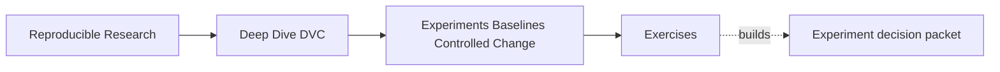
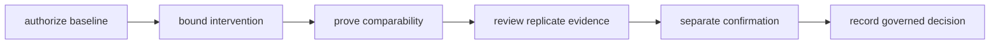

# Exercises

<!-- page-maps:start -->
## Page Maps




<!-- page-maps:end -->

These ten exercises build one decision packet. The first half uses the executable,
deterministic experiment audit. The second half adds a modeled stochastic candidate
family. Keep the evidence sources distinct.

Create:

```bash
packet=artifacts/learning/deep-dive-dvc/experiment-decisions
mkdir -p "$packet"
```

Run the audit only when directed:

```bash
make PROGRAM=reproducible-research/deep-dive-dvc capstone-experiment-comparability-audit
audit=artifacts/audit/reproducible-research/deep-dive-dvc/experiment-comparability
```

## Exercise: Predict the decision gates

Read the specimen source and audit guide, but do not run the audit.

Create `audit-predictions.tsv` with:

```text
case	expected_result	expected_decision	deciding_boundary	reversing_evidence
```

Predict all seven cases:

- controlled threshold;
- mixed control change;
- mutated baseline contract;
- population drift;
- metric schema drift;
- missing candidate intent;
- unsafe promotion request.

**Acceptance evidence:** distinguish `PASS` from an acceptable decision and distinguish
comparison blocks from promotion blocks.

## Exercise: Prove the baseline authority

Run the audit. Choose the controlled case and create `baseline-authority.md`.

Record:

- approved baseline identifier;
- Git and DVC anchor evidence;
- threshold;
- population ID, count, and digest;
- metric schema;
- expected baseline metrics;
- candidate intent and allowed change;
- one condition that would require a new baseline.

Write the exact finite-population claim the baseline supports.

**Acceptance evidence:** the claim must not imply stochastic stability or production
generalization.

## Exercise: Classify every changed surface

Create `change-role-ledger.tsv`:

```text
case	path_or_field	role	allowed	decision_reason
```

Classify fields from controlled threshold, mixed controls, population drift, and schema
drift as:

- intervention;
- planned consequence;
- comparison control;
- unrelated change;
- baseline boundary change.

Explain why a declared change may still be disallowed by experiment intent.

**Acceptance evidence:** `decision.threshold` is the controlled intervention; review
capacity, population identity, and metric schema do not become harmless because DVC
records them.

## Exercise: Bound DVC experiment receipts

Inspect `candidate_run`, `experiment_show`, and `experiment_diff` receipts for controlled
threshold and population drift.

Create `receipt-boundaries.md` with:

| Receipt | Observation supported | Claim not supported |
| --- | --- | --- |

Explain why both candidates can execute successfully while only one remains comparable.

**Acceptance evidence:** separate execution, changed-state visibility, population
continuity, and metric meaning.

## Exercise: Decide the deterministic comparison

Create `deterministic-comparison.md` for the controlled threshold case.

Include:

- baseline and candidate metric table;
- explicit deltas;
- operational translation into missed and false escalations;
- recall-gain and precision-safeguard checks;
- decision;
- evidence limit.

Then contrast population drift and unsafe promotion in a three-gate table:

| Case | Execution | Comparison | Promotion |
| --- | --- | --- | --- |

**Acceptance evidence:** return `KEEP_FOR_PROMOTION_REVIEW`, not promotion, for the
controlled candidate.

## Exercise: Design a replicate contract

Assume a model-training candidate changes only `fit.learning_rate` and contains meaningful
seed variation.

Create `replicate-contract.json` describing:

- baseline authority;
- intervention;
- preserved controls;
- replicate-varying control;
- five seed values;
- primary metric;
- summary rule;
- minimum practical gain;
- safeguards;
- failed-run handling.

Explain why five cached reads of one result are not replicates.

**Acceptance evidence:** seed is planned variation, not the candidate intervention.

## Exercise: Reconstruct the replicate evidence

Use:

| Seed | Baseline F1 | Candidate F1 | Precision safeguard |
| ---: | ---: | ---: | --- |
| 11 | 0.741 | 0.756 | pass |
| 23 | 0.752 | 0.749 | pass |
| 37 | 0.738 | 0.761 | pass |
| 41 | 0.747 | 0.754 | pass |
| 53 | 0.744 | 0.760 | pass |

Create `replicate-results.tsv`. Compute every paired difference and the mean paired
difference.

Write:

- direction in every replicate;
- practical-threshold result for minimum gain `0.010`;
- safeguard result;
- uncertainty statement;
- next decision.

**Acceptance evidence:** report the negative seed result as well as the positive mean.

## Exercise: Expose winner selection

Assume the candidate above was nominated after twelve configurations were explored.

Create `candidate-search-ledger.tsv` with twelve rows. Include:

- identity;
- planned or exploratory status;
- comparability;
- primary summary;
- safeguard outcome;
- disposition.

Design at least:

- one incomparable candidate;
- one dominated candidate;
- one practically negligible candidate;
- one candidate with a safeguard failure;
- the nominated configuration.

Explain how reporting only the nominee would inflate the decision story.

**Acceptance evidence:** blocked candidates remain outside ranking, while unattractive
comparable candidates remain visible in the search denominator.

## Exercise: Design independent confirmation

Create `confirmation-plan.md`:

```text
frozen candidate:
selection evidence:
confirmation authority:
population identity:
primary metric:
practical rule:
safeguards:
retuning rule:
accept decision:
reject decision:
abstain decision:
```

Describe what happens if the candidate is changed after seeing confirmation results.

**Acceptance evidence:** confirmation evidence must not be the same evidence used to
choose the winner without explicit limitation.

## Exercise: Write the promotion decision

Assemble `promotion-decision.md` linking all packet artifacts.

The decision must contain:

1. baseline authority;
2. controlled intervention;
3. deterministic audit decision and limit;
4. replicate design and results;
5. full candidate-search scope;
6. confirmation outcome;
7. practical and safeguard judgment;
8. owner and authorization;
9. applied-state verification;
10. new baseline and rollback evidence.

Choose `PROMOTE`, `REJECT`, or `ABSTAIN` and defend it. If you invent a confirmation
outcome, label it as a scenario rather than generated capstone evidence.

**Acceptance evidence:** the decision promotes a configuration and governed state, not a
lucky seed or a metric maximum.

## Completion checklist

Your packet should contain:

```text
audit-predictions.tsv
baseline-authority.md
change-role-ledger.tsv
receipt-boundaries.md
deterministic-comparison.md
replicate-contract.json
replicate-results.tsv
candidate-search-ledger.tsv
confirmation-plan.md
promotion-decision.md
```

You have completed the module when another learner can reconstruct which evidence came
from the executable deterministic audit, which came from the modeled stochastic study,
and why neither alone authorizes promotion.
