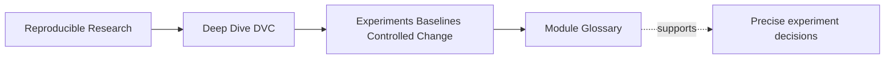
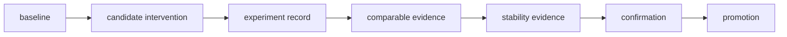
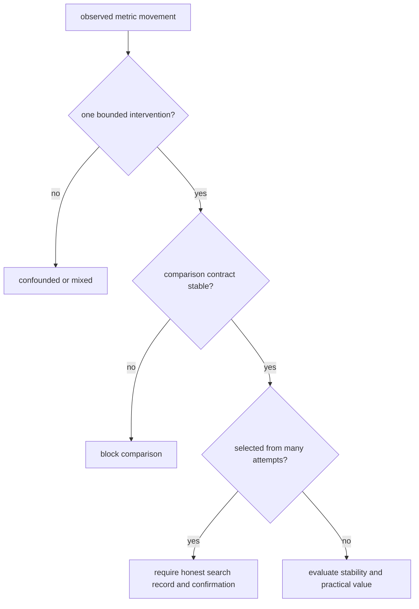

# Module Glossary

<!-- page-maps:start -->
## Page Maps

<!-- page-maps:end -->

Use this glossary to keep experiment lineage, comparison validity, uncertainty, and
governance from collapsing into one word such as “successful.”

## Baseline and scope

| Term | Meaning | Boundary |
| --- | --- | --- |
| baseline | Authorized reference state for a named comparison question. | A Git parent or current workspace is not automatically approved authority. |
| baseline contract | Data, runtime, pipeline, controls, metric meaning, and expected evidence that define the anchor. | Changing the contract may require a new baseline rather than an ordinary candidate. |
| baseline profile | Replicate-level behavior and predeclared summary for a stochastic baseline. | One selected baseline run is not a distribution. |
| experiment intent | Bounded question stated before candidate interpretation. | “Try settings and keep the best” is search activity, not a causal question. |
| intervention | Deliberate candidate change whose effect is under review. | It must be distinguished from consequences and planned variation. |
| allowed change set | Paths or controls permitted by the intent. | A visible declared change may still be outside the allowed set. |
| comparison control | State required to remain stable for the intended comparison. | Population, metric, and runtime controls often belong here. |
| planned consequence | Output or lock movement caused by the intervention. | It is evidence of the change, not a second intervention. |
| baseline boundary work | Change that redefines the comparison anchor or meaning. | Repair and approve the new anchor before ranking ordinary candidates. |

## Variation and uncertainty

| Term | Meaning | Boundary |
| --- | --- | --- |
| stochastic influence | Intended source of variation such as seed, sample, or nondeterministic optimization. | First distinguish it from hidden undeclared state. |
| seed | Recorded control for a pseudo-random sequence. | One seed does not establish typical performance. |
| replicate | Independently executed observation under one contract with only planned variation. | Re-reading a cache or duplicating one output is not replication. |
| replicate control | Field deliberately varied across repeated observations, such as seed. | It is not the candidate intervention unless the study explicitly asks about it. |
| paired replicate | Baseline and candidate observation matched on planned variation. | Pairing must be designed, not invented after results. |
| stability | Degree to which direction, magnitude, and safeguards persist across relevant variation. | Exact-run reproducibility does not imply stability. |
| uncertainty statement | Bounded description of variation and evidence limits. | It need not promise one universal statistical method. |
| practical significance | Effect large enough to matter under a predeclared domain threshold. | A precisely measured tiny gain may remain operationally irrelevant. |
| safeguard | Constraint that must hold beside the primary objective. | Strong primary movement cannot compensate for a failed required safeguard. |

## Confounding and search

| Term | Meaning | Boundary |
| --- | --- | --- |
| confound | Another difference that prevents clean attribution to the intended intervention. | It may be declared, hidden, or introduced by selection. |
| interaction | Effect of one intervention changes with another control. | Requires a planned multi-cell design, not one mixed candidate. |
| candidate family | Configuration evaluated across planned replicates. | Select the family from its evidence, not its luckiest member. |
| search ledger | Inventory of planned and exploratory candidates considered in a decision. | Winner-only reporting hides the selection denominator. |
| winner selection bias | Optimism created by choosing the maximum among many noisy attempts. | Full search history and independent confirmation reduce the misleading story. |
| dominated candidate | Comparable option no better on any governed objective and worse on at least one. | Removing it from policy debate does not choose among remaining tradeoffs. |
| Pareto frontier | Non-dominated comparable candidates that preserve genuine tradeoffs. | It narrows choices but does not supply the policy preference. |

## DVC experiment evidence

| Term | Meaning | Boundary |
| --- | --- | --- |
| experiment record | Candidate state, parameters, metrics, and lineage preserved outside ordinary main history. | Record existence does not establish comparison validity. |
| experiment identity | Reference locating one candidate state. | Opaque identity needs intent and contract evidence for review. |
| experiment family manifest | Description binding replicate records to one question and summary. | It explains the family but does not replace individual DVC records. |
| run receipt | Evidence that candidate execution occurred and returned a result or failure. | Successful execution is weaker than comparability. |
| experiment diff | Declared difference between candidate and anchor. | It cannot prove every actual influence was visible or allowed. |
| applied candidate | Experiment state brought into the current workspace. | Apply is not promotion or approval. |
| failed-run ledger | Retained account of planned runs that crashed, timed out, or emitted invalid results. | Silently dropping failures can bias the evidence. |

## Decision and governance

| Term | Meaning | Boundary |
| --- | --- | --- |
| comparability | Baseline and candidate measurements preserve the contract needed for ranking. | Comparable does not mean useful or promotable. |
| blocked comparison | Contract failure prevents ranking. | Repair scope or establish new baseline; do not place last on leaderboard. |
| uncertain effect | Comparison is valid but stability or decision burden is unmet. | Different from an incomparable candidate. |
| exploration | Flexible search for promising candidates on development evidence. | Must remain visible as search, not confirmation. |
| nomination | Frozen candidate proposed for stronger evidence. | Nomination is not selection authority or promotion. |
| independent confirmation | Predeclared test of a frozen candidate on evidence not used to choose it. | Retuning after viewing it consumes the boundary. |
| promotion request | Proposal to adopt candidate into governed history. | Request without owner and decision may be blocked. |
| promotion decision | Authorized judgment attaching evidence, reasoning, owner, and resulting state. | A Boolean request or `dvc exp apply` is insufficient. |
| new baseline | Promoted state authorized as reference for future experiments. | Record transition and whether old and new eras remain comparable. |
| rollback evidence | Tested route from promoted authority back to named prior authority. | Retaining an old experiment name without objects and runtime is not rollback. |

## Distinctions to rehearse

| Do not confuse | With | Deciding question |
| --- | --- | --- |
| reproducible run | stable effect | does the result persist across relevant planned variation? |
| seed recorded | uncertainty handled | were independent repeats and summaries planned? |
| changed field declared | changed field allowed | does it serve the experiment intent? |
| experiment executed | candidate comparable | did baseline, population, metric, and controls remain valid? |
| comparable | practically useful | does movement exceed a domain-relevant threshold? |
| selected | independently confirmed | was fresh governed evidence used after freezing? |
| applied | promoted | did an owner authorize and verify governed history? |
| best run | best configuration | does replicate evidence support the candidate family? |
| audit `PASS` | candidate accepted | what decision did the passing finding encode? |

## Review sentence

A precise experiment decision names the baseline authority, intended intervention,
planned variation, complete candidate search, DVC lineage, comparability checks,
replicate evidence where needed, practical and safeguard rules, confirmation boundary,
promotion owner, resulting authority, rollback, and evidence limit.
