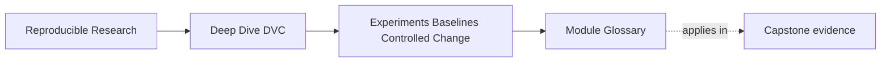

# Module Glossary

<!-- page-maps:start -->
## Page Maps

<!-- page-maps:end -->

This glossary belongs to **Module 06: Experiments, Baselines, and Controlled Change** in
**Deep Dive DVC**.

Use it to keep the module language stable while you move between the core lessons, the
worked example, the exercises, and capstone review.

## How to use this glossary

Read the directory index first. Return here when an experiment review, candidate
comparison, baseline discussion, or promotion decision starts to feel vague.

The goal is not extra theory. The goal is shared language for exploring without damaging
the baseline evidence story.

## Terms in this directory

| Term | Meaning in this directory |
| --- | --- |
| baseline | The recorded reference state used as the comparison anchor for candidates. |
| baseline authority | The degree to which baseline data, parameters, metrics, pipeline, and review evidence are trustworthy enough for comparison. |
| baseline boundary work | A change that redefines what the baseline means and should be reviewed before ordinary candidate comparison. |
| candidate | A provisional run being compared against a baseline or other candidates. |
| candidate intent | The short explanation of what a candidate is trying to learn or prove. |
| allowed change set | The exact declared controls that may change while preserving the candidate's stated question. |
| controlled change | A declared change with a reviewable purpose and evidence trail. |
| experiment scope | The set of changes included in one candidate run and the review question they answer. |
| experiment record | The DVC-preserved evidence for a candidate run, including parameter and metric differences. |
| experiment isolation | Keeping candidate runs separate from main Git history until a promotion decision is made. |
| comparison anchor | The baseline or prior state used as the reference for judging a candidate. |
| comparison control | A population, schema, runtime, or other semantic surface that must remain stable for the intended comparison. |
| comparison gate | The review boundary that rejects ranking when baseline, intent, change scope, population, schema, or execution evidence is invalid. |
| selection | The review decision to keep, discard, or promote a candidate based on evidence and intent. |
| metric tradeoff | A result where one metric improves while another worsens, requiring review judgment. |
| promotion | The deliberate decision to make a candidate part of the main state story. |
| promotion request | A proposal to adopt a candidate; it does not itself contain review authority. |
| promotion decision | A durable owner-backed record that accepts or rejects governed adoption using named evidence. |
| apply | Bringing a candidate's state into the workspace for inspection before any promotion commit. |
| blocked comparison | A candidate outcome that must stay outside metric ranking because the comparison contract failed. |
| blocked promotion | A comparable candidate that cannot enter governed history because decision or post-apply evidence is missing. |
| discard | Removing a candidate from active consideration because it is not useful, valid, comparable, or worth keeping. |
| workspace discipline | Keeping local files understandable while reviewing, applying, or discarding candidates. |
| lineage | The evidence trail that explains where a result came from and how it relates to the baseline. |
| local folklore | Unrecorded knowledge about candidate runs that depends on memory instead of inspectable evidence. |
| promotion note | A review statement explaining the control change, metric tradeoff, baseline comparison, and reason for promotion. |
| release objective | The decision criterion that tells reviewers which tradeoffs matter for promotion. |

## Stable review questions

Use these questions when the module feels abstract:

- What baseline is this candidate comparing against?
- What is the candidate trying to learn?
- Which declared control changed?
- Do the actual changed paths exactly match the allowed change set?
- Did the metric definition and population stay comparable?
- What tradeoff did the candidate create?
- Does the candidate deserve promotion, discard, or more bounded review?
- What changed after applying the candidate to the workspace?
- Which evidence authorizes promotion rather than merely requesting it?
- What should the promotion note say two years from now?
