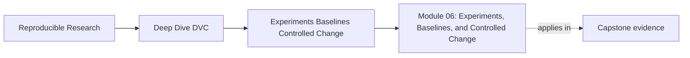

# Module 06: Experiments, Baselines, and Controlled Change


<!-- page-maps:start -->
## Page Maps




<!-- page-maps:end -->

Module 06 turns reproducibility into a way to explore safely.

Earlier modules made the baseline more trustworthy: data has identity, runtime influence
is visible, pipeline edges are declared, and metric meaning is reviewable. That does not
mean the team should stop changing the workflow. It means change needs a clean boundary.

This module is about disciplined exploration:

- what makes a baseline authoritative
- what makes an experiment comparable to that baseline
- what DVC experiments help record
- where experiment isolation ends
- how a candidate result becomes a deliberate promotion instead of a lucky local run

The central question is:

> What changed, where was it declared, and can this result be compared or promoted without
> corrupting the baseline story?

If the answer is still "I tried a few things locally," the workflow has left the course's
evidence model.

The primary corroboration surface is the executable experiment-comparability audit. It
creates seven isolated Git and DVC repositories, runs real candidates, and preserves
baseline records, candidate records, DVC command receipts, changed paths, and decisions.
Use the broader capstone experiment and release surfaces only after the focused audit is
clear.

## Why this module exists

Experimentation is where many reproducible workflows become informal again.

Common failure patterns look ordinary:

- changing a threshold locally and forgetting which run produced the better metric
- copying a script to try a new model family
- mixing data changes with parameter changes and calling the result one experiment
- keeping a strong result in the workspace without a promotion review
- promoting a result because it had the best metric, while ignoring comparability limits

Those are not just organization problems. They erase lineage. They make later release and
collaboration decisions depend on memory instead of evidence.

The point of Module 06 is not to make exploration slow. The point is to let exploration
happen without damaging the baseline that makes comparison possible.

## Study route


Read the module in that order the first time.

For a missed class or independent study session:

1. read Core 1 and Core 2 before running anything
2. predict the seven audit decisions in Exercise 1
3. run the focused audit
4. read Core 3 and inspect command receipts
5. read Core 4 and the worked example
6. finish Exercises 2-8 before reading their answers
7. read Core 5, then complete the apply and retention exercises

This order delays metric ranking until you have established baseline and scope discipline.

If the problem is already partly clear, use this shortcut:

- open Core 1 when the main confusion is "what is the baseline protecting?"
- open Core 2 when the main confusion is "what belongs in one experiment?"
- open Core 3 when the main confusion is "what do DVC experiments record and isolate?"
- open Core 4 when the main confusion is "which candidate is actually comparable?"
- open Core 5 when the main confusion is "how does a candidate become history safely?"

## Module map

| Page | Purpose |
| --- | --- |
| [Overview](index.md) | explains the module promise and study route |
| [Baseline Authority and Experiment Intent](baseline-authority-and-experiment-intent.md) | teaches how a baseline anchors controlled exploration |
| [Experiment Scope and Change Boundaries](experiment-scope-and-change-boundaries.md) | teaches which changes belong in one experiment and which require stronger review |
| [DVC Experiment Records and Isolation](dvc-experiment-records-and-isolation.md) | teaches what DVC experiments record, compare, and keep separate |
| [Comparing Experiments and Selecting Candidates](comparing-experiments-and-selecting-candidates.md) | teaches candidate comparison without metric cherry-picking |
| [Promotion, Cleanup, and History Integrity](promotion-cleanup-and-history-integrity.md) | teaches deliberate promotion, discard, and baseline protection |
| [Worked Example: Promoting a Controlled Threshold Experiment](worked-example-promoting-a-controlled-threshold-experiment.md) | walks through one realistic experiment review |
| [Exercises](exercises.md) | provides ten cumulative evidence-based exercises |
| [Exercise Answers](exercise-answers.md) | explains model answers and review logic |
| [Glossary](glossary.md) | keeps the module vocabulary stable |

## What should be clear by the end

By the end of this module, you should be able to explain:

- what makes a baseline authoritative enough for experiment comparison
- how to keep one experiment focused on a reviewable change
- what DVC experiments add beyond ordinary Git branch history
- how to compare candidate runs without ignoring metric meaning
- why promotion requires evidence, not only a better number
- how cleanup protects you from stale local folklore
- why successful execution, valid comparison, and authorized promotion are separate gates
- how to repair comparison defects without rewriting failed evidence

## Commands to keep close

These commands form the evidence loop for Module 06:

```bash
make -C programs/reproducible-research/deep-dive-dvc/capstone experiment-comparability-audit
make -C programs/reproducible-research/deep-dive-dvc/capstone experiment-comparability-selftest
dvc exp run
dvc exp show
dvc exp diff
dvc exp apply
```

Use the focused audit before direct experiment commands. It gives each command receipt a
bounded interpretation and supplies negative cases that an ordinary successful run does
not reveal.

## Capstone route

Use the capstone after you can explain what the baseline promises.

Best corroboration surfaces for this module:

- `capstone/params.yaml`
- `capstone/metrics/metrics.json`
- `capstone/publish/v1/params.yaml`
- `capstone/publish/v1/metrics.json`
- `capstone/repro/experiment-comparability/`
- `capstone/docs/experiment-comparability-audit-guide.md`
- `capstone/docs/experiment-guide.md`
- `capstone/docs/release-review-guide.md`

Useful proof route:

```bash
make -C programs/reproducible-research/deep-dive-dvc/capstone experiment-comparability-audit
```

The route returns `KEEP_FOR_PROMOTION_REVIEW`, `BLOCK_COMPARISON`, or
`BLOCK_PROMOTION`. Those outcomes prevent a successful run from silently becoming a
ranked candidate or governed baseline.
