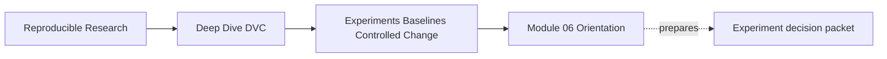
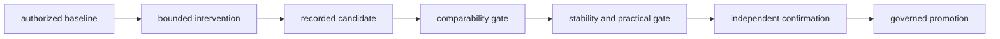
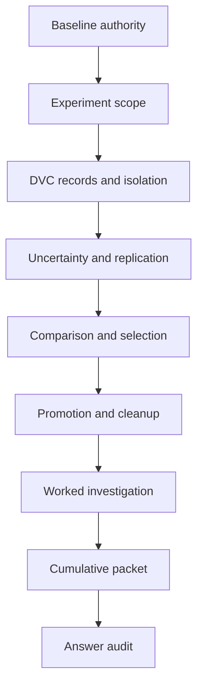

# Module 06: Experiments, Baselines, and Controlled Change

<!-- page-maps:start -->
## Page Maps




<!-- page-maps:end -->

DVC experiments can preserve candidate lineage without turning every candidate into a
valid comparison or promotion.

This module teaches six separate questions:

1. Which baseline is authoritative?
2. Which change does the candidate intend to test?
3. What did DVC record and isolate?
4. Is the result comparable and stable enough to interpret?
5. Is the effect practically useful and independently confirmed?
6. Who may promote the resulting state?

Skipping a question makes later confidence look stronger than its evidence.

## Prerequisites and time

You should already be able to:

- identify data content and authority from Module 02;
- name runtime influence from Module 03;
- compare actual command behavior with stage declarations from Module 04;
- reconstruct a complete metric meaning from Module 05.

Allow:

| Work | Suggested time |
| --- | ---: |
| core lessons | 100 minutes |
| worked investigation | 45 minutes |
| exercise packet | 120–180 minutes |
| answer review | 35 minutes |

If a prerequisite is weak, return to it. Experiments amplify hidden state and semantic
ambiguity; they do not repair either.

## Two evidence settings

The module deliberately uses two settings:

| Setting | Purpose | Supported claim |
| --- | --- | --- |
| executable capstone threshold audit | baseline, allowed change, population, metric, and promotion gates | deterministic fixed-cohort comparison decisions |
| modeled five-replicate training study | seed variation, practical gain, winner search, and confirmation | reasoning about stochastic evidence |

Do not claim the capstone generated the replicate table. Do not claim the modeled table
proves a real candidate.

## Study route



For first-pass independent study:

1. Read baseline authority and experiment scope.
2. Predict all seven audit decisions.
3. Run the focused audit.
4. Read DVC experiment records and inspect receipts.
5. Read uncertainty before ranking candidates.
6. Read comparison, selection, and promotion.
7. Complete the worked investigation.
8. Produce all ten exercise artifacts before opening answers.

This order delays metric interpretation until authority and comparability are established.

## Module map

| Page | Question answered |
| --- | --- |
| [Baseline Authority and Experiment Intent](baseline-authority-and-experiment-intent.md) | what makes an exact or stochastic baseline authoritative? |
| [Experiment Scope and Change Boundaries](experiment-scope-and-change-boundaries.md) | which changes are interventions, planned variation, controls, or confounds? |
| [DVC Experiment Records and Isolation](dvc-experiment-records-and-isolation.md) | what does one experiment record preserve, and how do replicate records form a family? |
| [Uncertainty, Replication, and Selection Bias](uncertainty-replication-and-selection-bias.md) | why is exact-run lineage different from effect stability? |
| [Comparing Experiments and Selecting Candidates](comparing-experiments-and-selecting-candidates.md) | how are comparable candidates selected without hiding search and tradeoffs? |
| [Promotion, Cleanup, and History Integrity](promotion-cleanup-and-history-integrity.md) | how does a confirmed configuration become governed state safely? |
| [Worked Investigation: Separating Comparability, Uncertainty, and Promotion](worked-investigation-separating-comparability-uncertainty-and-promotion.md) | where do deterministic, stochastic, and authority claims stop? |
| [Exercises](exercises.md) | how do you build a complete experiment decision packet? |
| [Exercise Answers](exercise-answers.md) | which reasoning makes each packet artifact defensible? |
| [Glossary](glossary.md) | which experiment terms must remain distinct? |

## The executable audit

Run:

```bash
make PROGRAM=reproducible-research/deep-dive-dvc capstone-experiment-comparability-audit
```

Evidence appears under:

```text
artifacts/audit/reproducible-research/deep-dive-dvc/experiment-comparability/
```

The cases isolate:

| Case | Decision boundary |
| --- | --- |
| controlled threshold | intended control changes on same population and metric |
| mixed control change | extra declared change breaks attribution |
| mutated baseline | approved anchor no longer matches |
| population drift | cohort continuity breaks |
| metric schema drift | measurement meaning breaks |
| missing intent | allowed change cannot be judged |
| unsafe promotion request | comparison passes but authority is missing |

`PASS` means the audit classified the case as designed. Read the decision separately.

## What DVC experiments contribute

DVC experiment commands can preserve and compare candidate state:

```bash
dvc exp run
dvc exp show
dvc exp diff
dvc exp apply
```

Within this module:

| Command surface | Bounded use |
| --- | --- |
| run | execute and record candidate state |
| show | inspect candidate parameters and metrics |
| diff | compare recorded declared state |
| apply | bring selected candidate changes into workspace review |

They do not define independent replicates, estimate uncertainty, prevent winner selection
bias, create confirmation evidence, or authorize promotion.

## The decision ladder

| Gate | Required evidence | Possible outcome |
| --- | --- | --- |
| execution | DVC and command receipts | executed or failed |
| comparability | baseline, scope, population, metric and runtime continuity | compare or block |
| stability | planned replicate evidence where variation matters | stable enough, uncertain, or untested |
| practical value | minimum gain and safeguards | useful or unattractive |
| confirmation | frozen candidate on independent governed evidence | accept, reject, or abstain |
| promotion | owner, decision, applied-state verification, new authority | promote or block |

A candidate cannot compensate for an earlier failed gate with a larger metric.

## What you will produce

The exercise packet contains:

```text
audit-predictions.tsv
baseline-authority.md
change-role-ledger.tsv
receipt-boundaries.md
deterministic-comparison.md
replicate-contract.json
replicate-results.tsv
candidate-search-ledger.tsv
confirmation-plan.md
promotion-decision.md
```

Keep it under:

```text
artifacts/learning/deep-dive-dvc/experiment-decisions/
```

The packet is the review surface. Shell history is not.

## Common wrong turns

| Wrong turn | Why it fails |
| --- | --- |
| compare scores before baseline checks | promising movement biases boundary review |
| call every parameter difference an experiment | visibility does not establish allowed scope |
| call five cached reads replicates | no independent observations were produced |
| select the best seed | seed variation is mistaken for intervention |
| report only the winner | search denominator and selection bias disappear |
| retune after confirmation | confirmation evidence becomes exploration evidence |
| apply and commit immediately | workspace state bypasses authority and verification |

## Completion standard

You are ready for Module 07 when you can:

- reconstruct and challenge baseline authority;
- classify intervention, planned variation, control, consequence, and confound;
- bound what DVC experiment receipts establish;
- define replicates and preserve failed runs;
- compare candidate families using predeclared summaries and practical thresholds;
- expose the complete candidate search;
- freeze a nominee before independent confirmation;
- separate execution, comparison, stability, usefulness, confirmation, and promotion;
- promote a governed configuration and retain rollback evidence;
- state which claims come from executable evidence and which are modeled reasoning.
