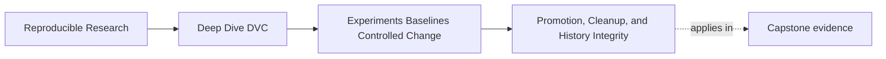
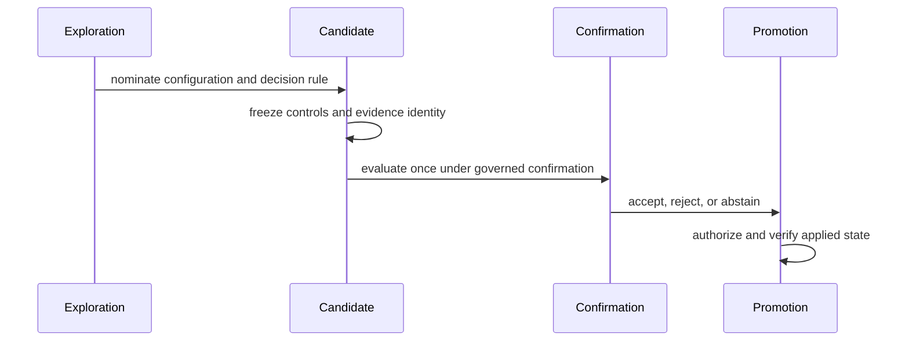
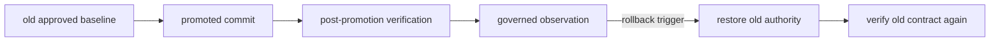

# Promotion, Cleanup, and History Integrity


<!-- page-maps:start -->
## Page Maps




<!-- page-maps:end -->

An experiment is not finished when it produces a metric.

It is finished when the team decides what to do with it:

- promote it
- keep it for a bounded review reason
- discard it

Leaving candidates in an undecided state creates local folklore. Someone remembers a good
run, someone else sees a stale artifact, and the baseline slowly stops being the authority.

## Promotion is a governance decision

Promotion means a candidate is allowed to become part of the main state story.

That requires more than a good number.

Before promotion, a reviewer should ask:

- did the candidate come from the intended baseline?
- are the parameter changes declared?
- are metric definitions and population comparable?
- is the tradeoff acceptable for the release objective?
- can the run be reproduced or at least defended with recorded evidence?
- will applying the candidate introduce unrelated workspace changes?

Only after those questions are answered should the candidate be applied and committed.

```bash
dvc exp show
dvc exp diff
dvc exp apply <candidate-id>
git diff
git status
```

The commands are not a ritual. They are the path from candidate evidence to main history.

## Four transitions, four meanings

Do not compress promotion into “apply and commit.”

| Transition | State change | Evidence needed |
| --- | --- | --- |
| candidate produced | experiment revision and outputs exist | run receipts, params, metrics |
| candidate requested for promotion | someone proposes governed adoption | candidate identity, baseline, tradeoff, objective |
| candidate applied | experiment changes enter the workspace | pre-apply status, post-apply diff, DVC status |
| candidate promoted | reviewed state enters Git history | approval record, verification receipts, commit |

Each transition can stop without implying the next one.

A candidate can exist without a promotion request. A request can be rejected. An applied
candidate can be removed after the diff reveals unrelated changes. Only the final
transition changes the governed history.

## A decision record closes the governance gap

The minimum durable decision record should answer:

```text
candidate:
baseline:
decision:
owner:
observed tradeoff:
comparison evidence:
reason:
resulting commit or rejection:
```

The format can be a pull request, review record, or repository-owned decision file. The
fields matter more than the container.

Weak evidence:

```text
promote: true
```

That expresses a request but not authority or reasoning.

The audit's `UNSAFE_PROMOTION_REQUEST` case deliberately creates a valid controlled
candidate and then writes only a promotion request. Its comparison checks pass. The final
check, `promotion_decision_is_recorded`, fails, so the result is `BLOCK_PROMOTION` rather
than `BLOCK_COMPARISON`.

## Applying is not the same as promoting

Applying an experiment changes the workspace. Promotion is the reviewed decision to make
that applied state part of history.

This distinction matters.

Weak workflow:

```text
Applied a promising experiment, kept working, and eventually forgot which files came from it.
```

Stronger workflow:

```text
Applied the candidate, inspected the diff, verified only intended changes were present,
ran the review route, then committed the promoted state with a clear message.
```

The workspace is a staging area for review. It is not proof by itself.

## Preserve pre-apply and post-apply evidence

Before applying:

```bash
git status --short
git diff
dvc status
dvc exp diff <candidate-id>
```

After applying:

```bash
git status --short
git diff -- params.yaml dvc.yaml dvc.lock
dvc status
```

Review the delta between those observations. If the workspace was already dirty, do not
attribute the entire post-apply diff to the candidate.

Use this matrix:

| Observation | Decision |
| --- | --- |
| clean before, intended changes after | continue to verification |
| unrelated changes before apply | isolate or stop before applying |
| unexpected files after apply | block promotion and investigate |
| intended files but stale DVC state | reproduce and review again |
| expected diff and checks pass | record the decision, then commit |

Capturing only the final workspace loses the causal boundary around `dvc exp apply`.

## Promotion must name the new authority

After a candidate is promoted, answer:

- does the promotion commit become the next approved baseline?
- which release or branch owns that authority?
- are earlier experiments still comparable to it?
- which evidence identifies the old and new anchors?

Promotion changes more than files. It changes which state future candidates may treat as
authoritative.

If the promoted threshold becomes the new baseline, record its controls, population,
metric schema, and expected metrics. Otherwise the next experiment begins with the same
ambiguity this module is meant to remove.

## Promote a configuration, not a lucky replicate

For a stochastic study, the selected object is normally a configuration and its evidence
profile. The best seed is not the configuration.

Promotion evidence should include:

```text
configuration:
baseline replicate set:
candidate replicate set:
planned summary:
observed center and spread:
minimum practical gain:
safeguard results:
failed-run handling:
confirmation evidence:
```

The applied workspace may contain one concrete seed for reconstruction or final training.
The decision record must explain how that concrete state relates to the configuration
family that was reviewed.

Reject this argument:

> Seed 37 had the highest F1, so promote seed 37.

The seed was planned variation unless the project has a defensible reason to make it part
of the deployed configuration.

## Freeze before confirmation

The candidate should be frozen before independent confirmation:



If the team changes the candidate after viewing confirmation evidence, the changed
candidate needs a new confirmation claim. Repeatedly tuning against the holdout turns it
into exploration data.

## Include uncertainty in the decision record

Extend the durable record:

```text
candidate family:
number of candidates explored:
replicate contract:
selection rule:
confirmation authority:
practical threshold:
uncertainty or sensitivity finding:
known limitation:
```

A bounded note might say:

> The candidate exceeded the minimum recall gain in four of five paired runs and met the
> precision safeguard in all five. One paired run showed no gain. The mean improvement
> exceeds the predeclared practical threshold, and the frozen configuration passed the
> independent confirmation set. Promotion remains limited to the governed population and
> runtime contract.

That note exposes both support and instability.

## Verify rollback against the new baseline

Promotion changes future experiment authority. Preserve:

- old baseline identity and reconstructability;
- promoted configuration and commit;
- output and metric verification;
- consumer or workflow cutover evidence;
- rollback trigger;
- command route to restore the old authority.

Rollback is not “find the old experiment later.” It is a tested state transition.



If old objects or runtime inputs are removed immediately after promotion, rollback may be
only a policy sentence.

## Discarding is an honest outcome

A discarded candidate is not wasted work if it taught something.

Good reasons to discard:

- metric movement did not support the intent
- tradeoff was unacceptable
- candidate was incomparable to the baseline
- result could not be reproduced
- candidate mixed too many changes to interpret
- better evidence arrived from another candidate

The key is to avoid keeping undecided clutter just because it might be useful someday.

If a candidate matters, write why. If it does not, remove it from the active review
surface.

Distinguish:

- **reject**: a reviewer considered the candidate and decided against promotion
- **discard**: the experiment record no longer needs active retention
- **block**: current evidence is insufficient for a valid decision

A blocked candidate may become reviewable after a bounded repair. A rejected candidate
already has a decision. A discarded candidate may have served either path.

## Cleanup protects future maintainers

Cleanup is part of experiment discipline.

Reviewers should avoid:

- stale candidate outputs in the workspace
- unpublished local changes that look like baseline state
- ambiguous candidate names
- copied metric files outside the declared path
- old experiment notes that no longer match the current baseline

Cleanup does not erase learning. It keeps the repository from becoming a museum of
unreviewed alternatives.

Retain a candidate when it supports one of these durable purposes:

- explains a rejected policy alternative
- provides a reproducible benchmark
- preserves evidence for an unresolved review
- establishes the lineage of a promoted decision

Otherwise, retain the decision summary and remove the bulky or ambiguous active record.

## A promotion note

A strong promotion note says what changed and why it deserves history:

> Promote the lower-threshold candidate because it improves recall from `0.84` to `0.95`
> on the same evaluation population, with precision decreasing from `0.78` to `0.75`.
> The change is limited to `evaluate.threshold` and matches the release objective of
> reducing missed escalations. Metric schema and published parameter evidence were
> reviewed before applying the candidate.

That note is stronger than:

> Promote best experiment.

The first note can be challenged. The second note cannot be reviewed.

For the executable specimen, a stronger note would say:

> Approve the threshold `0.50` candidate for governed adoption from baseline
> `approved-incident-triage`. It changes only `decision.threshold`, preserves the
> eight-record `incident-review-v1` population and `classification-v1` metric schema,
> raises recall from `0.60` to `1.00`, and lowers precision from `1.00` to `0.8333`.
> The result exceeds the `0.15` recall-gain requirement and remains above the `0.60`
> precision safeguard. Apply the candidate to a clean workspace, rerun verification, and
> record the resulting commit before naming it as the next baseline.

The note does not hide that verification and commit evidence still need to be attached.

## Commit history should tell the decision

Commit history should not contain vague experiment promotion.

Prefer a message that says the durable intent:

```text
docs(dvc): explain threshold promotion rationale
```

or, in a project codebase:

```text
feat(model): promote recall-oriented escalation threshold
```

The exact type depends on the repository change. The point is that future readers should
understand the decision without reconstructing a local experiment session.

## Review checkpoint

You understand this core when you can:

- distinguish applying a candidate from promoting it
- list the evidence needed before promotion
- explain why discard is a valid outcome
- clean up undecided candidate clutter
- write a promotion note that names the control change, metric tradeoff, and review basis
- distinguish candidate creation, promotion request, apply, and governed promotion
- explain why a valid comparison can still be blocked at the promotion gate
- promote a stochastic configuration from replicate evidence rather than a lucky seed
- freeze candidate controls before independent confirmation
- record uncertainty, search scope, and limitations in the decision
- verify rollback as a state transition between named authorities

Experiments are temporary. History should contain only the decisions the team can defend.
