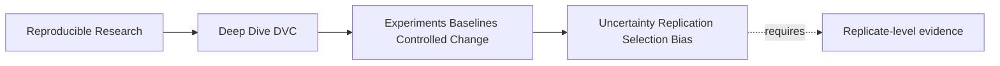
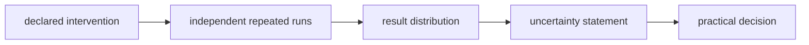
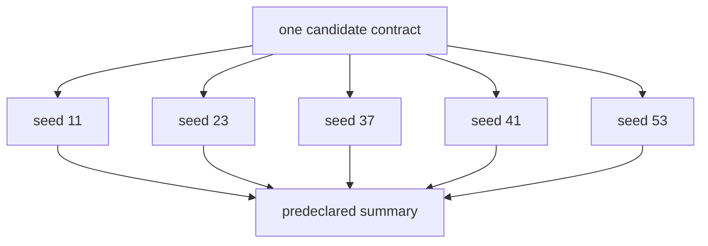
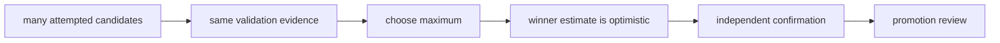

# Uncertainty, Replication, and Selection Bias

<!-- page-maps:start -->
## Page Maps




<!-- page-maps:end -->

A reproducible experiment record tells you which inputs and controls produced one result.
It does not tell you whether the observed improvement is stable under randomness, unusual
for the chosen population, or selected because you tried many candidates.

This distinction matters whenever training, sampling, optimization, scheduling, or
measurement contains meaningful variation.

## Separate deterministic and stochastic questions

The module's threshold specimen is deterministic:

- the eight evaluation records are fixed;
- scores are fixed;
- thresholding contains no random operation;
- the same declared inputs produce the same confusion matrix.

Its audit is designed to teach baseline authority, allowed changes, population
continuity, metric continuity, and promotion authority. It does not demonstrate
stability across training seeds or sampled populations.

For a stochastic model, two questions are needed:

1. **Lineage question:** can this exact run be reconstructed from recorded state?
2. **Uncertainty question:** does the candidate's advantage persist across relevant
   variation?

One run can answer the first and remain weak evidence for the second.

## Identify sources of variation

| Source | Example | What must be controlled or measured |
| --- | --- | --- |
| initialization | random model weights | seed policy and repeated training runs |
| sampling | train-validation split or bootstrap sample | split identity and resampling method |
| data order | shuffled batches | ordering or seed contract |
| optimization | nondeterministic kernels or parallel reductions | runtime boundary and observed variation |
| population | new cases drawn from a larger process | sampling design and interval or sensitivity analysis |
| measurement | noisy labels or human review | adjudication and reliability evidence |

Do not label all unexplained movement “random noise.” Some variation is hidden state or a
pipeline defect. First make the intended randomness explicit.

## Define the replicate

A replicate is one independently executed observation under the same experiment contract,
with only a declared variation such as seed or sample draw.

State:

```text
intervention:
preserved controls:
replicate-varying control:
number of planned replicates:
metric contract:
aggregation:
decision rule:
```

Running the same cached result five times is not five replicates. Neither is changing
several hyperparameters while calling each result a repeated run.



## Record seeds without mistaking them for proof

A seed is a control that can help reproduce a pseudo-random sequence. Record it in the
experiment parameters when it influences the result.

A seed does not:

- make a stochastic algorithm scientifically deterministic;
- guarantee identical results across libraries or hardware;
- establish that one seeded outcome is typical;
- replace repeated runs.

Use seeds for lineage and planned variation. Use replicate distributions for stability.

## Preserve replicate-level results

Suppose a baseline and candidate are each run under five predeclared seeds:

| Seed | Baseline F1 | Candidate F1 | Paired difference |
| ---: | ---: | ---: | ---: |
| 11 | 0.741 | 0.756 | +0.015 |
| 23 | 0.752 | 0.749 | -0.003 |
| 37 | 0.738 | 0.761 | +0.023 |
| 41 | 0.747 | 0.754 | +0.007 |
| 53 | 0.744 | 0.760 | +0.016 |

The mean difference is positive, but one replicate reverses direction. A review note
should retain that fact instead of publishing only the best candidate value.

Paired seeds can reduce irrelevant variation when baseline and candidate use the same
split and seed policy. Pairing must be planned; matching unrelated runs after seeing
results is not the same design.

## Choose the summary before seeing the winner

Predeclare:

- primary metric;
- replicate count;
- center, such as mean or median;
- spread, interval, or sensitivity summary;
- minimum practical gain;
- safeguards that must hold;
- handling of failed runs;
- stopping rule.

The exact statistical method depends on the data-generating process and domain. DVC does
not choose it. The reproducibility requirement is that the method and inputs are
reviewable before the result is interpreted.

## Distinguish statistical and practical uncertainty

A candidate can show a stable small gain that is operationally irrelevant. It can also
show a large average gain with unacceptable variability or a safeguard failure.

Use separate gates:

| Gate | Question |
| --- | --- |
| comparability | are baseline and candidate measurements of the same contract? |
| stability | does the direction or magnitude survive planned variation? |
| practical significance | is the gain large enough to matter? |
| safeguards | do cost, latency, fairness, precision, or other limits hold? |
| authority | who may select or promote the candidate? |

“Statistically detectable” and “worth adopting” are different claims.

## Recognize winner selection bias

If twenty candidates are tried and only the highest validation score is reported, the
winner benefits from both its real quality and favorable variation. The more candidates
and metrics inspected, the easier it is to find an apparent improvement by chance.



Preserve:

- all candidates considered for the decision;
- the selection rule;
- failed and inconclusive results;
- whether metrics were primary or exploratory;
- independent confirmation evidence.

Deleting losing experiment records before review makes the winner look more inevitable
than it was.

## Separate exploration from confirmation

Exploration can compare many ideas rapidly. Confirmation asks a narrower question using
evidence not consumed to choose the winner.

| Activity | Exploration | Confirmation |
| --- | --- | --- |
| purpose | discover promising candidates | test selected claim |
| flexibility | broad, clearly labeled | predeclared and bounded |
| data use | development or validation evidence | held-out or newly governed evidence |
| metrics | primary plus exploratory | predeclared decision surface |
| outcome | retain, discard, or nominate | accept, reject, or abstain |

The confirmation boundary may be a held-out dataset, a later time window, an independent
site, or another governed review. Its design is a domain decision, but its identity and
authority belong in the reproducibility record.

## Use DVC experiments for the evidence trail

DVC experiments can help preserve:

- candidate parameter state;
- pipeline and dependency lineage;
- metric outputs;
- candidate names and comparisons;
- multiple runs that would otherwise remain local folklore.

They do not automatically:

- decide which runs are independent replicates;
- detect post-hoc stopping;
- correct multiple-candidate selection bias;
- choose an uncertainty estimator;
- create an independent confirmation set;
- authorize promotion.

Represent each replicate with explicit controls and retain the collection used by the
decision. Do not average unidentified experiment rows into a number with no lineage.

## Review a stochastic candidate

Use this decision table:

| Question | Required evidence | Blocking condition |
| --- | --- | --- |
| same claim? | baseline and candidate contracts | population, metric, or control drift |
| independent repeats? | replicate identities and varying controls | cached duplicates or mixed interventions |
| stable enough? | predeclared distribution summary | direction or safeguards unstable |
| practically useful? | minimum gain and domain policy | effect below useful threshold |
| selection honest? | candidate inventory and rule | only winner retained |
| confirmed? | independent governed evidence | selection and confirmation reuse same evidence without acknowledgment |

Blocked comparison and uncertain effect are different:

- **blocked comparison** means the measurements cannot be ranked;
- **uncertain effect** means the comparison is valid but decision evidence is insufficient.

## Apply the boundary to the deterministic specimen

Run:

```bash
make PROGRAM=reproducible-research/deep-dive-dvc capstone-experiment-comparability-audit
```

The controlled-threshold result needs no stochastic replicate claim because the specimen's
mapping is deterministic. Its `KEEP_FOR_PROMOTION_REVIEW` outcome remains bounded:

- the same fixed cohort and schema support the measured tradeoff;
- the result says nothing about a retrained model's seed stability;
- the tiny cohort does not establish production generalization;
- promotion still requires a decision record.

Adding invented confidence intervals to eight fixed cases would not strengthen the audit.
The honest improvement is to state which uncertainty questions the specimen does not
model.

## Review checkpoint

You understand this boundary when you can:

- distinguish exact-run lineage from stability across variation;
- define a real replicate and its varying control;
- use seeds as recorded controls without calling one seed representative;
- retain replicate-level evidence and predeclare summaries;
- separate comparability, stability, practical significance, safeguards, and authority;
- explain winner selection bias;
- separate exploration from independent confirmation;
- state why the deterministic capstone audit does not prove stochastic robustness.
