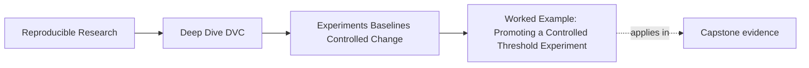

# Worked Example: Promoting a Controlled Threshold Experiment


<!-- page-maps:start -->
## Page Maps




<!-- page-maps:end -->

This example uses the executable experiment specimen rather than invented terminal output.
You will review the same intervention under three conditions:

- a controlled candidate
- a candidate with population drift
- a valid comparison with an unsafe promotion request

The goal is to locate the exact gate where each path stops.

## Build the evidence

From the repository root:

```bash
make PROGRAM=reproducible-research/deep-dive-dvc capstone-experiment-comparability-audit
```

The command creates isolated Git and DVC repositories and executes a real `dvc exp run`
inside each one. Locate the generated audit directory, then open:

```text
summary.tsv
workspace/controlled-threshold/finding.json
workspace/population-drift/finding.json
workspace/unsafe-promotion-request/finding.json
```

Start with `summary.tsv`. Do not inspect the candidate metrics yet.

## Establish the approved anchor

Open the controlled case's:

```text
workspace/evidence/baseline-params.json
workspace/evidence/baseline-metrics.json
```

The baseline control is:

```json
{"decision": {"threshold": 0.65}}
```

The baseline result includes:

```json
{
  "metric_schema": "classification-v1",
  "metrics": {
    "f1": 0.75,
    "precision": 1.0,
    "recall": 0.6
  },
  "population": {
    "id": "incident-review-v1",
    "record_count": 8
  }
}
```

The population record also carries a digest of sorted incident IDs. Count and label alone
are not enough; the digest lets the audit detect a changed cohort with the same friendly
name.

The contract permits exactly one candidate change:

```text
decision.threshold
```

The planned target is `0.50`.

## Confirm execution without overclaiming it

Open `workspace/evidence/receipts.json` and find:

```text
candidate_run
experiment_show
experiment_diff
```

The candidate run has return code zero. That proves DVC executed the candidate. It does
not prove the result is comparable.

Next inspect `finding.json`. The controlled case verifies:

- the baseline still matches its recorded contract
- the intent is present
- the actual changed paths match the allowed change set
- the population is stable
- the metric schema is stable
- the experiment reproduced
- the baseline Git commit did not move

Only now is it reasonable to read the metric movement.

## Interpret the controlled tradeoff

Open `candidate-metrics.json`:

| Metric | Baseline | Candidate | Delta |
| --- | ---: | ---: | ---: |
| recall | `0.6000` | `1.0000` | `+0.4000` |
| precision | `1.0000` | `0.8333` | `-0.1667` |
| F1 | `0.7500` | `0.9091` | `+0.1591` |

The change means two previously missed positive incidents are now escalated, while one
negative incident becomes a false escalation.

The promotion policy requires:

```text
minimum recall gain: 0.15
minimum precision:   0.60
```

The candidate passes those safeguards. The finding is:

```text
KEEP_FOR_PROMOTION_REVIEW
```

That decision is intentionally weaker than promotion.

## Contrast population drift

Now open the corresponding baseline and candidate metrics for `population-drift`.

The candidate still:

- changes threshold from `0.65` to `0.50`
- executes successfully
- emits metrics
- keeps the same friendly population ID

But the candidate population contains a ninth incident. Both record count and ID digest
change. The audit fails `evaluation_population_is_stable` and returns:

```text
BLOCK_COMPARISON
```

Do not rank this candidate below the controlled one. It is outside the comparison because
the threshold intervention and cohort change are confounded.

The repair is not “accept the larger sample.” The team must decide whether the ninth record
belongs in a newly approved baseline, record that anchor, and rerun candidates against it.

## Contrast unsafe promotion

Finally inspect `unsafe-promotion-request`.

Every comparison check passes. Its metric evidence is the same as the controlled case.
The workspace also contains:

```text
promotion-request.json
```

It does not contain a durable decision with an owner and evidence. Therefore the audit
returns:

```text
BLOCK_PROMOTION
```

This is not a comparison defect. Re-running the experiment will not repair it. The missing
work is governance: a reviewer must decide, record why, attach evidence, and identify the
resulting governed state.

## Write the review record

A defensible record would say:

> Keep the threshold `0.50` candidate for promotion review from baseline
> `approved-incident-triage`. The candidate changes only `decision.threshold`, preserves
> the `incident-review-v1` population digest and `classification-v1` metric schema, raises
> recall from `0.60` to `1.00`, and lowers precision from `1.00` to `0.8333`. It passes
> the stated recall-gain and precision safeguards. No promotion is authorized until an
> owner records the decision, the candidate is applied to a clean workspace, and the
> resulting state is verified and committed.

This note separates observation, comparison eligibility, policy judgment, and authority.

## Reconstruct the three stopping points

| Case | Execution | Comparison | Promotion |
| --- | --- | --- | --- |
| controlled threshold | passes | passes | awaiting review |
| population drift | passes | blocks | not reached |
| unsafe promotion request | passes | passes | blocks |

If you can explain why the same successful command leads to these three outcomes, you have
the core reasoning this module was previously missing.
