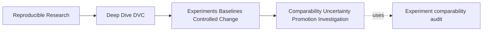
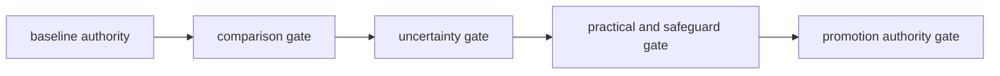
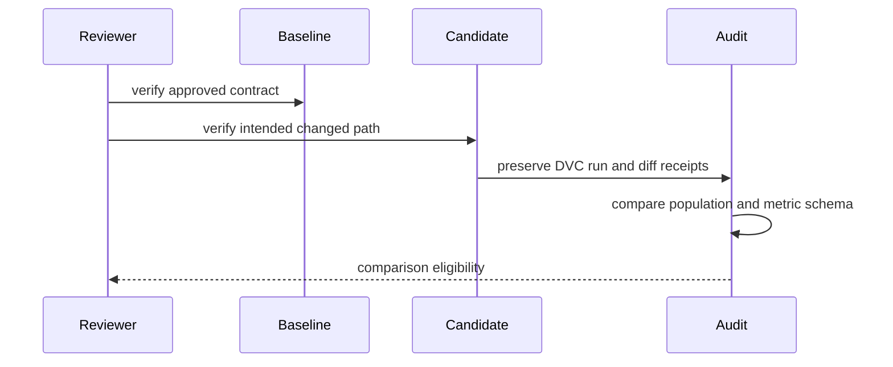

# Worked Investigation: Separating Comparability, Uncertainty, and Promotion

<!-- page-maps:start -->
## Page Maps




<!-- page-maps:end -->

This investigation uses the executable threshold specimen to prove comparability and
promotion boundaries. It then introduces a separate stochastic evidence packet to show
what the deterministic specimen cannot prove.

Keep those evidence sources distinct:

- generated audit receipts support claims about the capstone specimen;
- the replicate table supports reasoning about a modeled stochastic study;
- neither establishes real-world deployment value.

## Predict every audit decision

Before running the route, copy this table and fill the final two columns:

| Case | Changed boundary | Expected decision | Evidence that would reverse it |
| --- | --- | --- | --- |
| controlled threshold | only intended threshold | | |
| mixed control change | threshold plus capacity | | |
| mutated baseline contract | approved anchor differs | | |
| population drift | evaluation records differ | | |
| metric schema drift | metric meaning differs | | |
| missing candidate intent | question is absent | | |
| unsafe promotion request | comparison valid; approval missing | | |

Run:

```bash
make PROGRAM=reproducible-research/deep-dive-dvc capstone-experiment-comparability-audit
audit=artifacts/audit/reproducible-research/deep-dive-dvc/experiment-comparability
```

If the generated directory differs, read the target output and use the reported path.
Do not invent or relocate receipts.

## Read result and decision together

Open `summary.tsv`. The expected classifications are:

| Finding | Result | Decision |
| --- | --- | --- |
| `CONTROLLED_THRESHOLD` | `PASS` | `KEEP_FOR_PROMOTION_REVIEW` |
| `MIXED_CONTROL_CHANGE` | `PASS` | `BLOCK_COMPARISON` |
| `MUTATED_BASELINE_CONTRACT` | `PASS` | `BLOCK_COMPARISON` |
| `POPULATION_DRIFT` | `PASS` | `BLOCK_COMPARISON` |
| `METRIC_SCHEMA_DRIFT` | `PASS` | `BLOCK_COMPARISON` |
| `MISSING_CANDIDATE_INTENT` | `PASS` | `BLOCK_COMPARISON` |
| `UNSAFE_PROMOTION_REQUEST` | `PASS` | `BLOCK_PROMOTION` |

`PASS` means the audit reproduced its expected contrast. Five of these passing findings
block comparison and one blocks promotion.

## Reconstruct the approved anchor

For the controlled case, read:

```text
workspace/evidence/baseline-params.json
workspace/evidence/baseline-metrics.json
```

The baseline contract includes:

```text
baseline id: approved-incident-triage
threshold: 0.65
population id: incident-review-v1
population records: 8
metric schema: classification-v1
allowed candidate change: decision.threshold
```

The population also carries a digest of sorted incident identifiers. Friendly ID and row
count are useful descriptions; the digest detects membership drift.

State the baseline claim:

> On the identified eight-record evaluation population, under
> `classification-v1` and threshold `0.65`, the deterministic evaluator produces the
> recorded precision, recall, and F1 values.

This is an exact finite-population claim. It is not a population-generalization or
stochastic-training claim.

## Confirm the candidate intervention

Compare baseline and candidate parameters. The controlled candidate changes:

```text
decision.threshold: 0.65 -> 0.50
```

No population, schema, or unrelated policy control changes.

Inspect the DVC receipts:

```text
candidate_run
experiment_show
experiment_diff
```

A zero return code establishes successful candidate execution. The surrounding contract
checks establish whether the output belongs in the same comparison.



## Interpret the deterministic tradeoff

The controlled result is:

| Metric | Baseline | Candidate | Delta |
| --- | ---: | ---: | ---: |
| recall | 0.6000 | 1.0000 | +0.4000 |
| precision | 1.0000 | 0.8333 | -0.1667 |
| F1 | 0.7500 | 0.9091 | +0.1591 |

The operational translation is:

- two previously missed positive incidents are now escalated;
- one negative incident becomes a false escalation;
- the declared recall-gain threshold passes;
- the declared precision safeguard passes.

Because the evaluator is deterministic over a fixed cohort, repeating the same inputs
should reproduce the same counts. More identical repetitions would demonstrate
repeatability, not uncertainty about retraining or a larger population.

The correct result is `KEEP_FOR_PROMOTION_REVIEW`, not `PROMOTE`.

## Diagnose the comparison blocks

### Mixed controls

Threshold and review capacity change together. Both are visible, but visibility does not
restore attribution. The candidate asks two questions without a design that separates
their effects.

### Mutated baseline

Candidate evidence no longer matches the recorded approved anchor. A high score cannot
repair changed baseline authority.

### Population drift

The cohort gains a ninth record. Population count and identity digest change. Threshold
movement is now confounded with cohort movement.

### Metric schema drift

The candidate changes the meaning of the result. Numeric continuity is insufficient
across a schema boundary.

### Missing intent

Without a bounded question and allowed change set, the reviewer cannot decide whether the
observed diff is controlled or accidental.

These are distinct defects. “Experiment failed” is an unhelpful summary because every
candidate may execute successfully.

## Diagnose the promotion block

The unsafe promotion request uses comparison evidence equivalent to the controlled case.
It blocks later because no durable decision record authorizes the state transition.

Re-running cannot add authority. Required repair:

```text
candidate identity:
baseline authority:
comparison evidence:
tradeoff:
policy result:
owner:
decision:
resulting commit or rejection:
```

The same numbers support “keep for review” and “block promotion” at different gates.

## Add a stochastic evidence question

Now consider a separate training candidate evaluated under five predeclared paired seeds:

| Seed | Baseline F1 | Candidate F1 | Difference | Precision safeguard |
| ---: | ---: | ---: | ---: | --- |
| 11 | 0.741 | 0.756 | +0.015 | pass |
| 23 | 0.752 | 0.749 | -0.003 | pass |
| 37 | 0.738 | 0.761 | +0.023 | pass |
| 41 | 0.747 | 0.754 | +0.007 | pass |
| 53 | 0.744 | 0.760 | +0.016 | pass |

Predeclared rule:

```text
summary: mean paired F1 difference
minimum practical gain: 0.010
safeguard: precision passes in every replicate
confirmation: frozen candidate on independent governed evidence
```

Compute the paired mean:

```text
(0.015 - 0.003 + 0.023 + 0.007 + 0.016) / 5 = 0.0116
```

The mean exceeds the practical threshold, but one seed reverses direction. A defensible
decision says both.

## Review the replicate contract

Before interpreting the mean, check:

| Question | Evidence |
| --- | --- |
| were seeds planned before results? | experiment-family manifest |
| are baseline and candidate paired? | matching seed identities |
| are intervention controls otherwise equal? | parameter and DVC experiment diffs |
| are failed runs retained? | replicate ledger |
| is the summary recomputable? | replicate-level metric records |
| was the winner chosen from a larger search? | candidate inventory |

If only these five winning runs survived from a fifty-candidate search, the mean is not an
honest account of selection.

## Separate nomination from confirmation

Assume the replicate evidence nominates the candidate. Freeze:

- candidate configuration;
- primary metric and practical threshold;
- safeguards;
- confirmation population;
- decision rule.

Then evaluate on independent governed evidence.

Possible outcomes:

| Confirmation result | Decision |
| --- | --- |
| rule and safeguards pass | keep for promotion review |
| primary rule fails | reject confirmation claim |
| population identity missing | abstain |
| candidate retuned after seeing result | confirmation boundary consumed; redesign |

Confirmation does not authorize promotion. It satisfies a stronger evidence burden before
the governance decision.

## Write two bounded conclusions

For the executable deterministic audit:

> Lowering the threshold from `0.65` to `0.50` on the same identified eight-record
> population preserves metric schema, changes only the allowed control, raises recall,
> and retains precision above the audit safeguard. The evidence supports keeping the
> candidate for promotion review. It does not establish behavior on another population,
> stochastic training stability, or promotion authority.

For the modeled stochastic packet:

> Across five predeclared paired seeds, the candidate's mean F1 difference is `+0.0116`,
> above the `0.010` practical threshold, and every precision safeguard passes. One seed
> shows a negative difference, so the effect is not directionally uniform. The
> configuration may proceed to independent confirmation if the candidate inventory and
> failed-run ledger are complete.

Do not merge the two conclusions. They rely on different evidence.

## Preserve the review packet

```text
audit-summary.tsv
baseline-contract.json
candidate-intent.json
dvc-receipts.json
comparability-decision.md
replicate-family.json
replicate-results.tsv
candidate-inventory.tsv
uncertainty-decision.md
confirmation-contract.md
promotion-decision.md
```

The packet makes each stopping point reviewable.

## Investigation checkpoint

You have completed the investigation when you can:

- predict all seven audit decisions;
- explain why successful execution is weaker than comparison;
- interpret the fixed-cohort threshold tradeoff without inventing stochastic evidence;
- distinguish mixed change, baseline, population, schema, and intent defects;
- explain why valid comparison can still block promotion;
- compute and qualify a replicate summary;
- identify winner-selection evidence;
- separate exploration, confirmation, and promotion authority;
- write conclusions whose scope matches their evidence.
