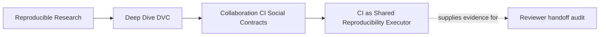
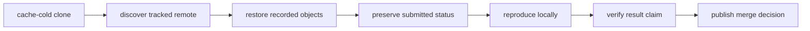
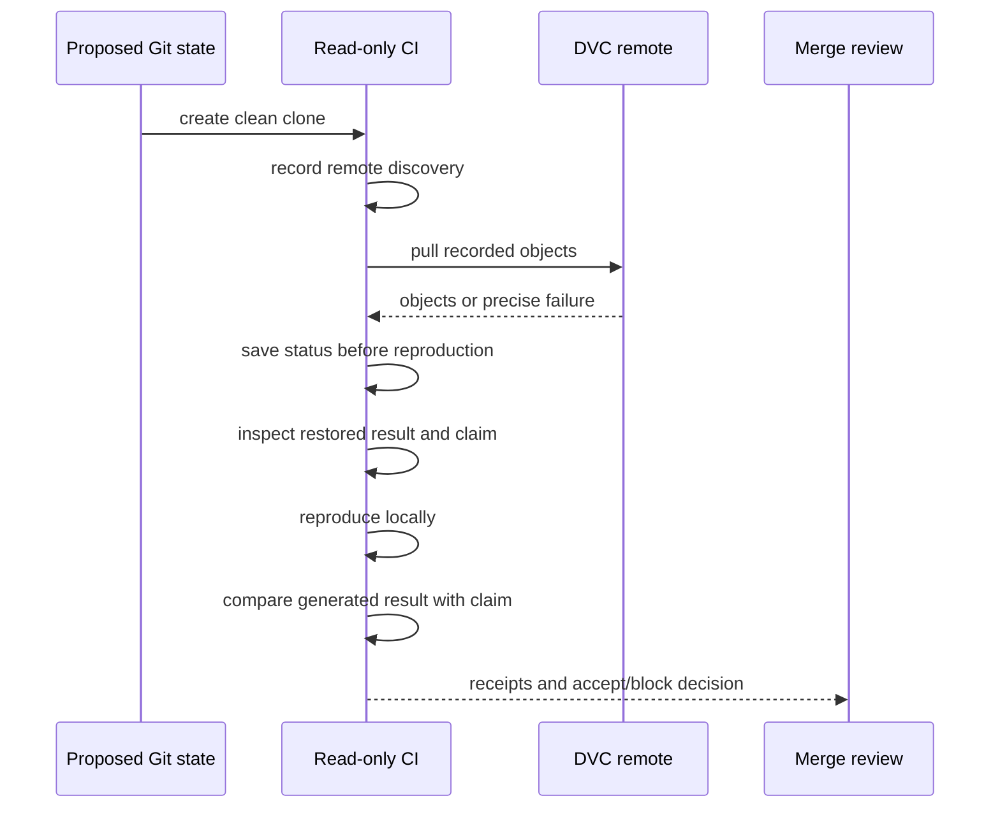
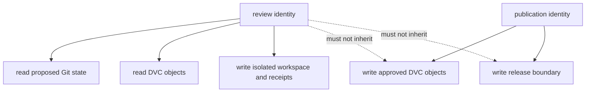

# CI as Shared Reproducibility Executor

<!-- page-maps:start -->
## Page Maps




<!-- page-maps:end -->

CI is valuable when it acts as an independent reviewer with a defined authority and a
preserved evidence route. It is weak when it merely reruns the author's commands in a
workspace containing hidden caches, broad credentials, or repaired state.

The goal is not “put DVC in CI.” The goal is:

> Give every proposed shared state the same cache-cold, read-only, claim-aware review.

## Decide what CI has authority to conclude

Different jobs support different claims:

| Job | Supported conclusion |
| --- | --- |
| unit tests | implementation behaves as tested with available fixtures |
| declaration checks | pipeline and configuration satisfy structural rules |
| cache-cold handoff audit | tracked state plus remote reads can reconstruct the submitted claim |
| fresh reproduction | pipeline executes from reconstructed inputs |
| result contract check | generated result matches the declared bounded expectation |
| publication job | approved objects or bundles were written to governed storage |

A green unit-test job cannot prove DVC object availability. A successful reproduction
cannot prove submitted lock state was clean before CI repaired it. A handoff audit cannot
prove scientific representativeness.

Branch protection should require the jobs whose conclusions match the merge policy.

## Build the job around claim order

A cache-cold handoff job should preserve evidence in this order:



This route separates three questions:

1. Was the submitted recorded state recoverable?
2. Was it coherent before CI changed anything?
3. Can the declared pipeline reproduce the bounded result?

Changing the order can erase the answer to the second question.

## Run the reference audit

```bash
make PROGRAM=reproducible-research/deep-dive-dvc capstone-reviewer-handoff-audit
audit=artifacts/audit/reproducible-research/deep-dive-dvc/reviewer-handoff
```

Inspect the accepted finding:

```bash
jq '.findings[] | select(.finding == "COMPLETE_HANDOFF")' \
  "$audit/report.json"
```

The seven checks are:

```text
remote_discoverable
pull_succeeded
recorded_state_clean_before_repro
repro_succeeded
review_route_avoids_remote_mutation
result_contract_present
result_matches_claim
```

Together they support one bounded conclusion: a clean, read-only reviewer can recover,
inspect, reproduce, and explain the submitted specimen.

## Preserve receipts even when the final command succeeds

The stale execution case demonstrates why:

```bash
jq '.findings[] | select(.finding == "STALE_EXECUTION_RECORD")' \
  "$audit/report.json"
```

Its pull succeeds. Its reproduction succeeds. It still blocks because pre-reproduction
status is stale and the submitted result does not match the contract.

If CI reported only the exit code from final reproduction, it would convert a defective
submission into a green local repair.

Retain at least:

| Receipt | Purpose |
| --- | --- |
| remote list | prove route discovery |
| pull stdout/stderr and exit status | prove recorded object restoration |
| pre-repro status JSON | evaluate submitted currency |
| restored result identity and values | inspect submitted meaning |
| repro stdout/stderr and exit status | prove executable route |
| post-repro result identity and values | inspect regenerated meaning |
| contract comparison | explain acceptance decision |
| job context identity | bind receipts to commit and executor |

CI logs alone may expire or be hard to review. Publish a structured evidence artifact when
the claim matters beyond immediate debugging.

## Use least authority

The reviewer-handoff audit blocks a route containing `dvc push`.

Verification needs:

- read access to the proposed Git state;
- read access to the relevant DVC objects;
- permission to write only inside the isolated job workspace;
- permission to publish review receipts to the CI system.

It should not need:

- write access to the shared DVC remote;
- release registry authority;
- production credentials;
- permission to alter protected history.



This separation reduces risk and makes failures interpretable. A review job should not
silently publish the state it is deciding whether to trust.

## Treat forks and external contributors as real users

A CI design that works only for trusted branches with full secrets may fail to review
external contributions.

Decide explicitly:

| Contribution context | Remote access | Safe review scope |
| --- | --- | --- |
| trusted internal branch | scoped read credential | full handoff audit |
| external fork | no secret exposure | structural checks and approved public fixtures |
| protected post-merge job | controlled write identity | publication after independent acceptance |

Never expose write credentials to untrusted code. If private data prevents full fork
verification, state the limitation and run the privileged audit only in a safe,
maintainer-controlled context.

The merge policy must explain which evidence is available before acceptance and which
requires trusted execution.

## Fail with boundary-specific evidence

A useful CI failure says:

> Block: tracked remote is discoverable, but `dvc pull` cannot retrieve object
> `<identity>` referenced by `data/incidents.csv.dvc`. Publish that object from the
> reviewed state, then rerun the cache-cold handoff audit.

A weak failure says:

> DVC job failed.

Boundary-specific output should identify:

- failed check;
- affected artifact or route;
- preserved receipt;
- required owner or repair;
- whether rerunning without state change can help.

The summary table from the audit is a model: each case names `failed_checks` rather than
collapsing all defects into one exit code.

## Keep the job isolated and reproducible

A trustworthy executor defines:

- base image or runner identity;
- DVC and Git versions;
- cache policy;
- credentials and authority;
- network assumptions;
- artifact retention;
- timeout and resource boundaries.

For a clean handoff test, do not restore the author's DVC cache before verifying remote
availability. Tool-install caches may be safe, but data caches can invalidate the claim
being tested.

Use separate cache scopes:

| Cache | Usually safe for handoff claim? | Reason |
| --- | --- | --- |
| package-download cache | yes, with integrity checks | accelerates installation without supplying project data |
| virtual environment | conditional | must match reviewed lock and executor policy |
| DVC object cache | no before remote restoration check | can hide missing shared objects |
| prior generated outputs | no | can hide stale or incomplete execution |

## Design a two-authority pipeline

A durable collaboration route often has two jobs:

### Review job

- cache-cold clone;
- tracked remote discovery;
- read-only pull;
- pre-repro status;
- local reproduction;
- claim verification;
- evidence publication;
- merge decision.

### Publication job

- runs only after acceptance;
- uses a narrowly scoped write identity;
- publishes approved DVC objects or release bundles;
- verifies written identities;
- records publication receipts;
- never changes the reviewed claim silently.

The jobs may use the same workflow system, but their identities and permissions must
differ.

## Decide what blocks merge

A merge gate should block when:

- tracked configuration cannot identify the required remote;
- any reviewed pointer lacks a readable object;
- a declared source dependency is absent from Git;
- submitted recorded state is stale;
- the declared pipeline cannot reproduce in the supported executor;
- review requires remote mutation;
- the result claim is absent or contradicted.

It may report separately, rather than block, on:

- performance variation outside an established budget;
- storage retention policy review not tied to this change;
- optional platform coverage;
- scientific claims governed by another review body.

Do not weaken a required check merely because it is inconvenient. If the claim cannot be
tested safely in a contribution context, design a trusted review stage and state the
evidence gap before merge.

## CI contract template

```text
Merge claim:
What does a green job allow reviewers to conclude?

Initial state:
Which caches and untracked files are intentionally absent?

Inputs:
Which Git revision, DVC objects, configuration, and claim contract are reviewed?

Authority:
Which reads and local writes are allowed? Which shared writes are forbidden?

Receipt order:
Which evidence is captured before reproduction and after it?

Decision:
Which failed checks block merge?

Retention:
How long are structured receipts available?

Limits:
Which fork, storage, runtime, scientific, or release claims remain outside this job?
```

## Review checkpoint

You understand CI as a shared reproducibility executor when you can:

- state the exact conclusion of each required job;
- explain why cache-cold restoration matters;
- preserve pre-repro evidence before local repair;
- distinguish review from publication authority;
- design safe behavior for untrusted contributions;
- prevent DVC caches from hiding remote defects;
- emit boundary-specific failure evidence;
- name what a green handoff job does not prove.

The standard is:

> CI should reproduce the conditions of an independent reviewer, preserve the submitted
> state before repair, and publish a decision whose evidence and authority are explicit.
