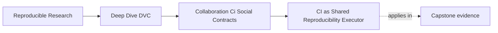

# CI as Shared Reproducibility Executor


<!-- page-maps:start -->
## Page Maps




<!-- page-maps:end -->

Local success is useful, but it is not enough for team trust.

CI gives the team a shared executor: a place where the repository must prove itself
without the author's local cache, shell history, notebook state, or private files.

That is why CI matters in a DVC project. It is not only a way to run tests. It is a way to
ask whether a clean environment can recover and verify the declared state story.

## What CI should prove

A DVC-aware CI route should prove more than "Python imports."

It should answer:

- can the repository install the required tools?
- can required DVC objects be pulled from the configured remote?
- do `dvc.yaml`, `dvc.lock`, parameters, metrics, and outputs agree?
- can the verification route run without private local state?
- do release or review checks fail loudly when evidence is incomplete?

The exact commands vary by project, but the intent and evidence order should be stable.

Example review route:

```bash
dvc remote list
dvc pull
dvc status --json
dvc repro
```

The course exposes these ideas through
`make PROGRAM=reproducible-research/deep-dive-dvc capstone-reviewer-handoff-audit`, which
is narrower than full capstone confirmation and preserves each intermediate receipt.

## Order the route by claim

These commands are not interchangeable:

| Command | Question answered | Why it comes here |
| --- | --- | --- |
| `dvc remote list` | can the clone discover shared storage? | discovery must exist before availability can be tested |
| `dvc pull` | are the recorded objects available? | recovery should happen before pipeline inspection |
| `dvc status --json` | was the submitted state coherent? | status must be captured before a command repairs it |
| `dvc repro` | can the clean clone execute? | reproduction is a later capability, not a substitute for submitted-state evidence |
| governed result check | does the generated evidence match its claim? | successful execution still needs interpretation |

Suppose a pull request changes a data pointer and pushes its object but leaves
`dvc.lock` and a generated report stale. A clean clone can pull. `dvc repro` can also
succeed by rebuilding the report. If CI runs only reproduction and checks the final exit
code, it loses the evidence that the pull request arrived incoherent.

The stronger route saves pre-reproduction status and blocks the submitted state even
when a local rebuild is possible.

## Compare real clean executors

Run:

```bash
make PROGRAM=reproducible-research/deep-dive-dvc capstone-reviewer-handoff-audit
```

Compare these findings:

```text
COMPLETE_HANDOFF       PASS  ACCEPT
MISSING_REMOTE_OBJECT  PASS  BLOCK
STALE_EXECUTION_RECORD PASS  BLOCK
```

Then inspect:

```text
workspace/complete-handoff/evidence/receipts.json
workspace/missing-remote-object/evidence/receipts.json
workspace/stale-execution-record/evidence/receipts.json
```

The missing-object case fails at `dvc pull`; CI cannot obtain the state. The stale case
passes pull and later reproduction but fails pre-reproduction status. A useful CI job
reports those as different contract failures.

## Separate review authority from publication authority

The audit's `MUTATING_REVIEW_ROUTE` case is operationally complete, but its documented
route includes `dvc push`. It blocks because routine review should not require permission
to mutate shared storage.

A practical authority split is:

| Actor | Ordinary authority | Why |
| --- | --- | --- |
| pull-request CI | read shared objects, write local workspace | verifies without changing shared evidence |
| trusted publication job | write promoted objects | publishes only after review gates pass |
| untrusted fork job | no secret-backed remote access | avoids exposing credentials |
| scheduled recovery job | read protected recovery sources | rehearses restore without publishing |

When an untrusted fork cannot access remote-backed evidence, the reduced job should say
what it skipped. A skipped secret-dependent check is not a pass; it is a limitation that
trusted CI must resolve before merge.

## CI should fail for missing shared state

If a pull request updates DVC metadata but does not push the corresponding data, CI should
fail.

That failure is not annoying noise. It is the system protecting collaborators from a
broken state story.

Weak response:

> It works on my machine; CI probably does not have the data.

Stronger response:

> CI correctly found that the shared remote cannot reconstruct the declared state. Push
> the missing DVC objects or revise the change before merge.

The difference is important. CI is not the less-trusted executor. It is the shared proof
surface.

## Keep CI focused enough to be useful

CI does not need to rerun every expensive production workflow on every small change.

But it should include a meaningful route that catches broken collaboration contracts:

- missing remote objects
- inconsistent lock evidence
- undeclared output drift
- invalid release bundle shape
- broken recovery command
- metric or parameter evidence missing from a promotion review

If the full workflow is expensive, split checks by confidence level:

| Check | Trigger | Purpose |
| --- | --- | --- |
| fast metadata check | every change | catch broken declarations quickly |
| remote discovery and pull | pointers, lock, or DVC output changed | prove the shared route and objects exist |
| pre-reproduction status | pipeline-relevant state changed | prove the submitted record is coherent |
| bounded reproduction | relevant code, data, params, or runtime changed | prove the core graph runs cleanly |
| release audit | promoted evidence changed | prove the promotion boundary is complete |
| scheduled recovery route | schedule or storage change | prove restoration still works |

This keeps CI practical without making it superficial.

## Local failures and CI failures mean different things

If local fails and CI passes, the local environment may be drifted.

If local passes and CI fails, the repository may depend on local state.

Neither result should be dismissed. But for merge trust, CI failure blocks the shared
contract because it proves another clean executor cannot verify the change yet.

That does not mean CI is always perfectly configured. It means CI failures deserve repair
or explicit explanation before merge.

## Review checkpoint

You understand this core when you can:

- explain why local success is not enough for collaboration
- name the DVC state CI should recover or verify
- order discovery, pull, status, reproduction, and interpretation by claim
- explain why status captured after reproduction cannot validate the submitted state
- separate read-only review authority from trusted publication authority
- treat missing remote data as a correct blocking failure
- design a practical verification route instead of an ornamental one
- explain why CI is part of the shared proof surface

CI is not a substitute for review. It is the part of review that does not rely on memory.
