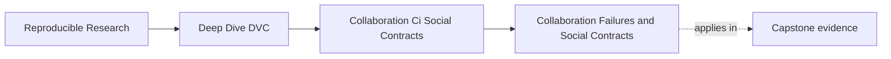
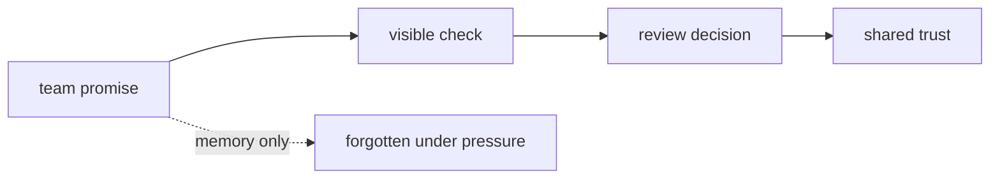

# Collaboration Failures and Social Contracts


<!-- page-maps:start -->
## Page Maps




<!-- page-maps:end -->

Reproducibility failures often look technical after they happen.

Before they happen, they often look social:

- someone forgot to push data
- someone trusted a local result
- someone merged a lockfile change without checking remote state
- someone assumed a teammate knew which command to run
- someone promoted a report without the parameters that made it interpretable

Module 07 does not treat these as character flaws. It treats them as missing contracts.

## The problem with "careful people"

"We are careful" is not a reproducibility strategy.

Careful people still get interrupted. They still miss uploads under deadline pressure.
They still onboard new teammates who do not share private context. They still forget why a
local result was trusted three months later.

A stronger system asks:

> Which promises should the repository and CI enforce because humans will eventually
> forget them?

That question turns blame into design.

## Social contracts should become visible checks

A social contract is an agreement the team relies on.

Weak contract:

> Remember to push DVC data before merging.

Stronger contract:

> A pull request cannot merge unless CI can pull required DVC objects and run the
> verification route from a clean checkout.

The second version can be checked. It gives reviewers a shared standard instead of a
reminder.



The diagram is simple because the idea is simple: important promises need evidence.

## Common failure classes

| Failure | What it looks like | Missing contract |
| --- | --- | --- |
| missing data push | metadata merged, remote object absent | CI or review did not verify data availability |
| local-only success | author can run it, teammate cannot | clean executor was not authoritative |
| lockfile drift | pipeline declaration and lock evidence disagree | merge gate did not require consistent state |
| private review context | only the author understands the result | review notes and published evidence are incomplete |
| stale release bundle | metrics promoted without matching params | release boundary did not require paired evidence |

These are not rare edge cases. They are ordinary collaboration pressure points.

## One handoff contains several contracts

"The repository is reproducible" is too broad to review. Break it into contracts that can
fail independently:

| Contract | Reviewer question | Evidence |
| --- | --- | --- |
| discovery | does the clone know which shared remote to use? | tracked `.dvc/config` and `dvc remote list` |
| availability | do the referenced DVC objects exist there? | successful clean `dvc pull` |
| repository completeness | are every declared script, policy, and config file tracked? | clone contents plus `dvc status` |
| recorded execution | did the submitted lock and outputs describe current inputs? | clean status before reproduction |
| reproducibility | can the clone execute without private files? | successful `dvc repro` |
| authority | can ordinary review avoid shared-storage writes? | read-only review route |
| interpretation | does the repository say what result should be explained? | result contract joined to generated evidence |

This decomposition prevents a successful check in one layer from excusing a failure in
another. A reviewer may discover the remote but find missing objects. A pull may succeed
while an untracked policy file still breaks reproduction. Reproduction may succeed after
repairing a stale submitted state. None of those outcomes are equivalent.

## Inspect the contracts in a clean handoff

Run the controlled audit from the repository root:

```bash
make -C programs/reproducible-research/deep-dive-dvc/capstone reviewer-handoff-audit
```

Open:

```text
artifacts/audit/reproducible-research/deep-dive-dvc/reviewer-handoff/
├── summary.tsv
└── workspace/
    ├── complete-handoff/
    ├── missing-remote-object/
    ├── undiscoverable-remote/
    ├── untracked-stage-dependency/
    ├── stale-execution-record/
    ├── mutating-review-route/
    └── missing-result-contract/
```

Each case contains an `author/`, an empty-cache `reviewer/`, and saved receipts. The audit
does not ask you to imagine what another maintainer might see; it creates that maintainer's
workspace.

Read `summary.tsv` as two decisions:

- `PASS` means the audit reproduced the case it promised to demonstrate.
- `ACCEPT` or `BLOCK` is the handoff decision.

Therefore `PASS / BLOCK` is not contradictory. It means the evidence defect was observed
successfully and should stop the handoff.

## Diagnose by failed promise, not by last command

The six blocked cases are deliberately different:

| Case | Failed promise | Why "run it again" is not the answer |
| --- | --- | --- |
| missing remote object | availability | the clone cannot obtain the named bytes |
| undiscoverable remote | discovery | the clone was never told where shared state lives |
| untracked dependency | repository completeness | DVC storage cannot restore an author-only Git dependency |
| stale execution record | recorded execution | reproduction repairs locally but does not make the submitted evidence current |
| mutating review route | authority | a reviewer should not need remote write access |
| missing result contract | interpretation | runnable output still has no bounded meaning |

This table turns "the handoff failed" into a repairable diagnosis. Each row calls for a
different owner and fix.

## Make the reviewer independent

A reviewer should not need to ask:

- which local file did you use?
- did you remember to push the data?
- which threshold produced this metric?
- did this run happen before or after the feature change?
- can you send me the missing artifact?

Some human discussion is always useful. But the core state story should be inspectable
from the repository and remote-backed evidence.

The review target is:

> Another maintainer can verify the result without private files, private memory, or local
> machine state.

In the accepted audit case, that maintainer receives only the Git clone and remote read
access. The author's cache is intentionally absent. All seven contract checks pass before
the handoff is accepted.

## Good contracts are specific

Weak:

> Keep DVC up to date.

Specific:

> Pull requests that change `dvc.yaml`, `dvc.lock`, `params.yaml`, metric files, or DVC
> pointer files must pass a clean verification route and include any required remote data
> pushes.

Weak:

> Review metrics carefully.

Specific:

> Release review must include the metric file, matching parameters, baseline comparison,
> and any known comparability limits.

Specific contracts are easier to teach and easier to automate.

## Review checkpoint

You understand this core when you can:

- describe a reproducibility failure as a missing contract
- distinguish memory-based expectations from enforceable checks
- identify whether discovery, availability, Git completeness, recorded execution,
  authority, or interpretation failed
- explain why `PASS / BLOCK` is a successful audit result
- name what a reviewer should verify without private context
- explain why "careful team" is not enough
- rewrite vague collaboration advice into a specific review rule

The goal is not distrust. The goal is a system where trust has evidence.
