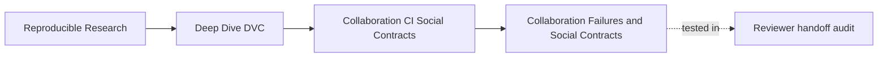
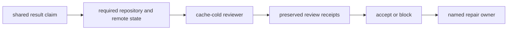
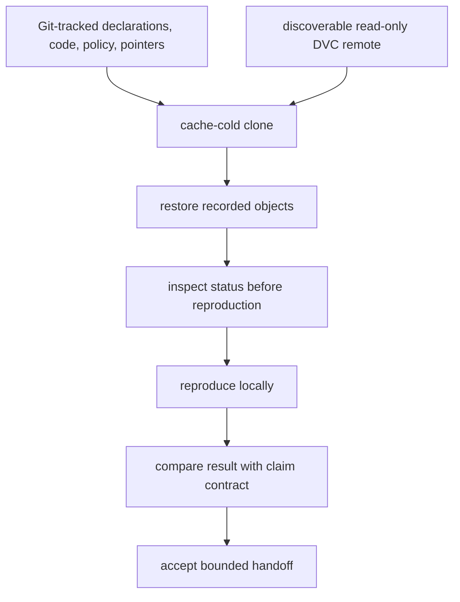
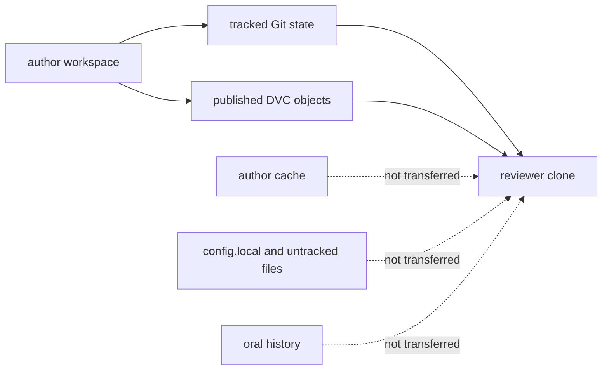

# Collaboration Failures and Social Contracts

<!-- page-maps:start -->
## Page Maps




<!-- page-maps:end -->

Collaboration fails when a result depends on knowledge, files, permissions, or cached
objects that never crossed the handoff boundary. The author may have a working directory
that runs perfectly while a reviewer receives an incomplete system.

“Remember to push the data” is not a durable contract. A collaboration contract states
what must be shared, who owns each boundary, how a clean reviewer verifies it, and which
evidence blocks acceptance.

## A handoff is a claim about independence

When an author hands off a DVC project, the implied claim is:

> A reviewer can recover the recorded state, understand the result, and reproduce it using
> tracked repository state plus authorized read access to shared storage.

That claim is stronger than:

- the author's command succeeded;
- the pointer file is committed;
- the data exists somewhere;
- CI can run with privileged credentials;
- a teammate remembers the setup.

The reviewer must succeed without the author's warm cache, untracked files, shell history,
or oral explanation.

## The seven boundaries in one handoff

The capstone audit tests seven independent checks:

| Boundary | Required evidence | Failure revealed |
| --- | --- | --- |
| remote discovery | tracked DVC configuration names the shared route | objects exist but reviewer cannot locate them |
| object availability | `dvc pull` restores recorded data and result | pointers refer to absent objects |
| Git completeness | all declared source dependencies are tracked | author-only file prevents reproduction |
| recorded currency | status is clean before repair-oriented repro | submitted result is stale |
| reproducibility | repro succeeds from clean clone | repository cannot execute independently |
| review authority | review route avoids remote mutation | reviewer needs publisher privileges |
| result meaning | explicit contract matches restored result | bytes exist without an interpretable claim |

No one boundary substitutes for another. A successful pull cannot restore an untracked
Python or policy file. A successful repro can repair stale submitted state without proving
the handoff was coherent when reviewed.



## Run the controlled handoffs

From the repository root:

```bash
make PROGRAM=reproducible-research/deep-dive-dvc capstone-reviewer-handoff-audit
```

The audit writes isolated author repositories, Git remotes, DVC remotes, and reviewer
clones under:

```text
artifacts/audit/reproducible-research/deep-dive-dvc/reviewer-handoff/
```

Begin with:

```bash
audit=artifacts/audit/reproducible-research/deep-dive-dvc/reviewer-handoff
column -t -s $'\t' "$audit/summary.tsv"
cat "$audit/route.txt"
```

The summary contains one `ACCEPT` case and six `BLOCK` cases. Every row has audit result
`PASS`: the accepted case satisfies the contract, while each blocked case successfully
reproduces a defect.

## Read failures as broken promises

The case names point to technical symptoms. The social contract lives beneath them.

| Case | Broken promise | Likely owner |
| --- | --- | --- |
| `MISSING_REMOTE_OBJECT` | every committed pointer names shared, retrievable bytes | author or publication job |
| `UNDISCOVERABLE_REMOTE` | an authorized reviewer can find the shared route | repository maintainer |
| `UNTRACKED_STAGE_DEPENDENCY` | Git contains every declared source-side dependency | author and merge reviewer |
| `STALE_EXECUTION_RECORD` | submitted lock and result describe current declared inputs | author and CI |
| `MUTATING_REVIEW_ROUTE` | ordinary review requires read authority only | workflow maintainer |
| `MISSING_RESULT_CONTRACT` | the reviewer can interpret what the output claims | result owner |

This classification improves repair. “DVC pull failed” describes an observation. It does
not tell you whether objects are absent, the remote is undiscoverable, or access policy is
wrong.

## Author success is weak handoff evidence

An author's workspace contains hidden conveniences:

- cached DVC objects;
- local remote configuration;
- untracked policy files;
- generated outputs from an earlier run;
- credentials with write access;
- remembered commands.

The audit deliberately creates a cache-cold reviewer clone. Git-tracked state is cloned;
DVC objects must come from the isolated remote; untracked files do not cross.



A workflow that works only on the author machine has not yet passed the collaboration
boundary.

## Preserve evidence before local repair

The reviewer route must inspect recorded state before reproduction:

1. discover configured remotes;
2. pull recorded objects;
3. save `dvc status --json`;
4. inspect the restored result and claim contract;
5. run reproduction;
6. compare post-repro evidence.

The order matters in the stale execution case. `dvc repro` succeeds and repairs the local
reviewer workspace. If the pre-repro status receipt were discarded, the team might accept
the submitted state based on its repaired descendant.

Use this distinction:

| Evidence | Question |
| --- | --- |
| pre-repro status | was the submitted recorded state coherent? |
| repro receipt | can the reviewer execute the declared pipeline? |
| post-repro result | what does locally repaired state produce? |

Successful repair does not rewrite the history of what was handed off.

## Convert norms into executable checks

A weak norm:

> Contributors should make sure everything is available.

A reviewable contract:

> Before merge, a cache-cold clone with read-only remote access must discover the tracked
> remote, pull every recorded object, report clean pre-repro status, reproduce without
> private files, and match the declared result claim.

The second statement names:

- the initial state;
- the authority available;
- the commands;
- the evidence;
- the acceptance rule.

It can become a CI job and a reviewer checklist without relying on memory.

## Separate result acceptance from scientific endorsement

The complete handoff claims:

```text
record_count = 4
severity_total = 11
weekend_handoffs = 2
```

Passing the handoff audit means the reviewer can recover, reproduce, and explain that
bounded result. It does not establish:

- that four incidents represent a population;
- that severity scoring is scientifically appropriate;
- that the result should be promoted;
- that remote retention is sufficient for years;
- that credentials are distributed securely.

The social contract must name what it supports. Operational reviewability and scientific
validity are related but separate claims.

## Design responsibility without blame

When a boundary fails, ask:

1. Which promise was broken?
2. Which evidence exposed it?
3. Which role can repair the source of the defect?
4. Which automated check should prevent recurrence?

For a missing object:

- promise: every pointer in reviewed history resolves for authorized readers;
- evidence: tracked remote is discoverable, but pull reports missing cache objects;
- repair owner: author or publication job pushes the referenced object;
- prevention: clean-clone pull gate before merge.

This is more durable than telling one person to be careful next time.

## Handoff contract template

Use this structure for a repository:

```text
Claim:
What bounded result must another person recover and understand?

Tracked state:
Which declarations, code, policies, pointers, and remote routes must be in Git?

Shared objects:
Which DVC-tracked inputs and recorded outputs must be readable?

Reviewer authority:
Which operations are allowed, and which publication operations are forbidden?

Proof route:
Which receipts are preserved before and after reproduction?

Decision:
Which missing evidence blocks merge or handoff?

Ownership:
Who publishes objects, maintains configuration, repairs source completeness, and owns
result meaning?

Limits:
Which storage, security, scientific, and promotion claims remain outside this contract?
```

## Review checkpoint

You understand collaboration as a contract when you can explain:

- why a warm author cache is not shared evidence;
- why remote discovery and object availability are separate;
- why Git and DVC storage must both be complete;
- why status must be captured before reproduction;
- why review should not require `dvc push`;
- why runnable output still needs a claim contract;
- which role owns each repair.

The durable standard is:

> A handoff is complete only when a cache-cold, read-only reviewer can reconstruct the
> claim and preserve evidence of the submitted state without relying on the author.
